# Experiment log

Every scored run of the model evaluation gets one section here (docs/decisions/0008). The log
is append-only: earlier sections are never edited. A later run that changes a conclusion says
so in its own section.

## How to read this

Each section starts with a short summary, the notes and one table with a row per model. The
plots follow; the detail tables and the plot per flood are folded below them. Plots live in
`plots/<run>/`.

- **MAE:** mean absolute error of the forecast level in cm, pooled over the four test folds.
  "Mean MAE" averages the leads 1 to 24 hours.
- **Skill:** 1 - MAE / MAE of persistence on the same rows. Persistence is 0; above 0 is
  better than holding the last level.
- **High water:** issue times where the cleaned level is above `evaluation.high_water_cm`
  (75 cm) at the issue time or at the target. Every score uses only the cleaned Kupferdreh
  series, never the raw one.
- **Crossing:** the observed level goes above a threshold (95 cm and each category bound).
  Only first crossings count, with no hour above the threshold in the 24 hours before. A model
  warned when a forecast issued before the crossing showed it; less than 3 hours ahead is too
  late to act.
- **False alarm:** a forecast crossing with no observed crossing within 6 hours. A warning
  that stays up counts once.

## Adding a run

With a frozen dataset `eval.parquet` and a run folder named after the date and what it tries,
from the repo root:

```
uv run --group analysis python -m pegel.evaluation.predict <eval.parquet> --out <runs>/<run> [--models a,b]
uv run --group analysis python -m pegel.evaluation.score <runs>/<run>/predictions.parquet <eval.parquet> --out <runs>/<run>
uv run --group analysis python -m pegel.evaluation.report <runs>/<run> --notes "what was tried, what we learned"
```

The last command writes the plots and appends the section. Commit both.

## 2026-10-14-persistence

Mean MAE of persistence over leads 1-24 h: 2.8 cm over all issue times, 8.3 cm at high water.
First crossings of 95 cm warned at least 3 h ahead: persistence 0 of 6.
False alarms at 95 cm: 0.00 per month.

**Notes:** Persistence MAE 0.66 cm at +1 h and 4.01 cm at +24 h over all issue times; 1.36 cm at +1 h and 12.99 cm at +24 h at high water. At 95 cm its per-lead alarms (a diagnostic) hit 7 of 8 flood episodes at +1 h and 5 of 8 at +24 h; the one episode above 145 cm (2024-11-19) is hit at +1 h to +5 h and missed from +6 h on. It warns ahead of none of the 6 first crossings of 95 cm; its two warnings are re-crossings (2025-01-08, 2025-01-27). Peaks are underforecast by 27.6 cm at +6 h and 36.9 cm at +12 h on average; the lag check gives a shift equal to the lead. All 8 flood episodes fall in F1 and F2. No bootstrap band and no skill plot: the run has only persistence. Scored with PRs #67, #73 and #74 combined (none merged yet): #73 writes `crossings.csv` and `false_alarms.csv`, #74 scores only the cleaned series and drops the `high_water_raw` subset.

| model | mean MAE all (cm) | mean MAE high water (cm) | MAE +24 h high water (cm) | skill +24 h high water | 95 cm crossings warned >= 3 h | false alarms per month at 95 cm |
|---|---|---|---|---|---|---|
| persistence | 2.8 | 8.3 | 13.0 | 0.00 | 0 of 6 | 0.00 |

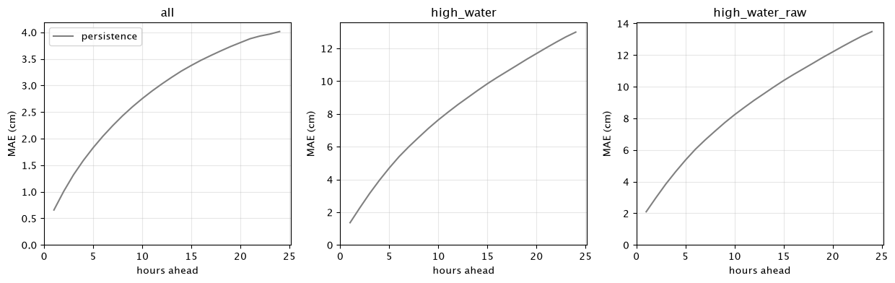

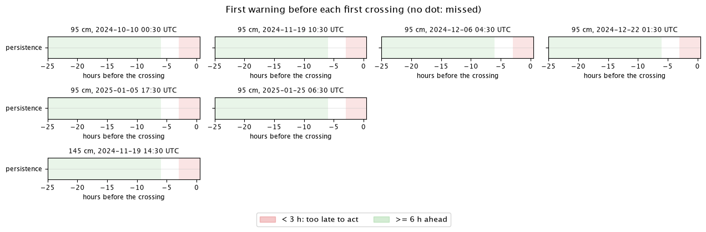

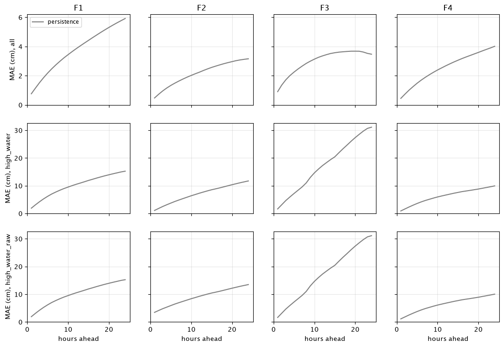

<details>
<summary>Flood events: observed level and forecasts (8 plots)</summary>

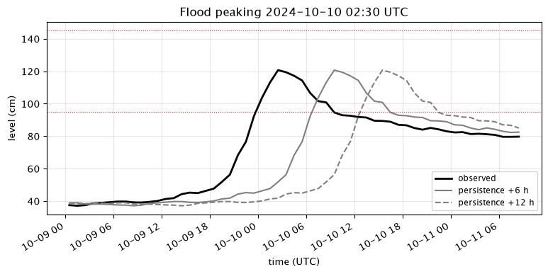

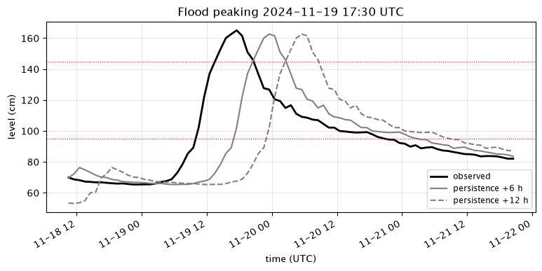

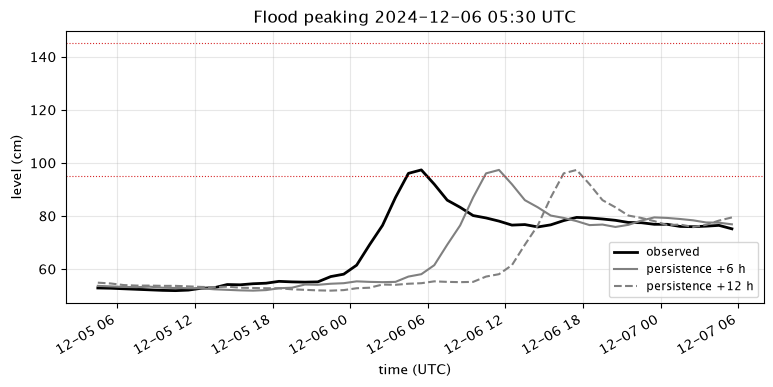

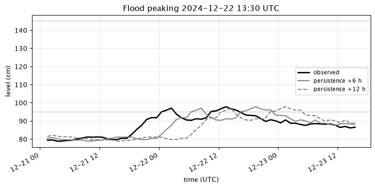

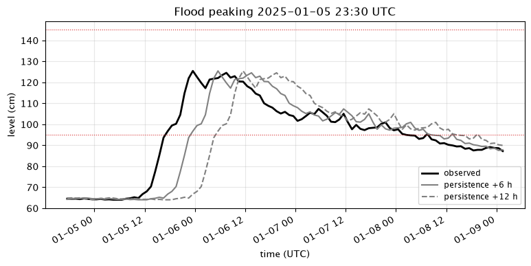

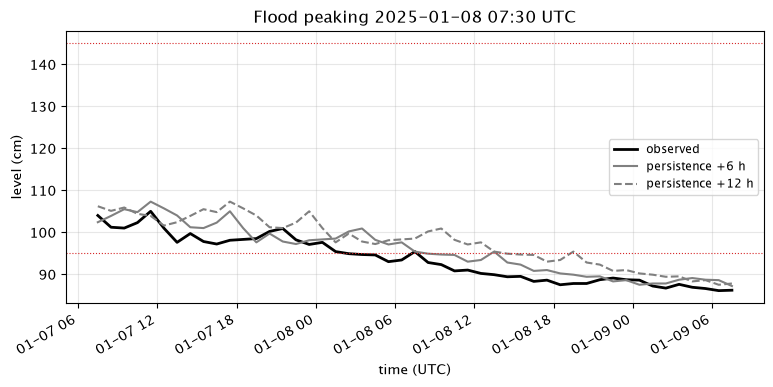

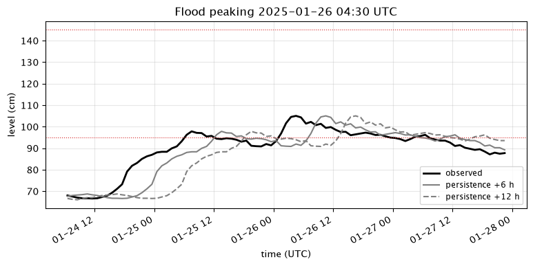

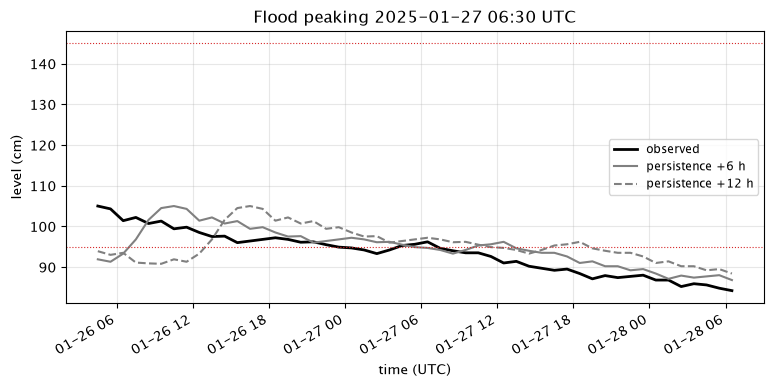

</details>

<details>
<summary>MAE in cm per lead and subset, pooled over folds</summary>

Subset `all`:

| model | +1 h | +3 h | +6 h | +12 h | +24 h | mean 1-24 h | mean skill |
|---|---|---|---|---|---|---|---|
| persistence | 0.66 | 1.32 | 2.05 | 3.03 | 4.01 | 2.84 | 0.00 |

Subset `high_water`:

| model | +1 h | +3 h | +6 h | +12 h | +24 h | mean 1-24 h | mean skill |
|---|---|---|---|---|---|---|---|
| persistence | 1.36 | 3.15 | 5.39 | 8.57 | 12.99 | 8.25 | 0.00 |

</details>

<details>
<summary>Warnings and false alarms per threshold</summary>

First crossings per threshold (no hour above it in the 24 hours before) and how far ahead the first forecast showed them.

| model | threshold_cm | crossings | warned >= 3 h | warned >= 6 h | median hours ahead |
|---|---|---|---|---|---|
| persistence | 95 | 6 | 0 | 0 | - |
| persistence | 145 | 1 | 0 | 0 | - |

False alarms: forecast crossings with no observed crossing within 6 hours; a warning that stays up counts once.

| model | threshold_cm | count | per_month |
|---|---|---|---|
| persistence | 95 | 0 | 0.00 |
| persistence | 145 | 0 | 0.00 |
| persistence | 165 | 0 | 0.00 |
| persistence | 185 | 0 | 0.00 |
| persistence | 225 | 0 | 0.00 |

Old rule (`warnings.csv`): every crossing and the first forecast that showed it. A re-crossing starts while the level was above the threshold in the 24 hours before; its warning is not counted as lead time.

| model | threshold_cm | crossings | warned | median hours ahead | min hours ahead | re-crossings | re-crossings warned |
|---|---|---|---|---|---|---|---|
| persistence | 95 | 6 | 0 | - | - | 2 | 2 |
| persistence | 145 | 1 | 0 | - | - | 0 | 0 |

</details>

<details>
<summary>Alarms per lead (diagnostic)</summary>

Flood episodes per threshold: hits / misses / false alarms of the lead-k forecasts, counted as overlapping episodes per lead. A different rule from the crossings and false alarms in the headline: a forecast issued during a flood scores a hit by staying high. A diagnostic only.

| model | threshold_cm | +1 h | +6 h | +12 h | +24 h |
|---|---|---|---|---|---|
| persistence | 95 | 7 / 1 / 1 | 7 / 1 / 3 | 6 / 2 / 4 | 5 / 3 / 5 |
| persistence | 145 | 1 / 0 / 0 | 0 / 1 / 1 | 0 / 1 / 1 | 0 / 1 / 1 |

</details>

<details>
<summary>Peaks</summary>

Forecasts issued k hours before each flood peak: highest value minus peak, value at the peak minus peak, and timing of the highest value (positive is late).

| model | lead | events | mean abs height error (cm) | mean at-peak error (cm) | mean timing error (h) |
|---|---|---|---|---|---|
| persistence | 6 | 8 | 27.60 | -27.60 | - |
| persistence | 12 | 8 | 36.86 | -35.84 | - |

</details>

<details>
<summary>Lag check</summary>

Shift in hours that best matches the forecast to the observed level on high water.

| model | shift at +6 h | shift at +12 h |
|---|---|---|
| persistence | 6 | 12 |

</details>

<details>
<summary>Run: commit and dataset</summary>

- Run: 2026-10-14, commit `15cfa3e02744` (clean)
- Dataset sha256: `aca86a175c82e3eb89602d018bea7bba044b8755d085e05ec92032d2f367407f`
- Models: persistence

</details>

## 2026-10-15-models-v2

Lowest mean MAE over leads 1-24 h: rain_change:v2:split over all issue times (2.1 cm; persistence 2.8 cm), ridge:change:v2 at high water (4.8 cm; persistence 8.3 cm).
First crossings of 95 cm warned at least 3 h ahead: ridge:change 3 of 6, persistence 0 of 6.
False alarms at 95 cm: 0.00 to 0.60 per month.

**Notes:** First comparison of all registered models on the same folds. ridge:level and ridge:change use an alpha grid that was set after one look at the test folds (PR #70). rain_change and rain_change:split were chosen from about 20 candidates, rain_change:v2:split and ridge:change:v2 from 68 candidates (PR #75), both on inner time splits of the training rows that overlap earlier test periods. Warnings are reported, not used to select.

| model | mean MAE all (cm) | mean MAE high water (cm) | MAE +24 h high water (cm) | skill +24 h high water | 95 cm crossings warned >= 3 h | false alarms per month at 95 cm |
|---|---|---|---|---|---|---|
| persistence | 2.8 | 8.3 | 13.0 | 0.00 | 0 of 6 | 0.00 |
| damped_trend | 2.8 | 8.2 | 13.1 | -0.01 | 0 of 6 | 0.27 |
| rain_change | 2.4 | 5.4 | 8.0 | 0.39 | 2 of 6 | 0.54 |
| rain_change:split | 2.3 | 5.2 | 7.6 | 0.42 | 2 of 6 | 0.54 |
| rain_change:v2:split | 2.1 | 5.1 | 7.4 | 0.43 | 2 of 6 | 0.38 |
| recession | 2.8 | 7.4 | 11.5 | 0.12 | 0 of 6 | 0.00 |
| ridge:change | 2.5 | 5.6 | 8.4 | 0.36 | 3 of 6 | 0.38 |
| ridge:change:no_icon | 3.1 | 7.7 | 12.4 | 0.05 | 1 of 6 | 0.27 |
| ridge:change:v2 | 2.1 | 4.8 | 7.1 | 0.46 | 2 of 6 | 0.60 |
| ridge:level | 2.7 | 5.6 | 7.8 | 0.40 | 2 of 6 | 0.49 |
| ridge:level:no_icon | 3.4 | 8.4 | 13.1 | -0.01 | 1 of 6 | 0.27 |
| upstream | 2.7 | 7.8 | 12.8 | 0.02 | 1 of 6 | 0.38 |

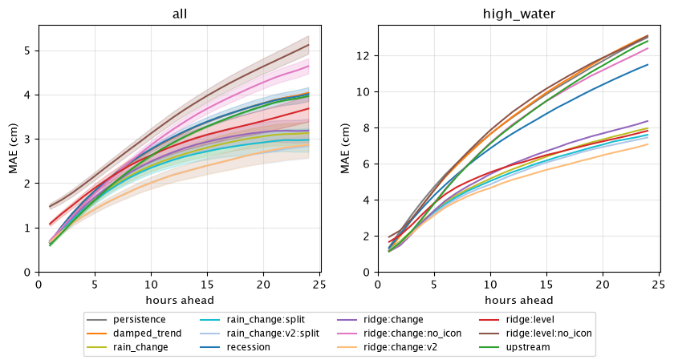

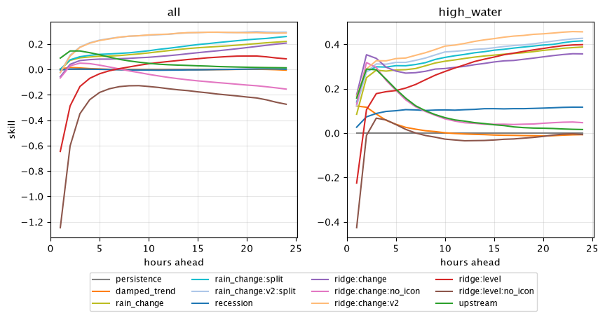

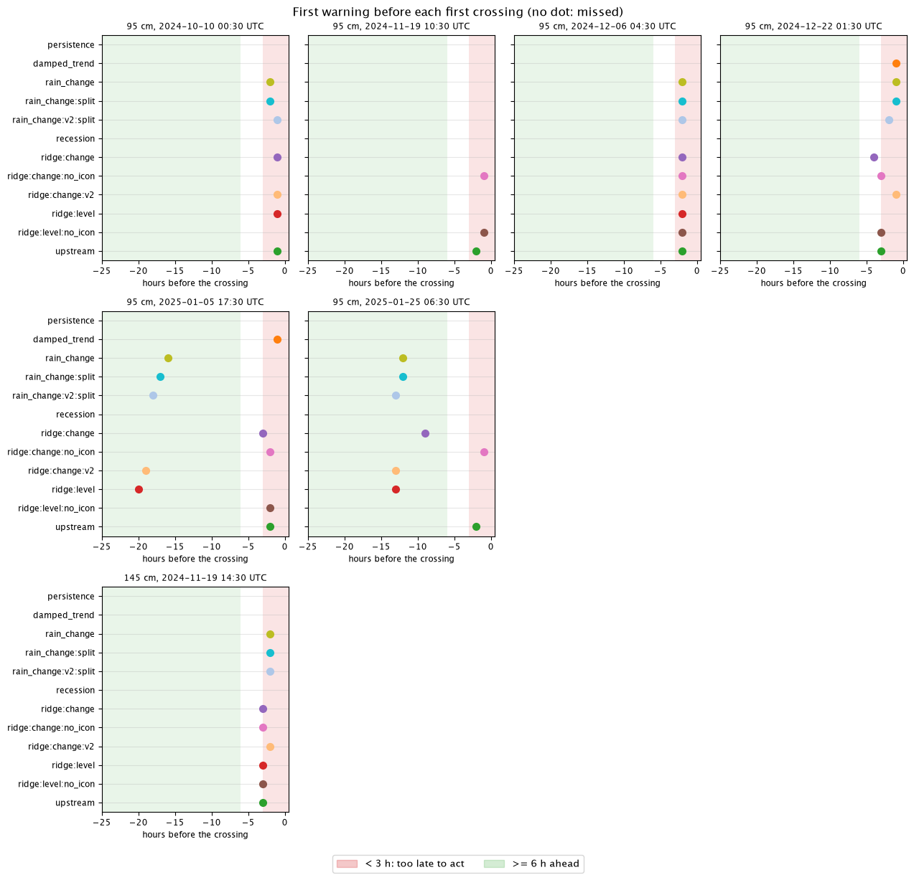

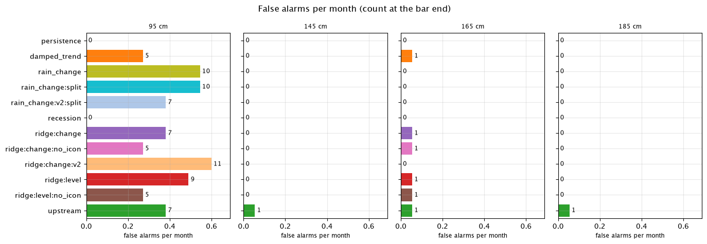

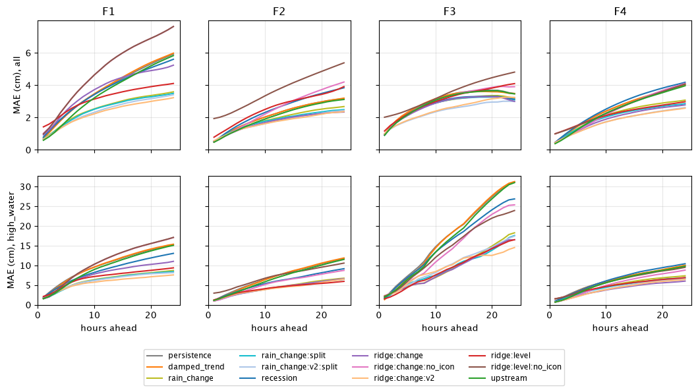

<details>
<summary>Flood events: observed level and forecasts (8 plots)</summary>

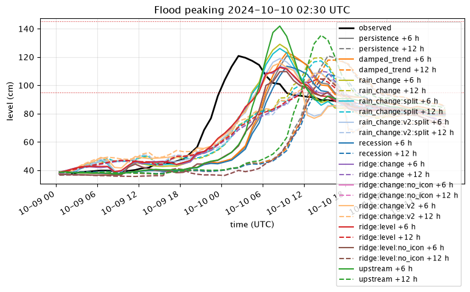

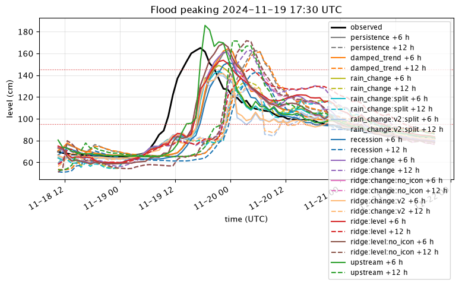

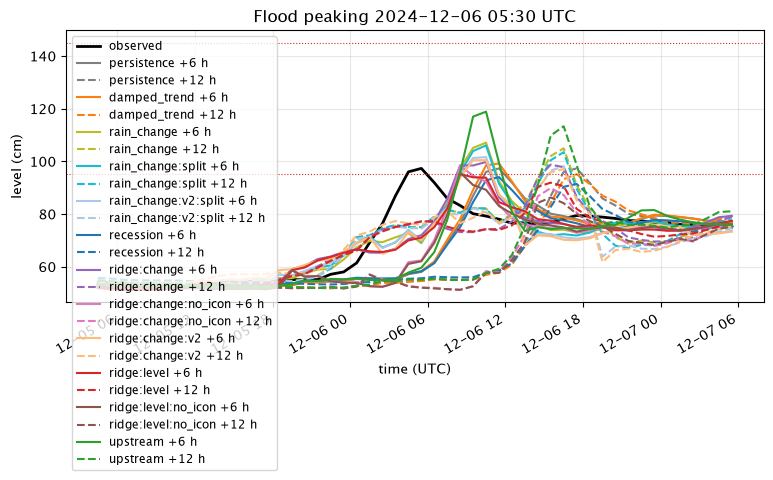

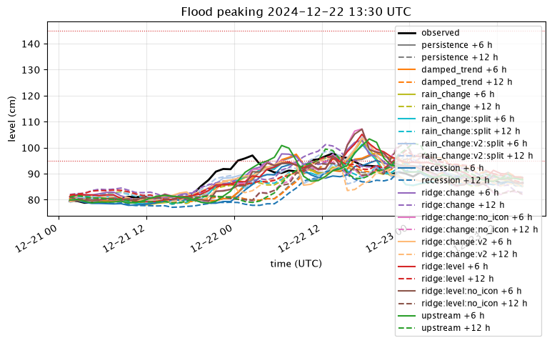

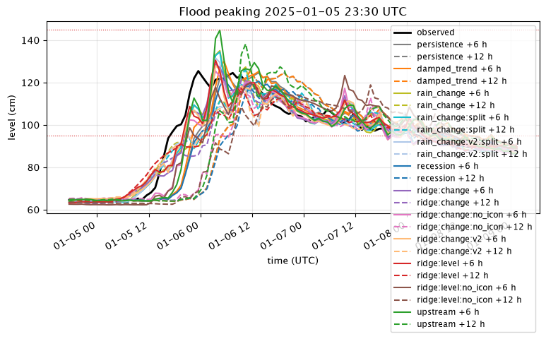

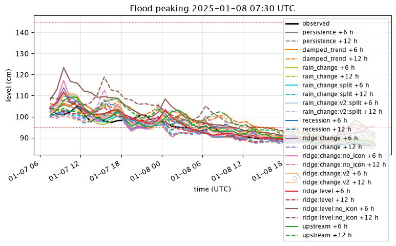

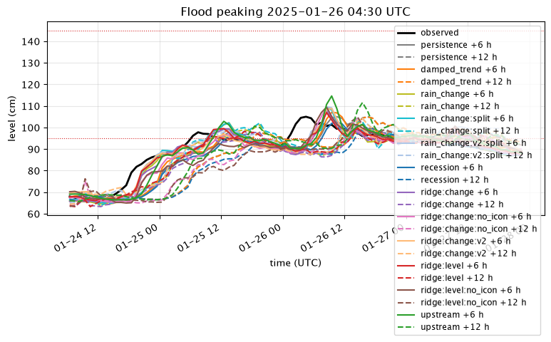

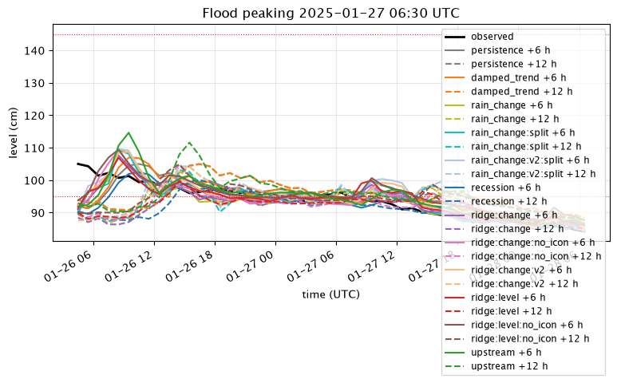

</details>

<details>
<summary>MAE in cm per lead and subset, pooled over folds</summary>

Subset `all`:

| model | +1 h | +3 h | +6 h | +12 h | +24 h | mean 1-24 h | mean skill |
|---|---|---|---|---|---|---|---|
| persistence | 0.66 | 1.32 | 2.05 | 3.03 | 4.01 | 2.84 | 0.00 |
| damped_trend | 0.65 | 1.31 | 2.05 | 3.04 | 4.04 | 2.85 | 0.00 |
| rain_change | 0.66 | 1.20 | 1.83 | 2.58 | 3.13 | 2.38 | 0.15 |
| rain_change:split | 0.66 | 1.19 | 1.80 | 2.53 | 2.98 | 2.31 | 0.17 |
| rain_change:v2:split | 0.67 | 1.09 | 1.55 | 2.19 | 2.84 | 2.07 | 0.25 |
| recession | 0.66 | 1.32 | 2.05 | 3.05 | 4.01 | 2.85 | -0.00 |
| ridge:change | 0.70 | 1.23 | 1.88 | 2.70 | 3.18 | 2.46 | 0.12 |
| ridge:change:no_icon | 0.70 | 1.26 | 2.01 | 3.22 | 4.64 | 3.07 | -0.06 |
| ridge:change:v2 | 0.67 | 1.09 | 1.56 | 2.19 | 2.87 | 2.07 | 0.25 |
| ridge:level | 1.08 | 1.50 | 2.07 | 2.84 | 3.68 | 2.69 | 0.01 |
| ridge:level:no_icon | 1.48 | 1.78 | 2.36 | 3.49 | 5.12 | 3.44 | -0.25 |
| upstream | 0.60 | 1.13 | 1.85 | 2.92 | 3.97 | 2.73 | 0.05 |

Subset `high_water`:

| model | +1 h | +3 h | +6 h | +12 h | +24 h | mean 1-24 h | mean skill |
|---|---|---|---|---|---|---|---|
| persistence | 1.36 | 3.15 | 5.39 | 8.57 | 12.99 | 8.25 | 0.00 |
| damped_trend | 1.19 | 2.88 | 5.26 | 8.61 | 13.09 | 8.25 | 0.01 |
| rain_change | 1.24 | 2.26 | 3.85 | 5.69 | 7.96 | 5.40 | 0.32 |
| rain_change:split | 1.17 | 2.21 | 3.76 | 5.54 | 7.60 | 5.22 | 0.35 |
| rain_change:v2:split | 1.19 | 2.17 | 3.68 | 5.38 | 7.45 | 5.10 | 0.36 |
| recession | 1.32 | 2.87 | 4.83 | 7.67 | 11.48 | 7.36 | 0.10 |
| ridge:change | 1.12 | 2.09 | 3.94 | 6.00 | 8.36 | 5.60 | 0.31 |
| ridge:change:no_icon | 1.18 | 2.22 | 4.59 | 8.18 | 12.39 | 7.69 | 0.10 |
| ridge:change:v2 | 1.13 | 2.12 | 3.57 | 5.11 | 7.07 | 4.83 | 0.39 |
| ridge:level | 1.66 | 2.59 | 4.30 | 5.94 | 7.82 | 5.57 | 0.28 |
| ridge:level:no_icon | 1.94 | 2.94 | 5.31 | 8.87 | 13.08 | 8.39 | -0.03 |
| upstream | 1.14 | 2.25 | 4.55 | 8.11 | 12.79 | 7.78 | 0.09 |

</details>

<details>
<summary>Warnings and false alarms per threshold</summary>

First crossings per threshold (no hour above it in the 24 hours before) and how far ahead the first forecast showed them.

| model | threshold_cm | crossings | warned >= 3 h | warned >= 6 h | median hours ahead |
|---|---|---|---|---|---|
| persistence | 95 | 6 | 0 | 0 | - |
| persistence | 145 | 1 | 0 | 0 | - |
| damped_trend | 95 | 6 | 0 | 0 | 1.00 |
| damped_trend | 145 | 1 | 0 | 0 | - |
| rain_change | 95 | 6 | 2 | 2 | 2.00 |
| rain_change | 145 | 1 | 0 | 0 | 2.00 |
| rain_change:split | 95 | 6 | 2 | 2 | 2.00 |
| rain_change:split | 145 | 1 | 0 | 0 | 2.00 |
| rain_change:v2:split | 95 | 6 | 2 | 2 | 2.00 |
| rain_change:v2:split | 145 | 1 | 0 | 0 | 2.00 |
| recession | 95 | 6 | 0 | 0 | - |
| recession | 145 | 1 | 0 | 0 | - |
| ridge:change | 95 | 6 | 3 | 1 | 3.00 |
| ridge:change | 145 | 1 | 1 | 0 | 3.00 |
| ridge:change:no_icon | 95 | 6 | 1 | 0 | 2.00 |
| ridge:change:no_icon | 145 | 1 | 1 | 0 | 3.00 |
| ridge:change:v2 | 95 | 6 | 2 | 2 | 2.00 |
| ridge:change:v2 | 145 | 1 | 0 | 0 | 2.00 |
| ridge:level | 95 | 6 | 2 | 2 | 7.50 |
| ridge:level | 145 | 1 | 1 | 0 | 3.00 |
| ridge:level:no_icon | 95 | 6 | 1 | 0 | 2.00 |
| ridge:level:no_icon | 145 | 1 | 1 | 0 | 3.00 |
| upstream | 95 | 6 | 1 | 0 | 2.00 |
| upstream | 145 | 1 | 1 | 0 | 3.00 |

False alarms: forecast crossings with no observed crossing within 6 hours; a warning that stays up counts once.

| model | threshold_cm | count | per_month |
|---|---|---|---|
| persistence | 95 | 0 | 0.00 |
| persistence | 145 | 0 | 0.00 |
| persistence | 165 | 0 | 0.00 |
| persistence | 185 | 0 | 0.00 |
| persistence | 225 | 0 | 0.00 |
| damped_trend | 95 | 5 | 0.27 |
| damped_trend | 145 | 0 | 0.00 |
| damped_trend | 165 | 1 | 0.05 |
| damped_trend | 185 | 0 | 0.00 |
| damped_trend | 225 | 0 | 0.00 |
| rain_change | 95 | 10 | 0.54 |
| rain_change | 145 | 0 | 0.00 |
| rain_change | 165 | 0 | 0.00 |
| rain_change | 185 | 0 | 0.00 |
| rain_change | 225 | 0 | 0.00 |
| rain_change:split | 95 | 10 | 0.54 |
| rain_change:split | 145 | 0 | 0.00 |
| rain_change:split | 165 | 0 | 0.00 |
| rain_change:split | 185 | 0 | 0.00 |
| rain_change:split | 225 | 0 | 0.00 |
| rain_change:v2:split | 95 | 7 | 0.38 |
| rain_change:v2:split | 145 | 0 | 0.00 |
| rain_change:v2:split | 165 | 0 | 0.00 |
| rain_change:v2:split | 185 | 0 | 0.00 |
| rain_change:v2:split | 225 | 0 | 0.00 |
| recession | 95 | 0 | 0.00 |
| recession | 145 | 0 | 0.00 |
| recession | 165 | 0 | 0.00 |
| recession | 185 | 0 | 0.00 |
| recession | 225 | 0 | 0.00 |
| ridge:change | 95 | 7 | 0.38 |
| ridge:change | 145 | 0 | 0.00 |
| ridge:change | 165 | 1 | 0.05 |
| ridge:change | 185 | 0 | 0.00 |
| ridge:change | 225 | 0 | 0.00 |
| ridge:change:no_icon | 95 | 5 | 0.27 |
| ridge:change:no_icon | 145 | 0 | 0.00 |
| ridge:change:no_icon | 165 | 1 | 0.05 |
| ridge:change:no_icon | 185 | 0 | 0.00 |
| ridge:change:no_icon | 225 | 0 | 0.00 |
| ridge:change:v2 | 95 | 11 | 0.60 |
| ridge:change:v2 | 145 | 0 | 0.00 |
| ridge:change:v2 | 165 | 0 | 0.00 |
| ridge:change:v2 | 185 | 0 | 0.00 |
| ridge:change:v2 | 225 | 0 | 0.00 |
| ridge:level | 95 | 9 | 0.49 |
| ridge:level | 145 | 0 | 0.00 |
| ridge:level | 165 | 1 | 0.05 |
| ridge:level | 185 | 0 | 0.00 |
| ridge:level | 225 | 0 | 0.00 |
| ridge:level:no_icon | 95 | 5 | 0.27 |
| ridge:level:no_icon | 145 | 0 | 0.00 |
| ridge:level:no_icon | 165 | 1 | 0.05 |
| ridge:level:no_icon | 185 | 0 | 0.00 |
| ridge:level:no_icon | 225 | 0 | 0.00 |
| upstream | 95 | 7 | 0.38 |
| upstream | 145 | 1 | 0.05 |
| upstream | 165 | 1 | 0.05 |
| upstream | 185 | 1 | 0.05 |
| upstream | 225 | 0 | 0.00 |

Old rule (`warnings.csv`): every crossing and the first forecast that showed it. A re-crossing starts while the level was above the threshold in the 24 hours before; its warning is not counted as lead time.

| model | threshold_cm | crossings | warned | median hours ahead | min hours ahead | re-crossings | re-crossings warned |
|---|---|---|---|---|---|---|---|
| persistence | 95 | 6 | 0 | - | - | 2 | 2 |
| persistence | 145 | 1 | 0 | - | - | 0 | 0 |
| damped_trend | 95 | 6 | 2 | 1.00 | 1.00 | 2 | 2 |
| damped_trend | 145 | 1 | 0 | - | - | 0 | 0 |
| rain_change | 95 | 6 | 5 | 2.00 | 1.00 | 2 | 2 |
| rain_change | 145 | 1 | 1 | 2.00 | 2.00 | 0 | 0 |
| rain_change:split | 95 | 6 | 5 | 2.00 | 1.00 | 2 | 2 |
| rain_change:split | 145 | 1 | 1 | 2.00 | 2.00 | 0 | 0 |
| rain_change:v2:split | 95 | 6 | 5 | 3.00 | 1.00 | 2 | 2 |
| rain_change:v2:split | 145 | 1 | 1 | 2.00 | 2.00 | 0 | 0 |
| recession | 95 | 6 | 0 | - | - | 2 | 2 |
| recession | 145 | 1 | 0 | - | - | 0 | 0 |
| ridge:change | 95 | 6 | 5 | 3.00 | 1.00 | 2 | 2 |
| ridge:change | 145 | 1 | 1 | 3.00 | 3.00 | 0 | 0 |
| ridge:change:no_icon | 95 | 6 | 5 | 2.00 | 1.00 | 2 | 2 |
| ridge:change:no_icon | 145 | 1 | 1 | 3.00 | 3.00 | 0 | 0 |
| ridge:change:v2 | 95 | 6 | 5 | 2.00 | 1.00 | 2 | 2 |
| ridge:change:v2 | 145 | 1 | 1 | 2.00 | 2.00 | 0 | 0 |
| ridge:level | 95 | 6 | 5 | 2.00 | 1.00 | 2 | 2 |
| ridge:level | 145 | 1 | 1 | 3.00 | 3.00 | 0 | 0 |
| ridge:level:no_icon | 95 | 6 | 4 | 2.00 | 1.00 | 2 | 2 |
| ridge:level:no_icon | 145 | 1 | 1 | 3.00 | 3.00 | 0 | 0 |
| upstream | 95 | 6 | 6 | 2.00 | 1.00 | 2 | 2 |
| upstream | 145 | 1 | 1 | 3.00 | 3.00 | 0 | 0 |

</details>

<details>
<summary>Alarms per lead (diagnostic)</summary>

Flood episodes per threshold: hits / misses / false alarms of the lead-k forecasts, counted as overlapping episodes per lead. A different rule from the crossings and false alarms in the headline: a forecast issued during a flood scores a hit by staying high. A diagnostic only.

| model | threshold_cm | +1 h | +6 h | +12 h | +24 h |
|---|---|---|---|---|---|
| persistence | 95 | 7 / 1 / 1 | 7 / 1 / 3 | 6 / 2 / 4 | 5 / 3 / 5 |
| persistence | 145 | 1 / 0 / 0 | 0 / 1 / 1 | 0 / 1 / 1 | 0 / 1 / 1 |
| damped_trend | 95 | 7 / 1 / 2 | 6 / 2 / 4 | 6 / 2 / 4 | 5 / 3 / 4 |
| damped_trend | 145 | 1 / 0 / 0 | 1 / 0 / 0 | 0 / 1 / 1 | 0 / 1 / 1 |
| rain_change | 95 | 7 / 1 / 1 | 5 / 3 / 4 | 5 / 3 / 6 | 4 / 4 / 4 |
| rain_change | 145 | 1 / 0 / 0 | 1 / 0 / 0 | 0 / 1 / 0 | 0 / 1 / 0 |
| rain_change:split | 95 | 7 / 1 / 1 | 4 / 4 / 5 | 6 / 2 / 6 | 4 / 4 / 4 |
| rain_change:split | 145 | 1 / 0 / 0 | 0 / 1 / 0 | 0 / 1 / 0 | 0 / 1 / 0 |
| rain_change:v2:split | 95 | 7 / 1 / 1 | 6 / 2 / 5 | 6 / 2 / 6 | 4 / 4 / 4 |
| rain_change:v2:split | 145 | 1 / 0 / 0 | 0 / 1 / 0 | 0 / 1 / 0 | 0 / 1 / 0 |
| recession | 95 | 7 / 1 / 1 | 4 / 4 / 1 | 4 / 4 / 1 | 4 / 4 / 1 |
| recession | 145 | 1 / 0 / 0 | 0 / 1 / 1 | 0 / 1 / 0 | 0 / 1 / 0 |
| ridge:change | 95 | 7 / 1 / 2 | 5 / 3 / 6 | 5 / 3 / 6 | 2 / 6 / 5 |
| ridge:change | 145 | 1 / 0 / 0 | 1 / 0 / 0 | 0 / 1 / 1 | 0 / 1 / 1 |
| ridge:change:no_icon | 95 | 7 / 1 / 2 | 5 / 3 / 4 | 4 / 4 / 4 | 3 / 5 / 1 |
| ridge:change:no_icon | 145 | 1 / 0 / 0 | 1 / 0 / 0 | 0 / 1 / 1 | 0 / 1 / 1 |
| ridge:change:v2 | 95 | 7 / 1 / 1 | 5 / 3 / 6 | 6 / 2 / 5 | 4 / 4 / 4 |
| ridge:change:v2 | 145 | 1 / 0 / 0 | 0 / 1 / 0 | 0 / 1 / 0 | 0 / 1 / 0 |
| ridge:level | 95 | 7 / 1 / 0 | 5 / 3 / 3 | 4 / 4 / 4 | 3 / 5 / 2 |
| ridge:level | 145 | 1 / 0 / 0 | 1 / 0 / 0 | 0 / 1 / 1 | 0 / 1 / 1 |
| ridge:level:no_icon | 95 | 7 / 1 / 3 | 7 / 1 / 5 | 5 / 3 / 5 | 4 / 4 / 0 |
| ridge:level:no_icon | 145 | 1 / 0 / 0 | 1 / 0 / 0 | 0 / 1 / 1 | 0 / 1 / 1 |
| upstream | 95 | 7 / 1 / 2 | 6 / 2 / 9 | 6 / 2 / 7 | 5 / 3 / 5 |
| upstream | 145 | 1 / 0 / 0 | 1 / 0 / 0 | 0 / 1 / 1 | 0 / 1 / 1 |

</details>

<details>
<summary>Peaks</summary>

Forecasts issued k hours before each flood peak: highest value minus peak, value at the peak minus peak, and timing of the highest value (positive is late).

| model | lead | events | mean abs height error (cm) | mean at-peak error (cm) | mean timing error (h) |
|---|---|---|---|---|---|
| persistence | 6 | 8 | 27.60 | -27.60 | - |
| persistence | 12 | 8 | 36.86 | -35.84 | - |
| damped_trend | 6 | 8 | 26.17 | -26.79 | 3.00 |
| damped_trend | 12 | 8 | 36.69 | -35.96 | -7.38 |
| rain_change | 6 | 8 | 13.90 | -20.51 | 2.33 |
| rain_change | 12 | 8 | 22.66 | -26.34 | 2.50 |
| rain_change:split | 6 | 8 | 13.98 | -20.58 | 3.86 |
| rain_change:split | 12 | 8 | 22.71 | -25.57 | 1.86 |
| rain_change:v2:split | 6 | 8 | 14.32 | -20.00 | 3.29 |
| rain_change:v2:split | 12 | 8 | 24.06 | -24.50 | 1.86 |
| recession | 6 | 8 | 27.87 | -29.62 | 18.00 |
| recession | 12 | 8 | 36.79 | -38.33 | 12.00 |
| ridge:change | 6 | 8 | 13.25 | -19.23 | 2.60 |
| ridge:change | 12 | 8 | 24.52 | -27.08 | 0.83 |
| ridge:change:no_icon | 6 | 8 | 18.06 | -22.37 | -2.00 |
| ridge:change:no_icon | 12 | 8 | 34.69 | -36.84 | -8.00 |
| ridge:change:v2 | 6 | 8 | 14.86 | -20.20 | 4.00 |
| ridge:change:v2 | 12 | 8 | 22.46 | -24.48 | 0.67 |
| ridge:level | 6 | 8 | 14.09 | -19.01 | 2.60 |
| ridge:level | 12 | 8 | 23.62 | -26.50 | 0.67 |
| ridge:level:no_icon | 6 | 8 | 18.86 | -22.25 | -2.00 |
| ridge:level:no_icon | 12 | 8 | 35.47 | -36.17 | -8.00 |
| upstream | 6 | 8 | 18.42 | -19.21 | 4.50 |
| upstream | 12 | 8 | 36.59 | -34.86 | -4.67 |

</details>

<details>
<summary>Lag check</summary>

Shift in hours that best matches the forecast to the observed level on high water.

| model | shift at +6 h | shift at +12 h |
|---|---|---|
| persistence | 6 | 12 |
| damped_trend | 6 | 12 |
| rain_change | 3 | 4 |
| rain_change:split | 3 | 4 |
| rain_change:v2:split | 3 | 4 |
| recession | 6 | 12 |
| ridge:change | 3 | 6 |
| ridge:change:no_icon | 4 | 11 |
| ridge:change:v2 | 3 | 4 |
| ridge:level | 4 | 7 |
| ridge:level:no_icon | 5 | 11 |
| upstream | 5 | 11 |

</details>

<details>
<summary>Run: commit and dataset</summary>

- Run: 2026-10-14, commit `e33a54d6505a` (clean)
- Dataset sha256: `aca86a175c82e3eb89602d018bea7bba044b8755d085e05ec92032d2f367407f`
- Models: persistence, damped_trend, rain_change, rain_change:split, rain_change:v2:split, recession, ridge:change, ridge:change:no_icon, ridge:change:v2, ridge:level, ridge:level:no_icon, upstream

</details>
