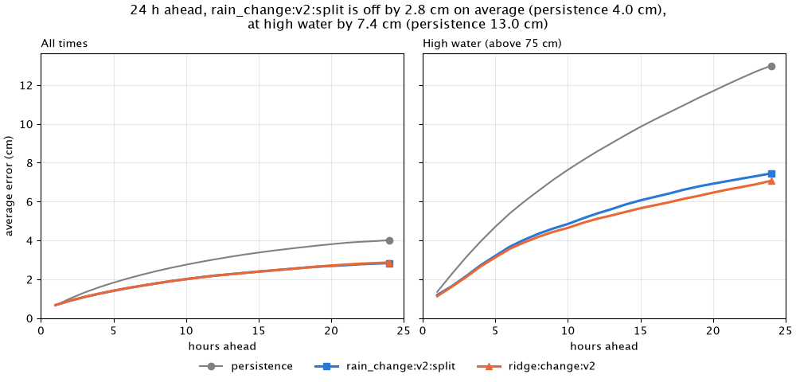
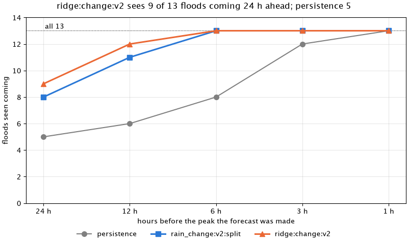
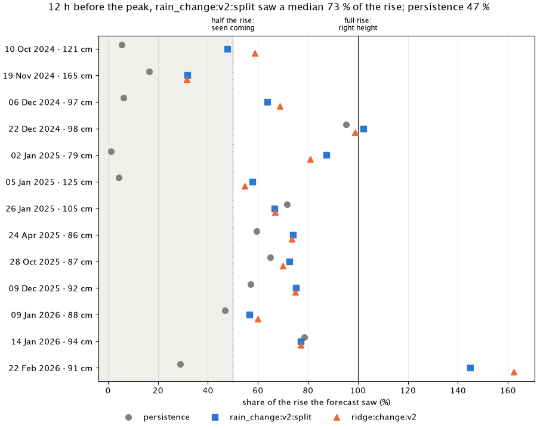
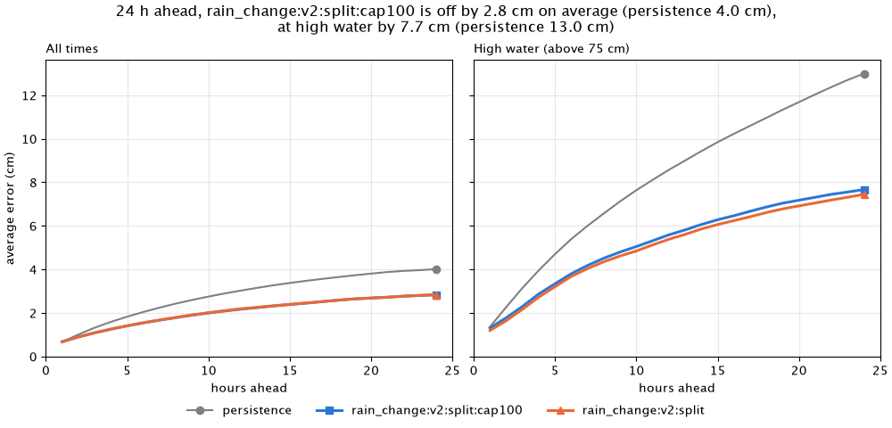
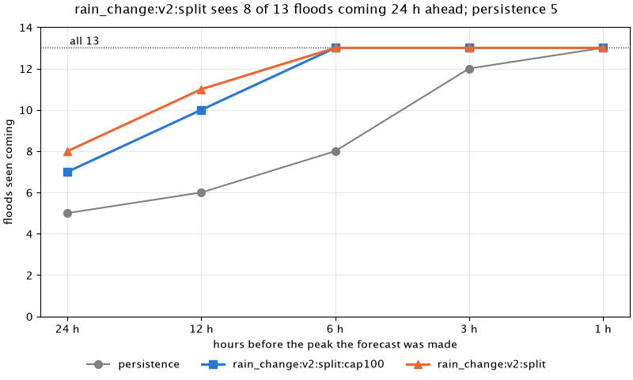
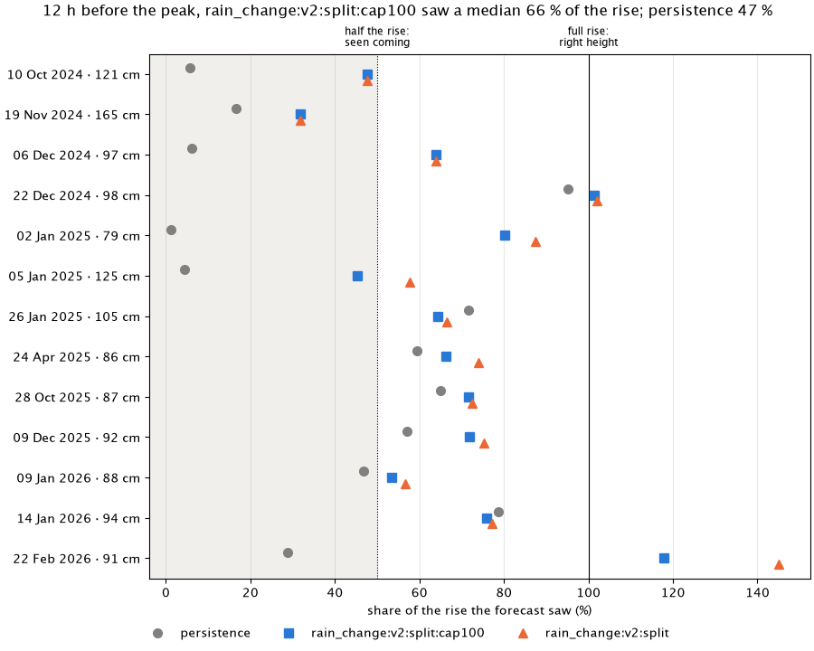

# Experiment log

Every scored run of the model evaluation gets one section here (docs/decisions/0008). The log
holds the runs of the current evaluation method only, so every section compares the same way.
Within a method it is append-only: earlier sections are never edited, and a later run that
changes a conclusion says so in its own section. When the method changes, the log starts
again with a fresh run; older runs stay in git history.

The method changed on 2026-10-15 (flood events from fast rises, flood forecasts per event).
The first run with it is [2026-10-15-flood-scores](#2026-10-15-flood-scores).

## How to read this

Each section starts with a short summary, the notes and one table with a row per model, then
the error plot; the detail tables are folded below it. The flood forecasts follow with their
summary table, two plots and one folded table per model. Each plot answers one question in its
title and has one line under it on how to read it. Plots show persistence (grey) and the two
best models by the selection rule; the tables show all models. Plots live in `plots/<run>/`.
The full rules are in [docs/evaluation.md](../../docs/evaluation.md).

- **MAE** ("average error" in the plots): mean absolute error of the forecast level in cm,
  pooled over the four test folds. "Mean MAE" averages the leads 1 to 24 hours. **Lead**: how
  many hours ahead the forecast looks.
- **Folds better than persistence:** in how many of the four test periods the model's mean
  MAE beats persistence. The selection rule asks for at least 3 of 4.
- **Skill:** 1 - MAE / MAE of persistence on the same rows. Persistence is 0; above 0 is
  better than holding the last level.
- **High water:** issue times where the cleaned level is above `evaluation.high_water_cm`
  (75 cm) at the issue time or at the target. Every score uses only the cleaned Kupferdreh
  series, never the raw one.
- **Flood forecasts:** for each of the 13 flood events and each lead of 24, 12, 6, 3 and 1
  hours before the peak, the forecast issued then. **Size** is the share of the rise from the
  pre-event level it saw, **timing** how many hours its peak was off, and **predicted** means
  it saw more than half the rise.
- **False alarm:** a forecast that shows a new event while none is running or starts within
  24 hours. A run of such forecasts counts once; the rate is per test month.

## Adding a run

With a frozen dataset `eval.parquet` and a run folder named after the date and what it tries,
from the repo root:

```
uv run --group analysis python -m pegel.evaluation.predict <eval.parquet> --out <runs>/<run> [--models a,b]
uv run --group analysis python -m pegel.evaluation.score <runs>/<run>/predictions.parquet <eval.parquet> --out <runs>/<run>
uv run --group analysis python -m pegel.evaluation.report <runs>/<run> --notes "what was tried, what we learned"
```

The last command writes the plots and appends the section. Commit both.

## 2026-10-15-flood-scores

Lowest mean MAE over leads 1-24 h: rain_change:v2:split and ridge:change:v2 over all issue times (2.1 cm; persistence 2.8 cm), ridge:change:v2 at high water (4.8 cm; persistence 8.3 cm).

Events predicted: ridge:change:v2 13 of 13 at 6 h, 9 of 13 at 24 h; persistence 8 of 13 at 6 h, 5 of 13 at 24 h.

**Notes:** First run of the new evaluation method: 13 flood events from fast rises, each scored per event at 24, 12, 6, 3 and 1 hours before the peak, with only the 4 models left after retiring the rest. Both v2 models see 8 (rain_change:v2:split) and 9 (ridge:change:v2) of the 13 floods coming 24 hours ahead, persistence 5, at a mean MAE of 2.1 cm against 2.8. All four miss the 165 cm flood of 19 Nov 2024 a day ahead, because ICON-D2 badly underforecast its rain, and the v2 models overshoot the small February 2026 event 12 hours ahead (145 and 162 % of its rise); ridge:change:v2 has 3 false alarms, rain_change:v2:split 2.

| model | mean MAE all (cm) | mean MAE high water (cm) | MAE +24 h high water (cm) | skill +24 h high water | folds better than persistence |
|---|---|---|---|---|---|
| persistence | 2.8 | 8.3 | 13.0 | 0.00 | - |
| rain_change:v2:split | 2.1 | 5.1 | 7.4 | 0.43 | 4 of 4 |
| ridge:change:v2 | 2.1 | 4.8 | 7.1 | 0.46 | 4 of 4 |
| upstream | 2.7 | 7.8 | 12.8 | 0.02 | 4 of 4 |

The plots show persistence (grey) and up to 2 models that beat it by the selection rule; the tables show all models.


Each line is a model's average error, from 1 to 24 hours ahead; lower is better. Left all times, right only when the water is high.

<details>
<summary>MAE in cm per lead and subset, pooled over folds</summary>

Subset `all`:

| model | +1 h | +3 h | +6 h | +12 h | +24 h | mean 1-24 h | mean skill |
|---|---|---|---|---|---|---|---|
| persistence | 0.66 | 1.32 | 2.05 | 3.03 | 4.01 | 2.84 | 0.00 |
| rain_change:v2:split | 0.67 | 1.09 | 1.55 | 2.19 | 2.84 | 2.07 | 0.25 |
| ridge:change:v2 | 0.67 | 1.09 | 1.56 | 2.19 | 2.87 | 2.07 | 0.25 |
| upstream | 0.60 | 1.13 | 1.85 | 2.92 | 3.97 | 2.73 | 0.05 |

Subset `high_water`:

| model | +1 h | +3 h | +6 h | +12 h | +24 h | mean 1-24 h | mean skill |
|---|---|---|---|---|---|---|---|
| persistence | 1.36 | 3.15 | 5.39 | 8.57 | 12.99 | 8.25 | 0.00 |
| rain_change:v2:split | 1.19 | 2.17 | 3.68 | 5.38 | 7.45 | 5.10 | 0.36 |
| ridge:change:v2 | 1.13 | 2.12 | 3.57 | 5.11 | 7.07 | 4.83 | 0.39 |
| upstream | 1.14 | 2.25 | 4.55 | 8.11 | 12.79 | 7.78 | 0.09 |

</details>

<details>
<summary>Lag check</summary>

Shift in hours that best matches the forecast to the observed level on high water.

| model | shift at +6 h | shift at +12 h |
|---|---|---|
| persistence | 6 | 12 |
| rain_change:v2:split | 3 | 4 |
| ridge:change:v2 | 3 | 4 |
| upstream | 5 | 11 |

</details>

<details>
<summary>Run: commit and dataset</summary>

- Run: 2026-10-15, commit `5e1df8debeb1` (clean)
- Dataset sha256: `aca86a175c82e3eb89602d018bea7bba044b8755d085e05ec92032d2f367407f`
- Models: persistence, rain_change:v2:split, ridge:change:v2, upstream

</details>

### Flood forecasts

Per lead before the peak: events predicted (forecast saw more than half the rise) of events with a forecast, median size, median timing of the predicted ones.

| model | 24 h before | 12 h before | 6 h before | 3 h before | 1 h before | false alarms / month |
|---|---|---|---|---|---|---|
| persistence | 5 of 13 · 6 % · −23 h | 6 of 13 · 47 % · −11 h | 8 of 13 · 59 % · −5 h | 12 of 13 · 82 % · −2 h | 13 of 13 · 98 % · ±0 h | 0.00 |
| rain_change:v2:split | 8 of 13 · 66 % · −8 h | 11 of 13 · 73 % · +1 h | 13 of 13 · 80 % · +3 h | 13 of 13 · 103 % · +1 h | 13 of 13 · 108 % · +1 h | 0.11 |
| ridge:change:v2 | 9 of 13 · 66 % · −2 h | 12 of 13 · 70 % · ±0 h | 13 of 13 · 76 % · +2 h | 13 of 13 · 99 % · +1 h | 13 of 13 · 105 % · +1 h | 0.16 |
| upstream | 5 of 13 · 9 % · −19 h | 7 of 13 · 52 % · −7 h | 10 of 13 · 74 % · −2 h | 13 of 13 · 101 % · +2 h | 13 of 13 · 114 % · +4 h | 0.05 |


How many of the floods each model saw coming (its forecast showed more than half the rise), by how long before the peak the forecast was made; higher is better.


One row per flood. A dot is how much of the rise a model's forecast saw: right of the dotted line counts as seen coming, on the solid line is the right height.

Forecast replay: [replay.html](plots/2026-10-15-flood-scores/replay.html); 3 h vs 24 h timeline: [timeline.html](plots/2026-10-15-flood-scores/timeline.html).

<details>
<summary>Flood events: persistence</summary>

✓ predicted, ✗ not, — missing.

| event | peak (UTC) | peak cm | 24 h before | 12 h before | 6 h before | 3 h before | 1 h before |
|---|---|---|---|---|---|---|---|
| 1 | 2024-10-10 | 121 | ✗ 0 % −23 h | ✗ 6 % −11 h | ✗ 18 % −5 h | ✗ 47 % −2 h | ✓ 80 % ±0 h |
| 2 | 2024-11-19 | 165 | ✗ 16 % −23 h | ✗ 17 % −11 h | ✗ 46 % −5 h | ✓ 83 % −2 h | ✓ 96 % ±0 h |
| 3 | 2024-12-06 | 97 | ✗ 2 % −23 h | ✗ 6 % −11 h | ✗ 14 % −5 h | ✓ 54 % −2 h | ✓ 97 % ±0 h |
| 4 | 2024-12-22 | 98 | ✓ 56 % −23 h | ✓ 95 % −11 h | ✓ 84 % −5 h | ✓ 94 % −2 h | ✓ 97 % ±0 h |
| 5 | 2025-01-02 | 79 | ✗ 6 % −23 h | ✗ 1 % −11 h | ✗ 34 % −5 h | ✓ 79 % −2 h | ✓ 98 % ±0 h |
| 6 | 2025-01-05 | 125 | ✗ 0 % −23 h | ✗ 4 % −11 h | ✓ 53 % −5 h | ✓ 66 % −2 h | ✓ 94 % ±0 h |
| 7 | 2025-01-26 | 105 | ✓ 64 % −23 h | ✓ 72 % −11 h | ✓ 66 % −5 h | ✓ 79 % −2 h | ✓ 99 % ±0 h |
| 8 | 2025-04-24 | 86 | ✗ 4 % −23 h | ✓ 59 % −11 h | ✓ 76 % −5 h | ✓ 96 % −2 h | ✓ 99 % ±0 h |
| 9 | 2025-10-28 | 87 | ✓ 82 % −23 h | ✓ 65 % −11 h | ✓ 76 % −5 h | ✓ 82 % −2 h | ✓ 98 % ±0 h |
| 10 | 2025-12-09 | 92 | ✓ 78 % −23 h | ✓ 57 % −11 h | ✓ 81 % −5 h | ✓ 88 % −2 h | ✓ 98 % ±0 h |
| 11 | 2026-01-09 | 88 | ✗ 0 % −23 h | ✗ 47 % −11 h | ✓ 59 % −5 h | ✓ 85 % −2 h | ✓ 99 % ±0 h |
| 12 | 2026-01-14 | 94 | ✓ 73 % −23 h | ✓ 79 % −11 h | ✓ 75 % −5 h | ✓ 85 % −2 h | ✓ 98 % ±0 h |
| 13 | 2026-02-22 | 91 | ✗ 4 % −23 h | ✗ 29 % −11 h | ✗ 29 % −5 h | ✓ 62 % −2 h | ✓ 97 % ±0 h |

</details>

<details>
<summary>Flood events: rain_change:v2:split</summary>

✓ predicted, ✗ not, — missing.

| event | peak (UTC) | peak cm | 24 h before | 12 h before | 6 h before | 3 h before | 1 h before |
|---|---|---|---|---|---|---|---|
| 1 | 2024-10-10 | 121 | ✗ 36 % ±0 h | ✗ 48 % +7 h | ✓ 58 % +7 h | ✓ 72 % +6 h | ✓ 108 % +1 h |
| 2 | 2024-11-19 | 165 | ✗ 26 % −6 h | ✗ 32 % −6 h | ✓ 80 % −4 h | ✓ 91 % −1 h | ✓ 97 % ±0 h |
| 3 | 2024-12-06 | 97 | ✗ 46 % −2 h | ✓ 64 % +9 h | ✓ 55 % +4 h | ✓ 95 % +1 h | ✓ 127 % +1 h |
| 4 | 2024-12-22 | 98 | ✓ 73 % −2 h | ✓ 102 % +2 h | ✓ 90 % +1 h | ✓ 105 % +1 h | ✓ 114 % +2 h |
| 5 | 2025-01-02 | 79 | ✓ 85 % ±0 h | ✓ 87 % +1 h | ✓ 93 % ±0 h | ✓ 133 % +1 h | ✓ 116 % +1 h |
| 6 | 2025-01-05 | 125 | ✓ 53 % ±0 h | ✓ 58 % +6 h | ✓ 72 % +6 h | ✓ 88 % +2 h | ✓ 117 % +1 h |
| 7 | 2025-01-26 | 105 | ✓ 86 % −15 h | ✓ 67 % −11 h | ✓ 68 % +5 h | ✓ 93 % +1 h | ✓ 114 % +1 h |
| 8 | 2025-04-24 | 86 | ✗ 46 % −1 h | ✓ 74 % −1 h | ✓ 83 % −3 h | ✓ 109 % −1 h | ✓ 102 % ±0 h |
| 9 | 2025-10-28 | 87 | ✓ 78 % −23 h | ✓ 73 % −7 h | ✓ 76 % −5 h | ✓ 89 % −1 h | ✓ 98 % ±0 h |
| 10 | 2025-12-09 | 92 | ✓ 69 % −23 h | ✓ 75 % −3 h | ✓ 87 % −3 h | ✓ 103 % +1 h | ✓ 100 % ±0 h |
| 11 | 2026-01-09 | 88 | ✗ 39 % ±0 h | ✓ 57 % +6 h | ✓ 71 % +3 h | ✓ 104 % ±0 h | ✓ 102 % ±0 h |
| 12 | 2026-01-14 | 94 | ✓ 66 % −23 h | ✓ 77 % −11 h | ✓ 99 % +4 h | ✓ 103 % +2 h | ✓ 101 % +1 h |
| 13 | 2026-02-22 | 91 | ✓ 103 % ±0 h | ✓ 145 % +2 h | ✓ 145 % +4 h | ✓ 111 % +2 h | ✓ 115 % +1 h |

</details>

<details>
<summary>Flood events: ridge:change:v2</summary>

✓ predicted, ✗ not, — missing.

| event | peak (UTC) | peak cm | 24 h before | 12 h before | 6 h before | 3 h before | 1 h before |
|---|---|---|---|---|---|---|---|
| 1 | 2024-10-10 | 121 | ✗ 42 % ±0 h | ✓ 59 % +7 h | ✓ 63 % +7 h | ✓ 73 % +6 h | ✓ 105 % +1 h |
| 2 | 2024-11-19 | 165 | ✗ 26 % −6 h | ✗ 31 % −5 h | ✓ 76 % −4 h | ✓ 87 % −2 h | ✓ 96 % ±0 h |
| 3 | 2024-12-06 | 97 | ✗ 49 % −2 h | ✓ 69 % +4 h | ✓ 56 % +9 h | ✓ 99 % ±0 h | ✓ 127 % +1 h |
| 4 | 2024-12-22 | 98 | ✓ 66 % −2 h | ✓ 99 % −11 h | ✓ 87 % +1 h | ✓ 106 % +1 h | ✓ 114 % +2 h |
| 5 | 2025-01-02 | 79 | ✓ 90 % ±0 h | ✓ 81 % +1 h | ✓ 88 % −1 h | ✓ 124 % +1 h | ✓ 113 % +1 h |
| 6 | 2025-01-05 | 125 | ✓ 54 % ±0 h | ✓ 55 % +3 h | ✓ 69 % +6 h | ✓ 84 % ±0 h | ✓ 114 % +1 h |
| 7 | 2025-01-26 | 105 | ✓ 78 % −15 h | ✓ 67 % −11 h | ✓ 68 % +5 h | ✓ 95 % +1 h | ✓ 115 % +2 h |
| 8 | 2025-04-24 | 86 | ✓ 54 % −1 h | ✓ 74 % −1 h | ✓ 83 % −3 h | ✓ 106 % −1 h | ✓ 101 % ±0 h |
| 9 | 2025-10-28 | 87 | ✓ 79 % −23 h | ✓ 70 % −6 h | ✓ 76 % −5 h | ✓ 89 % −1 h | ✓ 98 % ±0 h |
| 10 | 2025-12-09 | 92 | ✓ 69 % −23 h | ✓ 75 % −3 h | ✓ 88 % −3 h | ✓ 99 % +2 h | ✓ 99 % ±0 h |
| 11 | 2026-01-09 | 88 | ✗ 38 % ±0 h | ✓ 60 % +4 h | ✓ 72 % +3 h | ✓ 103 % ±0 h | ✓ 102 % ±0 h |
| 12 | 2026-01-14 | 94 | ✓ 69 % −23 h | ✓ 77 % −11 h | ✓ 94 % +3 h | ✓ 100 % +2 h | ✓ 101 % ±0 h |
| 13 | 2026-02-22 | 91 | ✓ 119 % ±0 h | ✓ 162 % +2 h | ✓ 140 % +2 h | ✓ 105 % +3 h | ✓ 114 % +1 h |

</details>

<details>
<summary>Flood events: upstream</summary>

✓ predicted, ✗ not, — missing.

| event | peak (UTC) | peak cm | 24 h before | 12 h before | 6 h before | 3 h before | 1 h before |
|---|---|---|---|---|---|---|---|
| 1 | 2024-10-10 | 121 | ✗ 0 % −19 h | ✗ 6 % −11 h | ✗ 25 % −3 h | ✓ 76 % +1 h | ✓ 123 % +3 h |
| 2 | 2024-11-19 | 165 | ✗ 16 % ±0 h | ✗ 20 % −9 h | ✓ 92 % −2 h | ✓ 102 % +1 h | ✓ 105 % +2 h |
| 3 | 2024-12-06 | 97 | ✗ 2 % −3 h | ✗ 7 % −8 h | ✗ 17 % −3 h | ✓ 100 % +1 h | ✓ 151 % +3 h |
| 4 | 2024-12-22 | 98 | ✓ 55 % ±0 h | ✓ 106 % −8 h | ✓ 84 % −5 h | ✓ 101 % +1 h | ✓ 115 % +3 h |
| 5 | 2025-01-02 | 79 | ✗ 6 % ±0 h | ✗ 1 % −11 h | ✓ 58 % −2 h | ✓ 118 % +2 h | ✓ 114 % +4 h |
| 6 | 2025-01-05 | 125 | ✗ 0 % ±0 h | ✗ 7 % −8 h | ✓ 74 % −1 h | ✓ 86 % +2 h | ✓ 133 % +4 h |
| 7 | 2025-01-26 | 105 | ✓ 76 % −19 h | ✓ 70 % −11 h | ✓ 66 % −5 h | ✓ 91 % +2 h | ✓ 126 % +4 h |
| 8 | 2025-04-24 | 86 | ✗ 6 % −19 h | ✓ 74 % −7 h | ✓ 87 % −1 h | ✓ 112 % +2 h | ✓ 105 % +4 h |
| 9 | 2025-10-28 | 87 | ✓ 81 % −23 h | ✓ 67 % −6 h | ✓ 79 % −1 h | ✓ 96 % +2 h | ✓ 111 % +4 h |
| 10 | 2025-12-09 | 92 | ✓ 72 % −23 h | ✓ 60 % −7 h | ✓ 93 % −1 h | ✓ 104 % +2 h | ✓ 107 % +4 h |
| 11 | 2026-01-09 | 88 | ✗ 0 % −19 h | ✓ 52 % −7 h | ✓ 68 % −1 h | ✓ 111 % +2 h | ✓ 111 % +4 h |
| 12 | 2026-01-14 | 94 | ✓ 75 % −19 h | ✓ 77 % −11 h | ✓ 75 % −5 h | ✓ 101 % +2 h | ✓ 112 % +4 h |
| 13 | 2026-02-22 | 91 | ✗ 9 % −19 h | ✗ 28 % −11 h | ✗ 38 % −1 h | ✓ 105 % +2 h | ✓ 138 % +4 h |

</details>

## 2026-10-15-lightgbm-residual

Lowest mean MAE over leads 1-24 h: rain_change:v2:split, ridge:change:v2, lgbm_residual:v1:linear and lgbm_residual:v1 over all issue times (2.1 cm; persistence 2.8 cm), ridge:change:v2 and lgbm_residual:v1 at high water (4.8 cm; persistence 8.3 cm).

Events predicted: lgbm_residual:v1 and lgbm_residual:v1:linear 13 of 13 at 6 h, 10 of 13 at 24 h; persistence 8 of 13 at 6 h, 5 of 13 at 24 h.

**Notes:** LightGBM fitted per lead on the out-of-fold residual of ridge:change:v2 (lgbm_residual:v1, and :linear with linear_tree), 10 rounds and min_data_in_leaf 200 from the inner splits. Ruled out: over all issue times it loses to ridge:change:v2 in F1 and F3 (linear: F1 to F3), by up to 0.13 cm in F1. It keeps the flood size (≥120 cm events slightly up), sees 10 of 13 floods a day ahead against 9, and cuts the high-water bias at +24 h from −3.8 to −3.2 cm, at 4 false alarms (linear 3) against 3. The trees mostly learned season, which the short training window can't support.

| model | mean MAE all (cm) | mean MAE high water (cm) | MAE +24 h high water (cm) | skill +24 h high water | folds better than persistence |
|---|---|---|---|---|---|
| persistence | 2.8 | 8.3 | 13.0 | 0.00 | - |
| lgbm_residual:v1 | 2.1 | 4.8 | 7.1 | 0.45 | 4 of 4 |
| lgbm_residual:v1:linear | 2.1 | 4.9 | 7.2 | 0.45 | 4 of 4 |
| rain_change:v2:split | 2.1 | 5.1 | 7.4 | 0.43 | 4 of 4 |
| ridge:change:v2 | 2.1 | 4.8 | 7.1 | 0.46 | 4 of 4 |

The plots show persistence (grey) and up to 2 models that beat it by the selection rule; the tables show all models.



Each line is a model's average error, from 1 to 24 hours ahead; lower is better. Left all times, right only when the water is high.

<details>
<summary>MAE in cm per lead and subset, pooled over folds</summary>

Subset `all`:

| model | +1 h | +3 h | +6 h | +12 h | +24 h | mean 1-24 h | mean skill |
|---|---|---|---|---|---|---|---|
| persistence | 0.66 | 1.32 | 2.05 | 3.03 | 4.01 | 2.84 | 0.00 |
| lgbm_residual:v1 | 0.66 | 1.06 | 1.57 | 2.20 | 2.89 | 2.09 | 0.25 |
| lgbm_residual:v1:linear | 0.66 | 1.05 | 1.56 | 2.19 | 2.93 | 2.09 | 0.25 |
| rain_change:v2:split | 0.67 | 1.09 | 1.55 | 2.19 | 2.84 | 2.07 | 0.25 |
| ridge:change:v2 | 0.67 | 1.09 | 1.56 | 2.19 | 2.87 | 2.07 | 0.25 |

Subset `high_water`:

| model | +1 h | +3 h | +6 h | +12 h | +24 h | mean 1-24 h | mean skill |
|---|---|---|---|---|---|---|---|
| persistence | 1.36 | 3.15 | 5.39 | 8.57 | 12.99 | 8.25 | 0.00 |
| lgbm_residual:v1 | 1.14 | 2.08 | 3.59 | 5.11 | 7.09 | 4.84 | 0.39 |
| lgbm_residual:v1:linear | 1.13 | 2.06 | 3.58 | 5.19 | 7.16 | 4.88 | 0.38 |
| rain_change:v2:split | 1.19 | 2.17 | 3.68 | 5.38 | 7.45 | 5.10 | 0.36 |
| ridge:change:v2 | 1.13 | 2.12 | 3.57 | 5.11 | 7.07 | 4.83 | 0.39 |

</details>

<details>
<summary>Lag check</summary>

Shift in hours that best matches the forecast to the observed level on high water.

| model | shift at +6 h | shift at +12 h |
|---|---|---|
| persistence | 6 | 12 |
| lgbm_residual:v1 | 3 | 4 |
| lgbm_residual:v1:linear | 3 | 5 |
| rain_change:v2:split | 3 | 4 |
| ridge:change:v2 | 3 | 4 |

</details>

<details>
<summary>Run: commit and dataset</summary>

- Run: 2026-10-15, commit `e75a34a59b99` (clean)
- Dataset sha256: `aca86a175c82e3eb89602d018bea7bba044b8755d085e05ec92032d2f367407f`
- Models: persistence, lgbm_residual:v1, lgbm_residual:v1:linear, rain_change:v2:split, ridge:change:v2

</details>

### Flood forecasts

Per lead before the peak: events predicted (forecast saw more than half the rise) of events with a forecast, median size, median timing of the predicted ones.

| model | 24 h before | 12 h before | 6 h before | 3 h before | 1 h before | false alarms / month |
|---|---|---|---|---|---|---|
| persistence | 5 of 13 · 6 % · −23 h | 6 of 13 · 47 % · −11 h | 8 of 13 · 59 % · −5 h | 12 of 13 · 82 % · −2 h | 13 of 13 · 98 % · ±0 h | 0.00 |
| lgbm_residual:v1 | 10 of 13 · 69 % · −1 h | 12 of 13 · 71 % · ±0 h | 13 of 13 · 76 % · +2 h | 13 of 13 · 101 % · +1 h | 13 of 13 · 105 % · +1 h | 0.22 |
| lgbm_residual:v1:linear | 10 of 13 · 69 % · −2 h | 12 of 13 · 70 % · +1 h | 13 of 13 · 76 % · +3 h | 13 of 13 · 100 % · +1 h | 13 of 13 · 105 % · +1 h | 0.16 |
| rain_change:v2:split | 8 of 13 · 66 % · −8 h | 11 of 13 · 73 % · +1 h | 13 of 13 · 80 % · +3 h | 13 of 13 · 103 % · +1 h | 13 of 13 · 108 % · +1 h | 0.11 |
| ridge:change:v2 | 9 of 13 · 66 % · −2 h | 12 of 13 · 70 % · ±0 h | 13 of 13 · 76 % · +2 h | 13 of 13 · 99 % · +1 h | 13 of 13 · 105 % · +1 h | 0.16 |



How many of the floods each model saw coming (its forecast showed more than half the rise), by how long before the peak the forecast was made; higher is better.



One row per flood. A dot is how much of the rise a model's forecast saw: right of the dotted line counts as seen coming, on the solid line is the right height.

<details>
<summary>Flood events: persistence</summary>

✓ predicted, ✗ not, — missing.

| event | peak (UTC) | peak cm | 24 h before | 12 h before | 6 h before | 3 h before | 1 h before |
|---|---|---|---|---|---|---|---|
| 1 | 2024-10-10 | 121 | ✗ 0 % −23 h | ✗ 6 % −11 h | ✗ 18 % −5 h | ✗ 47 % −2 h | ✓ 80 % ±0 h |
| 2 | 2024-11-19 | 165 | ✗ 16 % −23 h | ✗ 17 % −11 h | ✗ 46 % −5 h | ✓ 83 % −2 h | ✓ 96 % ±0 h |
| 3 | 2024-12-06 | 97 | ✗ 2 % −23 h | ✗ 6 % −11 h | ✗ 14 % −5 h | ✓ 54 % −2 h | ✓ 97 % ±0 h |
| 4 | 2024-12-22 | 98 | ✓ 56 % −23 h | ✓ 95 % −11 h | ✓ 84 % −5 h | ✓ 94 % −2 h | ✓ 97 % ±0 h |
| 5 | 2025-01-02 | 79 | ✗ 6 % −23 h | ✗ 1 % −11 h | ✗ 34 % −5 h | ✓ 79 % −2 h | ✓ 98 % ±0 h |
| 6 | 2025-01-05 | 125 | ✗ 0 % −23 h | ✗ 4 % −11 h | ✓ 53 % −5 h | ✓ 66 % −2 h | ✓ 94 % ±0 h |
| 7 | 2025-01-26 | 105 | ✓ 64 % −23 h | ✓ 72 % −11 h | ✓ 66 % −5 h | ✓ 79 % −2 h | ✓ 99 % ±0 h |
| 8 | 2025-04-24 | 86 | ✗ 4 % −23 h | ✓ 59 % −11 h | ✓ 76 % −5 h | ✓ 96 % −2 h | ✓ 99 % ±0 h |
| 9 | 2025-10-28 | 87 | ✓ 82 % −23 h | ✓ 65 % −11 h | ✓ 76 % −5 h | ✓ 82 % −2 h | ✓ 98 % ±0 h |
| 10 | 2025-12-09 | 92 | ✓ 78 % −23 h | ✓ 57 % −11 h | ✓ 81 % −5 h | ✓ 88 % −2 h | ✓ 98 % ±0 h |
| 11 | 2026-01-09 | 88 | ✗ 0 % −23 h | ✗ 47 % −11 h | ✓ 59 % −5 h | ✓ 85 % −2 h | ✓ 99 % ±0 h |
| 12 | 2026-01-14 | 94 | ✓ 73 % −23 h | ✓ 79 % −11 h | ✓ 75 % −5 h | ✓ 85 % −2 h | ✓ 98 % ±0 h |
| 13 | 2026-02-22 | 91 | ✗ 4 % −23 h | ✗ 29 % −11 h | ✗ 29 % −5 h | ✓ 62 % −2 h | ✓ 97 % ±0 h |

</details>

<details>
<summary>Flood events: lgbm_residual:v1</summary>

✓ predicted, ✗ not, — missing.

| event | peak (UTC) | peak cm | 24 h before | 12 h before | 6 h before | 3 h before | 1 h before |
|---|---|---|---|---|---|---|---|
| 1 | 2024-10-10 | 121 | ✗ 47 % ±0 h | ✓ 59 % +7 h | ✓ 65 % +7 h | ✓ 74 % +6 h | ✓ 105 % +1 h |
| 2 | 2024-11-19 | 165 | ✗ 26 % ±0 h | ✗ 31 % −5 h | ✓ 76 % −4 h | ✓ 87 % −2 h | ✓ 96 % ±0 h |
| 3 | 2024-12-06 | 97 | ✓ 53 % −1 h | ✓ 71 % +9 h | ✓ 58 % +9 h | ✓ 99 % ±0 h | ✓ 127 % +1 h |
| 4 | 2024-12-22 | 98 | ✓ 70 % ±0 h | ✓ 99 % −11 h | ✓ 89 % +2 h | ✓ 107 % +1 h | ✓ 115 % +2 h |
| 5 | 2025-01-02 | 79 | ✓ 86 % ±0 h | ✓ 89 % +1 h | ✓ 92 % ±0 h | ✓ 126 % +1 h | ✓ 114 % +1 h |
| 6 | 2025-01-05 | 125 | ✓ 53 % ±0 h | ✓ 59 % +3 h | ✓ 73 % +6 h | ✓ 84 % +1 h | ✓ 114 % +1 h |
| 7 | 2025-01-26 | 105 | ✓ 82 % −14 h | ✓ 67 % −11 h | ✓ 68 % +5 h | ✓ 96 % +1 h | ✓ 116 % +3 h |
| 8 | 2025-04-24 | 86 | ✓ 51 % −1 h | ✓ 70 % −1 h | ✓ 83 % −4 h | ✓ 106 % −1 h | ✓ 100 % ±0 h |
| 9 | 2025-10-28 | 87 | ✓ 79 % −23 h | ✓ 71 % −5 h | ✓ 76 % −4 h | ✓ 91 % ±0 h | ✓ 99 % ±0 h |
| 10 | 2025-12-09 | 92 | ✓ 70 % −23 h | ✓ 75 % −4 h | ✓ 90 % −3 h | ✓ 101 % +2 h | ✓ 100 % ±0 h |
| 11 | 2026-01-09 | 88 | ✗ 41 % ±0 h | ✓ 60 % +4 h | ✓ 72 % +2 h | ✓ 104 % ±0 h | ✓ 103 % ±0 h |
| 12 | 2026-01-14 | 94 | ✓ 69 % −23 h | ✓ 78 % −11 h | ✓ 93 % +2 h | ✓ 101 % ±0 h | ✓ 103 % +1 h |
| 13 | 2026-02-22 | 91 | ✓ 112 % ±0 h | ✓ 163 % +2 h | ✓ 139 % +2 h | ✓ 104 % +2 h | ✓ 117 % +1 h |

</details>

<details>
<summary>Flood events: lgbm_residual:v1:linear</summary>

✓ predicted, ✗ not, — missing.

| event | peak (UTC) | peak cm | 24 h before | 12 h before | 6 h before | 3 h before | 1 h before |
|---|---|---|---|---|---|---|---|
| 1 | 2024-10-10 | 121 | ✗ 45 % ±0 h | ✓ 63 % +7 h | ✓ 63 % +7 h | ✓ 73 % +9 h | ✓ 105 % +1 h |
| 2 | 2024-11-19 | 165 | ✗ 27 % −1 h | ✗ 31 % −4 h | ✓ 76 % −4 h | ✓ 87 % −2 h | ✓ 96 % ±0 h |
| 3 | 2024-12-06 | 97 | ✓ 51 % −1 h | ✓ 70 % +8 h | ✓ 57 % +9 h | ✓ 99 % +1 h | ✓ 125 % +1 h |
| 4 | 2024-12-22 | 98 | ✓ 69 % −3 h | ✓ 99 % +1 h | ✓ 89 % +1 h | ✓ 108 % +1 h | ✓ 115 % +3 h |
| 5 | 2025-01-02 | 79 | ✓ 91 % ±0 h | ✓ 84 % +1 h | ✓ 91 % −1 h | ✓ 127 % +1 h | ✓ 114 % +1 h |
| 6 | 2025-01-05 | 125 | ✓ 52 % ±0 h | ✓ 56 % +5 h | ✓ 71 % +6 h | ✓ 84 % +1 h | ✓ 113 % +1 h |
| 7 | 2025-01-26 | 105 | ✓ 81 % −14 h | ✓ 67 % −11 h | ✓ 68 % +5 h | ✓ 95 % +1 h | ✓ 115 % +1 h |
| 8 | 2025-04-24 | 86 | ✓ 50 % −1 h | ✓ 69 % −9 h | ✓ 82 % −5 h | ✓ 105 % −2 h | ✓ 100 % ±0 h |
| 9 | 2025-10-28 | 87 | ✓ 80 % −23 h | ✓ 70 % −6 h | ✓ 76 % −4 h | ✓ 91 % ±0 h | ✓ 99 % ±0 h |
| 10 | 2025-12-09 | 92 | ✓ 70 % −23 h | ✓ 75 % −3 h | ✓ 89 % −3 h | ✓ 101 % +2 h | ✓ 99 % ±0 h |
| 11 | 2026-01-09 | 88 | ✗ 40 % ±0 h | ✓ 60 % +2 h | ✓ 72 % +3 h | ✓ 103 % ±0 h | ✓ 102 % ±0 h |
| 12 | 2026-01-14 | 94 | ✓ 69 % −23 h | ✓ 78 % −11 h | ✓ 93 % +4 h | ✓ 100 % +1 h | ✓ 101 % ±0 h |
| 13 | 2026-02-22 | 91 | ✓ 117 % ±0 h | ✓ 165 % +2 h | ✓ 140 % +4 h | ✓ 105 % +3 h | ✓ 115 % +1 h |

</details>

<details>
<summary>Flood events: rain_change:v2:split</summary>

✓ predicted, ✗ not, — missing.

| event | peak (UTC) | peak cm | 24 h before | 12 h before | 6 h before | 3 h before | 1 h before |
|---|---|---|---|---|---|---|---|
| 1 | 2024-10-10 | 121 | ✗ 36 % ±0 h | ✗ 48 % +7 h | ✓ 58 % +7 h | ✓ 72 % +6 h | ✓ 108 % +1 h |
| 2 | 2024-11-19 | 165 | ✗ 26 % −6 h | ✗ 32 % −6 h | ✓ 80 % −4 h | ✓ 91 % −1 h | ✓ 97 % ±0 h |
| 3 | 2024-12-06 | 97 | ✗ 46 % −2 h | ✓ 64 % +9 h | ✓ 55 % +4 h | ✓ 95 % +1 h | ✓ 127 % +1 h |
| 4 | 2024-12-22 | 98 | ✓ 73 % −2 h | ✓ 102 % +2 h | ✓ 90 % +1 h | ✓ 105 % +1 h | ✓ 114 % +2 h |
| 5 | 2025-01-02 | 79 | ✓ 85 % ±0 h | ✓ 87 % +1 h | ✓ 93 % ±0 h | ✓ 133 % +1 h | ✓ 116 % +1 h |
| 6 | 2025-01-05 | 125 | ✓ 53 % ±0 h | ✓ 58 % +6 h | ✓ 72 % +6 h | ✓ 88 % +2 h | ✓ 117 % +1 h |
| 7 | 2025-01-26 | 105 | ✓ 86 % −15 h | ✓ 67 % −11 h | ✓ 68 % +5 h | ✓ 93 % +1 h | ✓ 114 % +1 h |
| 8 | 2025-04-24 | 86 | ✗ 46 % −1 h | ✓ 74 % −1 h | ✓ 83 % −3 h | ✓ 109 % −1 h | ✓ 102 % ±0 h |
| 9 | 2025-10-28 | 87 | ✓ 78 % −23 h | ✓ 73 % −7 h | ✓ 76 % −5 h | ✓ 89 % −1 h | ✓ 98 % ±0 h |
| 10 | 2025-12-09 | 92 | ✓ 69 % −23 h | ✓ 75 % −3 h | ✓ 87 % −3 h | ✓ 103 % +1 h | ✓ 100 % ±0 h |
| 11 | 2026-01-09 | 88 | ✗ 39 % ±0 h | ✓ 57 % +6 h | ✓ 71 % +3 h | ✓ 104 % ±0 h | ✓ 102 % ±0 h |
| 12 | 2026-01-14 | 94 | ✓ 66 % −23 h | ✓ 77 % −11 h | ✓ 99 % +4 h | ✓ 103 % +2 h | ✓ 101 % +1 h |
| 13 | 2026-02-22 | 91 | ✓ 103 % ±0 h | ✓ 145 % +2 h | ✓ 145 % +4 h | ✓ 111 % +2 h | ✓ 115 % +1 h |

</details>

<details>
<summary>Flood events: ridge:change:v2</summary>

✓ predicted, ✗ not, — missing.

| event | peak (UTC) | peak cm | 24 h before | 12 h before | 6 h before | 3 h before | 1 h before |
|---|---|---|---|---|---|---|---|
| 1 | 2024-10-10 | 121 | ✗ 42 % ±0 h | ✓ 59 % +7 h | ✓ 63 % +7 h | ✓ 73 % +6 h | ✓ 105 % +1 h |
| 2 | 2024-11-19 | 165 | ✗ 26 % −6 h | ✗ 31 % −5 h | ✓ 76 % −4 h | ✓ 87 % −2 h | ✓ 96 % ±0 h |
| 3 | 2024-12-06 | 97 | ✗ 49 % −2 h | ✓ 69 % +4 h | ✓ 56 % +9 h | ✓ 99 % ±0 h | ✓ 127 % +1 h |
| 4 | 2024-12-22 | 98 | ✓ 66 % −2 h | ✓ 99 % −11 h | ✓ 87 % +1 h | ✓ 106 % +1 h | ✓ 114 % +2 h |
| 5 | 2025-01-02 | 79 | ✓ 90 % ±0 h | ✓ 81 % +1 h | ✓ 88 % −1 h | ✓ 124 % +1 h | ✓ 113 % +1 h |
| 6 | 2025-01-05 | 125 | ✓ 54 % ±0 h | ✓ 55 % +3 h | ✓ 69 % +6 h | ✓ 84 % ±0 h | ✓ 114 % +1 h |
| 7 | 2025-01-26 | 105 | ✓ 78 % −15 h | ✓ 67 % −11 h | ✓ 68 % +5 h | ✓ 95 % +1 h | ✓ 115 % +2 h |
| 8 | 2025-04-24 | 86 | ✓ 54 % −1 h | ✓ 74 % −1 h | ✓ 83 % −3 h | ✓ 106 % −1 h | ✓ 101 % ±0 h |
| 9 | 2025-10-28 | 87 | ✓ 79 % −23 h | ✓ 70 % −6 h | ✓ 76 % −5 h | ✓ 89 % −1 h | ✓ 98 % ±0 h |
| 10 | 2025-12-09 | 92 | ✓ 69 % −23 h | ✓ 75 % −3 h | ✓ 88 % −3 h | ✓ 99 % +2 h | ✓ 99 % ±0 h |
| 11 | 2026-01-09 | 88 | ✗ 38 % ±0 h | ✓ 60 % +4 h | ✓ 72 % +3 h | ✓ 103 % ±0 h | ✓ 102 % ±0 h |
| 12 | 2026-01-14 | 94 | ✓ 69 % −23 h | ✓ 77 % −11 h | ✓ 94 % +3 h | ✓ 100 % +2 h | ✓ 101 % ±0 h |
| 13 | 2026-02-22 | 91 | ✓ 119 % ±0 h | ✓ 162 % +2 h | ✓ 140 % +2 h | ✓ 105 % +3 h | ✓ 114 % +1 h |

</details>

### Against ridge:change:v2

**Verdict: both variants are ruled out.** Over all issue times `lgbm_residual:v1` loses to `ridge:change:v2` in 2 of 4 folds (F1, F3), the linear variant in 3 (F1 to F3). The other two kill criteria pass: flood size on the ≥120 cm events goes up a little, and false alarms stay below 0.25 per month (0.22 plain, 0.16 linear).

Mean MAE over leads 1-24 h, cm:

| model | F1 | F2 | F3 | F4 | pooled | high water F1 | F2 | F3 | F4 | pooled |
|---|---|---|---|---|---|---|---|---|---|---|
| ridge:change:v2 | **2.28** | 1.68 | **2.47** | 1.77 | **2.07** | **5.64** | **4.13** | **9.32** | 4.10 | **4.83** |
| lgbm_residual:v1 | 2.41 | **1.68** | 2.48 | 1.76 | 2.09 | 5.67 | 4.14 | 10.20 | 4.03 | 4.84 |
| lgbm_residual:v1:linear | 2.41 | 1.71 | 2.48 | **1.75** | 2.09 | 5.71 | 4.22 | 10.61 | **4.01** | 4.88 |

Flood size and timing for the four flood events that matter most (ridge / plain / linear):

| event | 24 h before | 12 h before | 6 h before |
|---|---|---|---|
| 1 (121 cm) | 42 % ±0 h / 47 % ±0 h / 45 % ±0 h | 59 % +7 h / 59 % +7 h / 63 % +7 h | 63 % +7 h / 65 % +7 h / 63 % +7 h |
| 2 (165 cm) | 26 % −6 h / 26 % ±0 h / 27 % −1 h | 31 % −5 h / 31 % −5 h / 31 % −4 h | 76 % −4 h / 76 % −4 h / 76 % −4 h |
| 6 (125 cm) | 54 % ±0 h / 53 % ±0 h / 52 % ±0 h | 55 % +3 h / 59 % +3 h / 56 % +5 h | 69 % +6 h / 73 % +6 h / 71 % +6 h |
| 13 (91 cm) | 119 % ±0 h / 112 % ±0 h / 117 % ±0 h | 162 % +2 h / 163 % +2 h / 165 % +2 h | 140 % +2 h / 139 % +2 h / 140 % +4 h |

- **Flood size, ≥120 cm events (1, 2, 6), mean share of the rise** 24/12/6 h before: ridge 41/48/69 %, plain 42/50/71 %, linear 41/50/70 %. Seen a day ahead: 10 of 13 against 9 (event 3 moves from 49 to 53 %).
- **High-water bias at +24 h:** −3.8 cm ridge, −3.2 plain, −3.2 linear.
- **False alarms** in 18 months: ridge 3 (0.16 per month), plain 4 (0.22), linear 3 (0.16).
- **Residual leakage check.** On the inner splits, ridge residuals on its own training rows were 8 to 12 % smaller over all rows than 3-block out-of-fold residuals, and up to 33 % smaller at high water at +24 h (F2: 5.1 against 6.8 cm). So the trees learn out-of-fold residuals, with the lead window before each block left out of its ridge fit.
- **Inner split picked** 10 rounds at learning rate 0.05 and `min_data_in_leaf` 200 (against 50) for both variants. More rounds made the inner validation worse in F2 to F4; the mean of the four inner MAEs went from 2.41 (ridge) to 2.37 cm at best.
- **Top 10 inputs by gain**, summed over leads and folds, the same order for both variants: season sine (22 %), ICON-D2 sum above 5 mm (18 %), ICON-D2 sum (12 %), season cosine (12 %), last level (11 %), ICON-D2 sum 1-24 h (6 %), ICON × level (3 %), Langenberg 3 h change (3 %), recent rise 24 h (2 %), radar 12-23 h (2 %).

## 2026-10-15-capped-training

Lowest mean MAE over leads 1-24 h: rain_change:v2:split:cap100, rain_change:v2:split, ridge:change:v2 and ridge:change:v2:cap100 over all issue times (2.1 cm; persistence 2.8 cm), ridge:change:v2 at high water (4.8 cm; persistence 8.3 cm).

Events predicted: ridge:change:v2 13 of 13 at 6 h, 9 of 13 at 24 h; persistence 8 of 13 at 6 h, 5 of 13 at 24 h.

**Notes:** Extrapolation stress test. Each :cap100 model is the same model trained without any issue time whose cleaned level or any target is above 100 cm (95 to 286 training rows dropped per fold); test rows are not filtered. That puts the 121, 165, 125 and 105 cm floods (events 1, 2, 6, 7) beyond the training range. Persistence:cap100 is identical to persistence, as it should be. No family loses more than 20 points of flood size: the largest loss is 13 points (rain_change:v2:split, event 6, 12 h before), and most cells move by 0 to 5 points. High-water MAE rises by 0.1 to 0.3 cm per lead for the v2 models and stays flat for upstream. The cap also removes the rising limbs into big peaks, so read this as a comparison between families, not as absolute losses. Details in the comparison table below.

| model | mean MAE all (cm) | mean MAE high water (cm) | MAE +24 h high water (cm) | skill +24 h high water | folds better than persistence |
|---|---|---|---|---|---|
| persistence | 2.8 | 8.3 | 13.0 | 0.00 | - |
| persistence:cap100 | 2.8 | 8.3 | 13.0 | 0.00 | 0 of 4 |
| rain_change:v2:split | 2.1 | 5.1 | 7.4 | 0.43 | 4 of 4 |
| rain_change:v2:split:cap100 | 2.1 | 5.3 | 7.7 | 0.41 | 4 of 4 |
| ridge:change:v2 | 2.1 | 4.8 | 7.1 | 0.46 | 4 of 4 |
| ridge:change:v2:cap100 | 2.1 | 5.1 | 7.3 | 0.44 | 4 of 4 |
| upstream | 2.7 | 7.8 | 12.8 | 0.02 | 4 of 4 |
| upstream:cap100 | 2.7 | 7.8 | 12.7 | 0.02 | 4 of 4 |

The plots show persistence (grey) and up to 2 models that beat it by the selection rule; the tables show all models.



Each line is a model's average error, from 1 to 24 hours ahead; lower is better. Left all times, right only when the water is high.

<details>
<summary>MAE in cm per lead and subset, pooled over folds</summary>

Subset `all`:

| model | +1 h | +3 h | +6 h | +12 h | +24 h | mean 1-24 h | mean skill |
|---|---|---|---|---|---|---|---|
| persistence | 0.66 | 1.32 | 2.05 | 3.03 | 4.01 | 2.84 | 0.00 |
| persistence:cap100 | 0.66 | 1.32 | 2.05 | 3.03 | 4.01 | 2.84 | 0.00 |
| rain_change:v2:split | 0.67 | 1.09 | 1.55 | 2.19 | 2.84 | 2.07 | 0.25 |
| rain_change:v2:split:cap100 | 0.68 | 1.09 | 1.54 | 2.17 | 2.84 | 2.06 | 0.25 |
| ridge:change:v2 | 0.67 | 1.09 | 1.56 | 2.19 | 2.87 | 2.07 | 0.25 |
| ridge:change:v2:cap100 | 0.68 | 1.10 | 1.57 | 2.20 | 2.84 | 2.07 | 0.25 |
| upstream | 0.60 | 1.13 | 1.85 | 2.92 | 3.97 | 2.73 | 0.05 |
| upstream:cap100 | 0.61 | 1.13 | 1.85 | 2.92 | 3.95 | 2.72 | 0.05 |

Subset `high_water`:

| model | +1 h | +3 h | +6 h | +12 h | +24 h | mean 1-24 h | mean skill |
|---|---|---|---|---|---|---|---|
| persistence | 1.36 | 3.15 | 5.39 | 8.57 | 12.99 | 8.25 | 0.00 |
| persistence:cap100 | 1.36 | 3.15 | 5.39 | 8.57 | 12.99 | 8.25 | 0.00 |
| rain_change:v2:split | 1.19 | 2.17 | 3.68 | 5.38 | 7.45 | 5.10 | 0.36 |
| rain_change:v2:split:cap100 | 1.31 | 2.30 | 3.80 | 5.59 | 7.67 | 5.30 | 0.33 |
| ridge:change:v2 | 1.13 | 2.12 | 3.57 | 5.11 | 7.07 | 4.83 | 0.39 |
| ridge:change:v2:cap100 | 1.22 | 2.29 | 3.81 | 5.36 | 7.30 | 5.06 | 0.36 |
| upstream | 1.14 | 2.25 | 4.55 | 8.11 | 12.79 | 7.78 | 0.09 |
| upstream:cap100 | 1.24 | 2.30 | 4.56 | 8.11 | 12.74 | 7.77 | 0.08 |

</details>

<details>
<summary>Lag check</summary>

Shift in hours that best matches the forecast to the observed level on high water.

| model | shift at +6 h | shift at +12 h |
|---|---|---|
| persistence | 6 | 12 |
| persistence:cap100 | 6 | 12 |
| rain_change:v2:split | 3 | 4 |
| rain_change:v2:split:cap100 | 3 | 4 |
| ridge:change:v2 | 3 | 4 |
| ridge:change:v2:cap100 | 3 | 5 |
| upstream | 5 | 11 |
| upstream:cap100 | 5 | 11 |

</details>

<details>
<summary>Run: commit and dataset</summary>

- Run: 2026-10-15, commit `01c5f5469ae2` (clean)
- Dataset sha256: `aca86a175c82e3eb89602d018bea7bba044b8755d085e05ec92032d2f367407f`
- Models: persistence, persistence:cap100, rain_change:v2:split, rain_change:v2:split:cap100, ridge:change:v2, ridge:change:v2:cap100, upstream, upstream:cap100

</details>

### Flood forecasts

Per lead before the peak: events predicted (forecast saw more than half the rise) of events with a forecast, median size, median timing of the predicted ones.

| model | 24 h before | 12 h before | 6 h before | 3 h before | 1 h before | false alarms / month |
|---|---|---|---|---|---|---|
| persistence | 5 of 13 · 6 % · −23 h | 6 of 13 · 47 % · −11 h | 8 of 13 · 59 % · −5 h | 12 of 13 · 82 % · −2 h | 13 of 13 · 98 % · ±0 h | 0.00 |
| persistence:cap100 | 5 of 13 · 6 % · −23 h | 6 of 13 · 47 % · −11 h | 8 of 13 · 59 % · −5 h | 12 of 13 · 82 % · −2 h | 13 of 13 · 98 % · ±0 h | 0.00 |
| rain_change:v2:split | 8 of 13 · 66 % · −8 h | 11 of 13 · 73 % · +1 h | 13 of 13 · 80 % · +3 h | 13 of 13 · 103 % · +1 h | 13 of 13 · 108 % · +1 h | 0.11 |
| rain_change:v2:split:cap100 | 7 of 13 · 66 % · −14 h | 10 of 13 · 66 % · ±0 h | 13 of 13 · 81 % · ≥ +2 h | 13 of 13 · 97 % · ±0 h | 13 of 13 · 109 % · +1 h | 0.00 |
| ridge:change:v2 | 9 of 13 · 66 % · −2 h | 12 of 13 · 70 % · ±0 h | 13 of 13 · 76 % · +2 h | 13 of 13 · 99 % · +1 h | 13 of 13 · 105 % · +1 h | 0.16 |
| ridge:change:v2:cap100 | 7 of 13 · 60 % · −14 h | 11 of 13 · 67 % · −1 h | 13 of 13 · 76 % · ≥ +1 h | 13 of 13 · 96 % · ±0 h | 13 of 13 · 106 % · +1 h | 0.05 |
| upstream | 5 of 13 · 9 % · −19 h | 7 of 13 · 52 % · −7 h | 10 of 13 · 74 % · −2 h | 13 of 13 · 101 % · +2 h | 13 of 13 · 114 % · +4 h | 0.05 |
| upstream:cap100 | 5 of 13 · 9 % · −20 h | 7 of 13 · 53 % · ≥ −8 h | 10 of 13 · 73 % · ≥ −2 h | 13 of 13 · 102 % · +1 h | 13 of 13 · 115 % · +3 h | 0.05 |



How many of the floods each model saw coming (its forecast showed more than half the rise), by how long before the peak the forecast was made; higher is better.



One row per flood. A dot is how much of the rise a model's forecast saw: right of the dotted line counts as seen coming, on the solid line is the right height.

<details>
<summary>Flood events: persistence</summary>

✓ predicted, ✗ not, — missing.

| event | peak (UTC) | peak cm | 24 h before | 12 h before | 6 h before | 3 h before | 1 h before |
|---|---|---|---|---|---|---|---|
| 1 | 2024-10-10 | 121 | ✗ 0 % −23 h | ✗ 6 % −11 h | ✗ 18 % −5 h | ✗ 47 % −2 h | ✓ 80 % ±0 h |
| 2 | 2024-11-19 | 165 | ✗ 16 % −23 h | ✗ 17 % −11 h | ✗ 46 % −5 h | ✓ 83 % −2 h | ✓ 96 % ±0 h |
| 3 | 2024-12-06 | 97 | ✗ 2 % −23 h | ✗ 6 % −11 h | ✗ 14 % −5 h | ✓ 54 % −2 h | ✓ 97 % ±0 h |
| 4 | 2024-12-22 | 98 | ✓ 56 % −23 h | ✓ 95 % −11 h | ✓ 84 % −5 h | ✓ 94 % −2 h | ✓ 97 % ±0 h |
| 5 | 2025-01-02 | 79 | ✗ 6 % −23 h | ✗ 1 % −11 h | ✗ 34 % −5 h | ✓ 79 % −2 h | ✓ 98 % ±0 h |
| 6 | 2025-01-05 | 125 | ✗ 0 % −23 h | ✗ 4 % −11 h | ✓ 53 % −5 h | ✓ 66 % −2 h | ✓ 94 % ±0 h |
| 7 | 2025-01-26 | 105 | ✓ 64 % −23 h | ✓ 72 % −11 h | ✓ 66 % −5 h | ✓ 79 % −2 h | ✓ 99 % ±0 h |
| 8 | 2025-04-24 | 86 | ✗ 4 % −23 h | ✓ 59 % −11 h | ✓ 76 % −5 h | ✓ 96 % −2 h | ✓ 99 % ±0 h |
| 9 | 2025-10-28 | 87 | ✓ 82 % −23 h | ✓ 65 % −11 h | ✓ 76 % −5 h | ✓ 82 % −2 h | ✓ 98 % ±0 h |
| 10 | 2025-12-09 | 92 | ✓ 78 % −23 h | ✓ 57 % −11 h | ✓ 81 % −5 h | ✓ 88 % −2 h | ✓ 98 % ±0 h |
| 11 | 2026-01-09 | 88 | ✗ 0 % −23 h | ✗ 47 % −11 h | ✓ 59 % −5 h | ✓ 85 % −2 h | ✓ 99 % ±0 h |
| 12 | 2026-01-14 | 94 | ✓ 73 % −23 h | ✓ 79 % −11 h | ✓ 75 % −5 h | ✓ 85 % −2 h | ✓ 98 % ±0 h |
| 13 | 2026-02-22 | 91 | ✗ 4 % −23 h | ✗ 29 % −11 h | ✗ 29 % −5 h | ✓ 62 % −2 h | ✓ 97 % ±0 h |

</details>

<details>
<summary>Flood events: persistence:cap100</summary>

✓ predicted, ✗ not, — missing.

| event | peak (UTC) | peak cm | 24 h before | 12 h before | 6 h before | 3 h before | 1 h before |
|---|---|---|---|---|---|---|---|
| 1 | 2024-10-10 | 121 | ✗ 0 % −23 h | ✗ 6 % −11 h | ✗ 18 % −5 h | ✗ 47 % −2 h | ✓ 80 % ±0 h |
| 2 | 2024-11-19 | 165 | ✗ 16 % −23 h | ✗ 17 % −11 h | ✗ 46 % −5 h | ✓ 83 % −2 h | ✓ 96 % ±0 h |
| 3 | 2024-12-06 | 97 | ✗ 2 % −23 h | ✗ 6 % −11 h | ✗ 14 % −5 h | ✓ 54 % −2 h | ✓ 97 % ±0 h |
| 4 | 2024-12-22 | 98 | ✓ 56 % −23 h | ✓ 95 % −11 h | ✓ 84 % −5 h | ✓ 94 % −2 h | ✓ 97 % ±0 h |
| 5 | 2025-01-02 | 79 | ✗ 6 % −23 h | ✗ 1 % −11 h | ✗ 34 % −5 h | ✓ 79 % −2 h | ✓ 98 % ±0 h |
| 6 | 2025-01-05 | 125 | ✗ 0 % −23 h | ✗ 4 % −11 h | ✓ 53 % −5 h | ✓ 66 % −2 h | ✓ 94 % ±0 h |
| 7 | 2025-01-26 | 105 | ✓ 64 % −23 h | ✓ 72 % −11 h | ✓ 66 % −5 h | ✓ 79 % −2 h | ✓ 99 % ±0 h |
| 8 | 2025-04-24 | 86 | ✗ 4 % −23 h | ✓ 59 % −11 h | ✓ 76 % −5 h | ✓ 96 % −2 h | ✓ 99 % ±0 h |
| 9 | 2025-10-28 | 87 | ✓ 82 % −23 h | ✓ 65 % −11 h | ✓ 76 % −5 h | ✓ 82 % −2 h | ✓ 98 % ±0 h |
| 10 | 2025-12-09 | 92 | ✓ 78 % −23 h | ✓ 57 % −11 h | ✓ 81 % −5 h | ✓ 88 % −2 h | ✓ 98 % ±0 h |
| 11 | 2026-01-09 | 88 | ✗ 0 % −23 h | ✗ 47 % −11 h | ✓ 59 % −5 h | ✓ 85 % −2 h | ✓ 99 % ±0 h |
| 12 | 2026-01-14 | 94 | ✓ 73 % −23 h | ✓ 79 % −11 h | ✓ 75 % −5 h | ✓ 85 % −2 h | ✓ 98 % ±0 h |
| 13 | 2026-02-22 | 91 | ✗ 4 % −23 h | ✗ 29 % −11 h | ✗ 29 % −5 h | ✓ 62 % −2 h | ✓ 97 % ±0 h |

</details>

<details>
<summary>Flood events: rain_change:v2:split</summary>

✓ predicted, ✗ not, — missing.

| event | peak (UTC) | peak cm | 24 h before | 12 h before | 6 h before | 3 h before | 1 h before |
|---|---|---|---|---|---|---|---|
| 1 | 2024-10-10 | 121 | ✗ 36 % ±0 h | ✗ 48 % +7 h | ✓ 58 % +7 h | ✓ 72 % +6 h | ✓ 108 % +1 h |
| 2 | 2024-11-19 | 165 | ✗ 26 % −6 h | ✗ 32 % −6 h | ✓ 80 % −4 h | ✓ 91 % −1 h | ✓ 97 % ±0 h |
| 3 | 2024-12-06 | 97 | ✗ 46 % −2 h | ✓ 64 % +9 h | ✓ 55 % +4 h | ✓ 95 % +1 h | ✓ 127 % +1 h |
| 4 | 2024-12-22 | 98 | ✓ 73 % −2 h | ✓ 102 % +2 h | ✓ 90 % +1 h | ✓ 105 % +1 h | ✓ 114 % +2 h |
| 5 | 2025-01-02 | 79 | ✓ 85 % ±0 h | ✓ 87 % +1 h | ✓ 93 % ±0 h | ✓ 133 % +1 h | ✓ 116 % +1 h |
| 6 | 2025-01-05 | 125 | ✓ 53 % ±0 h | ✓ 58 % +6 h | ✓ 72 % +6 h | ✓ 88 % +2 h | ✓ 117 % +1 h |
| 7 | 2025-01-26 | 105 | ✓ 86 % −15 h | ✓ 67 % −11 h | ✓ 68 % +5 h | ✓ 93 % +1 h | ✓ 114 % +1 h |
| 8 | 2025-04-24 | 86 | ✗ 46 % −1 h | ✓ 74 % −1 h | ✓ 83 % −3 h | ✓ 109 % −1 h | ✓ 102 % ±0 h |
| 9 | 2025-10-28 | 87 | ✓ 78 % −23 h | ✓ 73 % −7 h | ✓ 76 % −5 h | ✓ 89 % −1 h | ✓ 98 % ±0 h |
| 10 | 2025-12-09 | 92 | ✓ 69 % −23 h | ✓ 75 % −3 h | ✓ 87 % −3 h | ✓ 103 % +1 h | ✓ 100 % ±0 h |
| 11 | 2026-01-09 | 88 | ✗ 39 % ±0 h | ✓ 57 % +6 h | ✓ 71 % +3 h | ✓ 104 % ±0 h | ✓ 102 % ±0 h |
| 12 | 2026-01-14 | 94 | ✓ 66 % −23 h | ✓ 77 % −11 h | ✓ 99 % +4 h | ✓ 103 % +2 h | ✓ 101 % +1 h |
| 13 | 2026-02-22 | 91 | ✓ 103 % ±0 h | ✓ 145 % +2 h | ✓ 145 % +4 h | ✓ 111 % +2 h | ✓ 115 % +1 h |

</details>

<details>
<summary>Flood events: rain_change:v2:split:cap100</summary>

✓ predicted, ✗ not, — missing.

| event | peak (UTC) | peak cm | 24 h before | 12 h before | 6 h before | 3 h before | 1 h before |
|---|---|---|---|---|---|---|---|
| 1 | 2024-10-10 | 121 | ✗ 36 % ±0 h | ✗ 48 % +8 h | ✓ 59 % +6 h | ✓ 74 % +6 h | ✓ 109 % +1 h |
| 2 | 2024-11-19 | 165 | ✗ 26 % −6 h | ✗ 32 % −5 h | ✓ 81 % −4 h | ✓ 92 % −1 h | ✓ 97 % ±0 h |
| 3 | 2024-12-06 | 97 | ✗ 46 % −2 h | ✓ 64 % +9 h | ✓ 55 % +4 h | ✓ 97 % +2 h | ✓ 128 % +1 h |
| 4 | 2024-12-22 | 98 | ✓ 73 % −2 h | ✓ 101 % +2 h | ✓ 90 % +2 h | ✓ 105 % +1 h | ✓ 115 % +2 h |
| 5 | 2025-01-02 | 79 | ✓ 78 % ±0 h | ✓ 80 % +1 h | ✓ 89 % ±0 h | ✓ 128 % +1 h | ✓ 118 % +1 h |
| 6 | 2025-01-05 | 125 | ✗ 47 % ±0 h | ✗ 45 % +3 h | ✓ 65 % +6 h | ✓ 85 % −1 h | ✓ 119 % +1 h |
| 7 | 2025-01-26 | 105 | ✓ 82 % −14 h | ✓ 64 % −11 h | ✓ 65 % ≥ +18 h | ✓ 90 % ±0 h | ✓ 113 % +1 h |
| 8 | 2025-04-24 | 86 | ✗ 37 % ±0 h | ✓ 66 % −1 h | ✓ 84 % −4 h | ✓ 107 % −1 h | ✓ 104 % ±0 h |
| 9 | 2025-10-28 | 87 | ✓ 76 % −23 h | ✓ 72 % −7 h | ✓ 75 % −5 h | ✓ 87 % −1 h | ✓ 99 % ±0 h |
| 10 | 2025-12-09 | 92 | ✓ 68 % −23 h | ✓ 72 % −3 h | ✓ 85 % −4 h | ✓ 102 % −1 h | ✓ 99 % ±0 h |
| 11 | 2026-01-09 | 88 | ✗ 34 % ±0 h | ✓ 53 % +6 h | ✓ 71 % +2 h | ✓ 102 % ±0 h | ✓ 102 % ±0 h |
| 12 | 2026-01-14 | 94 | ✓ 66 % −23 h | ✓ 76 % −11 h | ✓ 90 % +5 h | ✓ 97 % +1 h | ✓ 100 % ±0 h |
| 13 | 2026-02-22 | 91 | ✓ 88 % ±0 h | ✓ 118 % +2 h | ✓ 118 % +4 h | ✓ 101 % +2 h | ✓ 117 % +1 h |

</details>

<details>
<summary>Flood events: ridge:change:v2</summary>

✓ predicted, ✗ not, — missing.

| event | peak (UTC) | peak cm | 24 h before | 12 h before | 6 h before | 3 h before | 1 h before |
|---|---|---|---|---|---|---|---|
| 1 | 2024-10-10 | 121 | ✗ 42 % ±0 h | ✓ 59 % +7 h | ✓ 63 % +7 h | ✓ 73 % +6 h | ✓ 105 % +1 h |
| 2 | 2024-11-19 | 165 | ✗ 26 % −6 h | ✗ 31 % −5 h | ✓ 76 % −4 h | ✓ 87 % −2 h | ✓ 96 % ±0 h |
| 3 | 2024-12-06 | 97 | ✗ 49 % −2 h | ✓ 69 % +4 h | ✓ 56 % +9 h | ✓ 99 % ±0 h | ✓ 127 % +1 h |
| 4 | 2024-12-22 | 98 | ✓ 66 % −2 h | ✓ 99 % −11 h | ✓ 87 % +1 h | ✓ 106 % +1 h | ✓ 114 % +2 h |
| 5 | 2025-01-02 | 79 | ✓ 90 % ±0 h | ✓ 81 % +1 h | ✓ 88 % −1 h | ✓ 124 % +1 h | ✓ 113 % +1 h |
| 6 | 2025-01-05 | 125 | ✓ 54 % ±0 h | ✓ 55 % +3 h | ✓ 69 % +6 h | ✓ 84 % ±0 h | ✓ 114 % +1 h |
| 7 | 2025-01-26 | 105 | ✓ 78 % −15 h | ✓ 67 % −11 h | ✓ 68 % +5 h | ✓ 95 % +1 h | ✓ 115 % +2 h |
| 8 | 2025-04-24 | 86 | ✓ 54 % −1 h | ✓ 74 % −1 h | ✓ 83 % −3 h | ✓ 106 % −1 h | ✓ 101 % ±0 h |
| 9 | 2025-10-28 | 87 | ✓ 79 % −23 h | ✓ 70 % −6 h | ✓ 76 % −5 h | ✓ 89 % −1 h | ✓ 98 % ±0 h |
| 10 | 2025-12-09 | 92 | ✓ 69 % −23 h | ✓ 75 % −3 h | ✓ 88 % −3 h | ✓ 99 % +2 h | ✓ 99 % ±0 h |
| 11 | 2026-01-09 | 88 | ✗ 38 % ±0 h | ✓ 60 % +4 h | ✓ 72 % +3 h | ✓ 103 % ±0 h | ✓ 102 % ±0 h |
| 12 | 2026-01-14 | 94 | ✓ 69 % −23 h | ✓ 77 % −11 h | ✓ 94 % +3 h | ✓ 100 % +2 h | ✓ 101 % ±0 h |
| 13 | 2026-02-22 | 91 | ✓ 119 % ±0 h | ✓ 162 % +2 h | ✓ 140 % +2 h | ✓ 105 % +3 h | ✓ 114 % +1 h |

</details>

<details>
<summary>Flood events: ridge:change:v2:cap100</summary>

✓ predicted, ✗ not, — missing.

| event | peak (UTC) | peak cm | 24 h before | 12 h before | 6 h before | 3 h before | 1 h before |
|---|---|---|---|---|---|---|---|
| 1 | 2024-10-10 | 121 | ✗ 41 % ±0 h | ✓ 58 % +7 h | ✓ 61 % +7 h | ✓ 72 % −1 h | ✓ 106 % +1 h |
| 2 | 2024-11-19 | 165 | ✗ 23 % −6 h | ✗ 31 % −5 h | ✓ 76 % −4 h | ✓ 88 % −1 h | ✓ 97 % ±0 h |
| 3 | 2024-12-06 | 97 | ✗ 46 % −2 h | ✓ 66 % +8 h | ✓ 53 % +9 h | ✓ 99 % ±0 h | ✓ 128 % +1 h |
| 4 | 2024-12-22 | 98 | ✓ 60 % −3 h | ✓ 99 % −11 h | ✓ 83 % +1 h | ✓ 106 % +1 h | ✓ 114 % +2 h |
| 5 | 2025-01-02 | 79 | ✓ 79 % ±0 h | ✓ 68 % +1 h | ✓ 83 % −1 h | ✓ 120 % +1 h | ✓ 114 % +1 h |
| 6 | 2025-01-05 | 125 | ✗ 45 % ±0 h | ✗ 45 % +3 h | ✓ 65 % −4 h | ✓ 82 % −1 h | ✓ 114 % +1 h |
| 7 | 2025-01-26 | 105 | ✓ 74 % −14 h | ✓ 65 % −11 h | ✓ 66 % ≥ +18 h | ✓ 92 % +1 h | ✓ 113 % +1 h |
| 8 | 2025-04-24 | 86 | ✗ 49 % ±0 h | ✓ 67 % −1 h | ✓ 83 % −4 h | ✓ 104 % −1 h | ✓ 101 % ±0 h |
| 9 | 2025-10-28 | 87 | ✓ 77 % −23 h | ✓ 69 % −6 h | ✓ 76 % −5 h | ✓ 88 % −1 h | ✓ 99 % ±0 h |
| 10 | 2025-12-09 | 92 | ✓ 68 % −23 h | ✓ 72 % −3 h | ✓ 87 % −4 h | ✓ 98 % −1 h | ✓ 99 % ±0 h |
| 11 | 2026-01-09 | 88 | ✗ 34 % ±0 h | ✓ 57 % +4 h | ✓ 73 % +3 h | ✓ 101 % ±0 h | ✓ 101 % ±0 h |
| 12 | 2026-01-14 | 94 | ✓ 69 % −23 h | ✓ 76 % −11 h | ✓ 86 % +2 h | ✓ 95 % ±0 h | ✓ 100 % ±0 h |
| 13 | 2026-02-22 | 91 | ✓ 106 % ±0 h | ✓ 132 % +2 h | ✓ 119 % +2 h | ✓ 96 % +1 h | ✓ 115 % +1 h |

</details>

<details>
<summary>Flood events: upstream</summary>

✓ predicted, ✗ not, — missing.

| event | peak (UTC) | peak cm | 24 h before | 12 h before | 6 h before | 3 h before | 1 h before |
|---|---|---|---|---|---|---|---|
| 1 | 2024-10-10 | 121 | ✗ 0 % −19 h | ✗ 6 % −11 h | ✗ 25 % −3 h | ✓ 76 % +1 h | ✓ 123 % +3 h |
| 2 | 2024-11-19 | 165 | ✗ 16 % ±0 h | ✗ 20 % −9 h | ✓ 92 % −2 h | ✓ 102 % +1 h | ✓ 105 % +2 h |
| 3 | 2024-12-06 | 97 | ✗ 2 % −3 h | ✗ 7 % −8 h | ✗ 17 % −3 h | ✓ 100 % +1 h | ✓ 151 % +3 h |
| 4 | 2024-12-22 | 98 | ✓ 55 % ±0 h | ✓ 106 % −8 h | ✓ 84 % −5 h | ✓ 101 % +1 h | ✓ 115 % +3 h |
| 5 | 2025-01-02 | 79 | ✗ 6 % ±0 h | ✗ 1 % −11 h | ✓ 58 % −2 h | ✓ 118 % +2 h | ✓ 114 % +4 h |
| 6 | 2025-01-05 | 125 | ✗ 0 % ±0 h | ✗ 7 % −8 h | ✓ 74 % −1 h | ✓ 86 % +2 h | ✓ 133 % +4 h |
| 7 | 2025-01-26 | 105 | ✓ 76 % −19 h | ✓ 70 % −11 h | ✓ 66 % −5 h | ✓ 91 % +2 h | ✓ 126 % +4 h |
| 8 | 2025-04-24 | 86 | ✗ 6 % −19 h | ✓ 74 % −7 h | ✓ 87 % −1 h | ✓ 112 % +2 h | ✓ 105 % +4 h |
| 9 | 2025-10-28 | 87 | ✓ 81 % −23 h | ✓ 67 % −6 h | ✓ 79 % −1 h | ✓ 96 % +2 h | ✓ 111 % +4 h |
| 10 | 2025-12-09 | 92 | ✓ 72 % −23 h | ✓ 60 % −7 h | ✓ 93 % −1 h | ✓ 104 % +2 h | ✓ 107 % +4 h |
| 11 | 2026-01-09 | 88 | ✗ 0 % −19 h | ✓ 52 % −7 h | ✓ 68 % −1 h | ✓ 111 % +2 h | ✓ 111 % +4 h |
| 12 | 2026-01-14 | 94 | ✓ 75 % −19 h | ✓ 77 % −11 h | ✓ 75 % −5 h | ✓ 101 % +2 h | ✓ 112 % +4 h |
| 13 | 2026-02-22 | 91 | ✗ 9 % −19 h | ✗ 28 % −11 h | ✗ 38 % −1 h | ✓ 105 % +2 h | ✓ 138 % +4 h |

</details>

<details>
<summary>Flood events: upstream:cap100</summary>

✓ predicted, ✗ not, — missing.

| event | peak (UTC) | peak cm | 24 h before | 12 h before | 6 h before | 3 h before | 1 h before |
|---|---|---|---|---|---|---|---|
| 1 | 2024-10-10 | 121 | ✗ 0 % −19 h | ✗ 6 % −11 h | ✗ 25 % −3 h | ✓ 77 % +1 h | ✓ 124 % +3 h |
| 2 | 2024-11-19 | 165 | ✗ 16 % ±0 h | ✗ 20 % −9 h | ✓ 94 % −2 h | ✓ 103 % +1 h | ✓ 105 % +2 h |
| 3 | 2024-12-06 | 97 | ✗ 2 % −3 h | ✗ 8 % −8 h | ✗ 17 % −2 h | ✓ 101 % +1 h | ✓ 152 % +3 h |
| 4 | 2024-12-22 | 98 | ✓ 55 % ±0 h | ✓ 106 % −8 h | ✓ 84 % −5 h | ✓ 101 % +1 h | ✓ 115 % +3 h |
| 5 | 2025-01-02 | 79 | ✗ 6 % −3 h | ✗ 1 % ≥ +12 h | ✓ 54 % −2 h | ✓ 118 % +1 h | ✓ 117 % +3 h |
| 6 | 2025-01-05 | 125 | ✗ 0 % −3 h | ✗ 6 % −9 h | ✓ 73 % −2 h | ✓ 87 % +1 h | ✓ 136 % +3 h |
| 7 | 2025-01-26 | 105 | ✓ 76 % −20 h | ✓ 69 % ≥ +12 h | ✓ 66 % ≥ +18 h | ✓ 91 % +1 h | ✓ 126 % +3 h |
| 8 | 2025-04-24 | 86 | ✗ 6 % −20 h | ✓ 71 % −8 h | ✓ 88 % −2 h | ✓ 110 % +1 h | ✓ 106 % +3 h |
| 9 | 2025-10-28 | 87 | ✓ 78 % −23 h | ✓ 66 % −5 h | ✓ 79 % −2 h | ✓ 96 % +1 h | ✓ 115 % +4 h |
| 10 | 2025-12-09 | 92 | ✓ 70 % −23 h | ✓ 60 % −7 h | ✓ 92 % −2 h | ✓ 106 % +2 h | ✓ 107 % +3 h |
| 11 | 2026-01-09 | 88 | ✗ 0 % −19 h | ✓ 53 % −8 h | ✓ 68 % −2 h | ✓ 110 % +1 h | ✓ 110 % +3 h |
| 12 | 2026-01-14 | 94 | ✓ 75 % −20 h | ✓ 77 % −11 h | ✓ 75 % −5 h | ✓ 102 % +1 h | ✓ 112 % +3 h |
| 13 | 2026-02-22 | 91 | ✗ 9 % −19 h | ✗ 28 % −11 h | ✗ 37 % −2 h | ✓ 109 % +2 h | ✓ 144 % +4 h |

</details>

### Capped vs uncapped

Flood size (share of the rise) and peak timing for the four floods above 100 cm, uncapped → capped. Persistence is the same in both and left out.

| event | peak cm | model | 24 h before | 12 h before | 6 h before | 1 h before |
|---|---|---|---|---|---|---|
| 1 | 121 | upstream | 0 → 0 % · −19 h | 6 → 6 % · −11 h | 25 → 25 % · −3 h | 123 → 124 % · +3 h |
| 1 | 121 | rain_change:v2:split | 36 → 36 % · ±0 h | 48 → 48 % · +7 h → +8 h | 58 → 59 % · +7 h → +6 h | 108 → 109 % · +1 h |
| 1 | 121 | ridge:change:v2 | 42 → 41 % · ±0 h | 59 → 58 % · +7 h | 63 → 61 % · +7 h | 105 → 106 % · +1 h |
| 2 | 165 | upstream | 16 → 16 % · ±0 h | 20 → 20 % · −9 h | 92 → 94 % · −2 h | 105 → 105 % · +2 h |
| 2 | 165 | rain_change:v2:split | 26 → 26 % · −6 h | 32 → 32 % · −6 h → −5 h | 80 → 81 % · −4 h | 97 → 97 % · ±0 h |
| 2 | 165 | ridge:change:v2 | 26 → 23 % · −6 h | 31 → 31 % · −5 h | 76 → 76 % · −4 h | 96 → 97 % · ±0 h |
| 6 | 125 | upstream | 0 → 0 % · ±0 h → −3 h | 7 → 6 % · −8 h → −9 h | 74 → 73 % · −1 h → −2 h | 133 → 136 % · +4 h → +3 h |
| 6 | 125 | rain_change:v2:split | 53 → 47 % · ±0 h | 58 → 45 % · +6 h → +3 h | 72 → 65 % · +6 h | 117 → 119 % · +1 h |
| 6 | 125 | ridge:change:v2 | 54 → 45 % · ±0 h | 55 → 45 % · +3 h | 69 → 65 % · +6 h → −4 h | 114 → 114 % · +1 h |
| 7 | 105 | upstream | 76 → 76 % · −19 h → −20 h | 70 → 69 % · −11 h → +12 h | 66 → 66 % · −5 h → +18 h | 126 → 126 % · +4 h → +3 h |
| 7 | 105 | rain_change:v2:split | 86 → 82 % · −15 h → −14 h | 67 → 64 % · −11 h | 68 → 65 % · +5 h → +18 h | 114 → 113 % · +1 h |
| 7 | 105 | ridge:change:v2 | 78 → 74 % · −15 h → −14 h | 67 → 65 % · −11 h | 68 → 66 % · +5 h → +18 h | 115 → 113 % · +2 h → +1 h |

High-water MAE in cm, capped minus uncapped, pooled over folds:

| model | +1 h | +3 h | +6 h | +12 h | +24 h | mean 1-24 h |
|---|---|---|---|---|---|---|
| upstream | +0.09 | +0.05 | +0.01 | -0.01 | -0.05 | -0.00 |
| rain_change:v2:split | +0.12 | +0.13 | +0.12 | +0.20 | +0.22 | +0.20 |
| ridge:change:v2 | +0.09 | +0.17 | +0.24 | +0.25 | +0.23 | +0.23 |

The timing jumps on event 7 (+5 h to +18 h at 6 h before) come from a nearly flat forecast whose highest hour moves to the other end of the window; its size barely changes. Training rows dropped per fold: F1 95, F2 179, F3 286, F4 286. F1's uncapped training already holds a 122 cm flood (February 2024), so for event 1 the cap is the only thing that takes it out of range.
