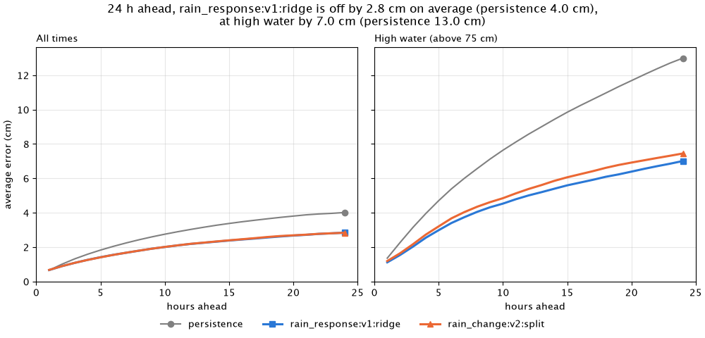
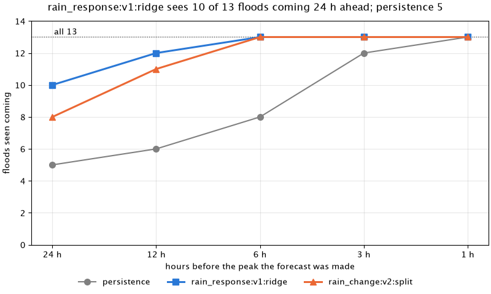
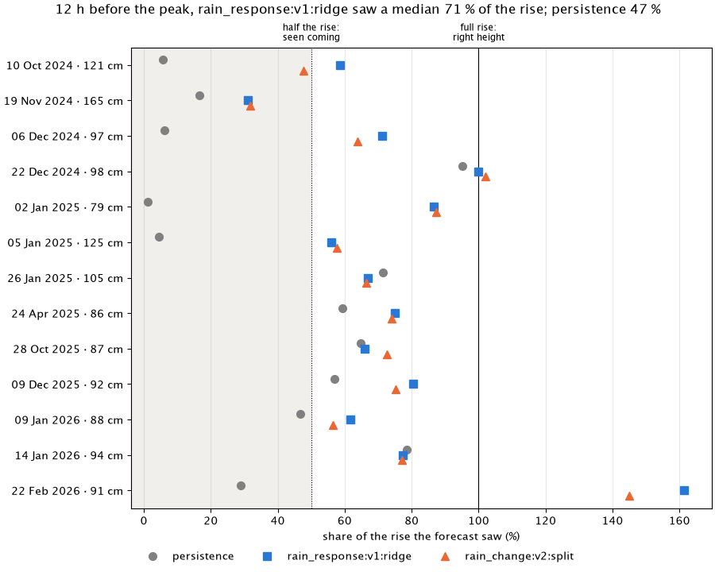

# Experiment log

Every scored run of the model evaluation gets one section here (docs/decisions/0008). The log
holds the runs of the current evaluation method only, so every section compares the same way.
Within a method it is append-only: earlier sections are never edited, and a later run that
changes a conclusion says so in its own section. When the method changes, the log starts
again with a fresh run; older runs stay in git history.

The method changed on 2026-10-15 (flood events from fast rises, flood forecasts per event).
The first run with it is [2026-10-15-flood-scores](#2026-10-15-flood-scores).

## How to read this

Each section starts with a short summary, the notes and one table with a row per model, then
the error plot; the detail tables are folded below it. The flood forecasts follow with their
summary table, two plots and one folded table per model. Each plot answers one question in its
title and has one line under it on how to read it. Plots show persistence (grey) and the two
best models by the selection rule; the tables show all models. Plots live in `plots/<run>/`.
The full rules are in [docs/evaluation.md](../../docs/evaluation.md).

- **MAE** ("average error" in the plots): mean absolute error of the forecast level in cm,
  pooled over the four test folds. "Mean MAE" averages the leads 1 to 24 hours. **Lead**: how
  many hours ahead the forecast looks.
- **Folds better than persistence:** in how many of the four test periods the model's mean
  MAE beats persistence. The selection rule asks for at least 3 of 4.
- **Skill:** 1 - MAE / MAE of persistence on the same rows. Persistence is 0; above 0 is
  better than holding the last level.
- **High water:** issue times where the cleaned level is above `evaluation.high_water_cm`
  (75 cm) at the issue time or at the target. Every score uses only the cleaned Kupferdreh
  series, never the raw one.
- **Flood forecasts:** for each of the 13 flood events and each lead of 24, 12, 6, 3 and 1
  hours before the peak, the forecast issued then. **Size** is the share of the rise from the
  pre-event level it saw, **timing** how many hours its peak was off, and **predicted** means
  it saw more than half the rise.
- **False alarm:** a forecast that shows a new event while none is running or starts within
  24 hours. A run of such forecasts counts once; the rate is per test month.

## Adding a run

With a frozen dataset `eval.parquet` and a run folder named after the date and what it tries,
from the repo root:

```
uv run --group analysis python -m pegel.evaluation.predict <eval.parquet> --out <runs>/<run> [--models a,b]
uv run --group analysis python -m pegel.evaluation.score <runs>/<run>/predictions.parquet <eval.parquet> --out <runs>/<run>
uv run --group analysis python -m pegel.evaluation.report <runs>/<run> --notes "what was tried, what we learned"
```

The last command writes the plots and appends the section. Commit both.

## 2026-10-15-flood-scores

Lowest mean MAE over leads 1-24 h: rain_change:v2:split and ridge:change:v2 over all issue times (2.1 cm; persistence 2.8 cm), ridge:change:v2 at high water (4.8 cm; persistence 8.3 cm).

Events predicted: ridge:change:v2 13 of 13 at 6 h, 9 of 13 at 24 h; persistence 8 of 13 at 6 h, 5 of 13 at 24 h.

**Notes:** First run of the new evaluation method: 13 flood events from fast rises, each scored per event at 24, 12, 6, 3 and 1 hours before the peak, with only the 4 models left after retiring the rest. Both v2 models see 8 (rain_change:v2:split) and 9 (ridge:change:v2) of the 13 floods coming 24 hours ahead, persistence 5, at a mean MAE of 2.1 cm against 2.8. All four miss the 165 cm flood of 19 Nov 2024 a day ahead, because ICON-D2 badly underforecast its rain, and the v2 models overshoot the small February 2026 event 12 hours ahead (145 and 162 % of its rise); ridge:change:v2 has 3 false alarms, rain_change:v2:split 2.

| model | mean MAE all (cm) | mean MAE high water (cm) | MAE +24 h high water (cm) | skill +24 h high water | folds better than persistence |
|---|---|---|---|---|---|
| persistence | 2.8 | 8.3 | 13.0 | 0.00 | - |
| rain_change:v2:split | 2.1 | 5.1 | 7.4 | 0.43 | 4 of 4 |
| ridge:change:v2 | 2.1 | 4.8 | 7.1 | 0.46 | 4 of 4 |
| upstream | 2.7 | 7.8 | 12.8 | 0.02 | 4 of 4 |

The plots show persistence (grey) and up to 2 models that beat it by the selection rule; the tables show all models.


Each line is a model's average error, from 1 to 24 hours ahead; lower is better. Left all times, right only when the water is high.

<details>
<summary>MAE in cm per lead and subset, pooled over folds</summary>

Subset `all`:

| model | +1 h | +3 h | +6 h | +12 h | +24 h | mean 1-24 h | mean skill |
|---|---|---|---|---|---|---|---|
| persistence | 0.66 | 1.32 | 2.05 | 3.03 | 4.01 | 2.84 | 0.00 |
| rain_change:v2:split | 0.67 | 1.09 | 1.55 | 2.19 | 2.84 | 2.07 | 0.25 |
| ridge:change:v2 | 0.67 | 1.09 | 1.56 | 2.19 | 2.87 | 2.07 | 0.25 |
| upstream | 0.60 | 1.13 | 1.85 | 2.92 | 3.97 | 2.73 | 0.05 |

Subset `high_water`:

| model | +1 h | +3 h | +6 h | +12 h | +24 h | mean 1-24 h | mean skill |
|---|---|---|---|---|---|---|---|
| persistence | 1.36 | 3.15 | 5.39 | 8.57 | 12.99 | 8.25 | 0.00 |
| rain_change:v2:split | 1.19 | 2.17 | 3.68 | 5.38 | 7.45 | 5.10 | 0.36 |
| ridge:change:v2 | 1.13 | 2.12 | 3.57 | 5.11 | 7.07 | 4.83 | 0.39 |
| upstream | 1.14 | 2.25 | 4.55 | 8.11 | 12.79 | 7.78 | 0.09 |

</details>

<details>
<summary>Lag check</summary>

Shift in hours that best matches the forecast to the observed level on high water.

| model | shift at +6 h | shift at +12 h |
|---|---|---|
| persistence | 6 | 12 |
| rain_change:v2:split | 3 | 4 |
| ridge:change:v2 | 3 | 4 |
| upstream | 5 | 11 |

</details>

<details>
<summary>Run: commit and dataset</summary>

- Run: 2026-10-15, commit `5e1df8debeb1` (clean)
- Dataset sha256: `aca86a175c82e3eb89602d018bea7bba044b8755d085e05ec92032d2f367407f`
- Models: persistence, rain_change:v2:split, ridge:change:v2, upstream

</details>

### Flood forecasts

Per lead before the peak: events predicted (forecast saw more than half the rise) of events with a forecast, median size, median timing of the predicted ones.

| model | 24 h before | 12 h before | 6 h before | 3 h before | 1 h before | false alarms / month |
|---|---|---|---|---|---|---|
| persistence | 5 of 13 · 6 % · −23 h | 6 of 13 · 47 % · −11 h | 8 of 13 · 59 % · −5 h | 12 of 13 · 82 % · −2 h | 13 of 13 · 98 % · ±0 h | 0.00 |
| rain_change:v2:split | 8 of 13 · 66 % · −8 h | 11 of 13 · 73 % · +1 h | 13 of 13 · 80 % · +3 h | 13 of 13 · 103 % · +1 h | 13 of 13 · 108 % · +1 h | 0.11 |
| ridge:change:v2 | 9 of 13 · 66 % · −2 h | 12 of 13 · 70 % · ±0 h | 13 of 13 · 76 % · +2 h | 13 of 13 · 99 % · +1 h | 13 of 13 · 105 % · +1 h | 0.16 |
| upstream | 5 of 13 · 9 % · −19 h | 7 of 13 · 52 % · −7 h | 10 of 13 · 74 % · −2 h | 13 of 13 · 101 % · +2 h | 13 of 13 · 114 % · +4 h | 0.05 |


How many of the floods each model saw coming (its forecast showed more than half the rise), by how long before the peak the forecast was made; higher is better.


One row per flood. A dot is how much of the rise a model's forecast saw: right of the dotted line counts as seen coming, on the solid line is the right height.

Forecast replay: [replay.html](plots/2026-10-15-flood-scores/replay.html); 3 h vs 24 h timeline: [timeline.html](plots/2026-10-15-flood-scores/timeline.html).

<details>
<summary>Flood events: persistence</summary>

✓ predicted, ✗ not, — missing.

| event | peak (UTC) | peak cm | 24 h before | 12 h before | 6 h before | 3 h before | 1 h before |
|---|---|---|---|---|---|---|---|
| 1 | 2024-10-10 | 121 | ✗ 0 % −23 h | ✗ 6 % −11 h | ✗ 18 % −5 h | ✗ 47 % −2 h | ✓ 80 % ±0 h |
| 2 | 2024-11-19 | 165 | ✗ 16 % −23 h | ✗ 17 % −11 h | ✗ 46 % −5 h | ✓ 83 % −2 h | ✓ 96 % ±0 h |
| 3 | 2024-12-06 | 97 | ✗ 2 % −23 h | ✗ 6 % −11 h | ✗ 14 % −5 h | ✓ 54 % −2 h | ✓ 97 % ±0 h |
| 4 | 2024-12-22 | 98 | ✓ 56 % −23 h | ✓ 95 % −11 h | ✓ 84 % −5 h | ✓ 94 % −2 h | ✓ 97 % ±0 h |
| 5 | 2025-01-02 | 79 | ✗ 6 % −23 h | ✗ 1 % −11 h | ✗ 34 % −5 h | ✓ 79 % −2 h | ✓ 98 % ±0 h |
| 6 | 2025-01-05 | 125 | ✗ 0 % −23 h | ✗ 4 % −11 h | ✓ 53 % −5 h | ✓ 66 % −2 h | ✓ 94 % ±0 h |
| 7 | 2025-01-26 | 105 | ✓ 64 % −23 h | ✓ 72 % −11 h | ✓ 66 % −5 h | ✓ 79 % −2 h | ✓ 99 % ±0 h |
| 8 | 2025-04-24 | 86 | ✗ 4 % −23 h | ✓ 59 % −11 h | ✓ 76 % −5 h | ✓ 96 % −2 h | ✓ 99 % ±0 h |
| 9 | 2025-10-28 | 87 | ✓ 82 % −23 h | ✓ 65 % −11 h | ✓ 76 % −5 h | ✓ 82 % −2 h | ✓ 98 % ±0 h |
| 10 | 2025-12-09 | 92 | ✓ 78 % −23 h | ✓ 57 % −11 h | ✓ 81 % −5 h | ✓ 88 % −2 h | ✓ 98 % ±0 h |
| 11 | 2026-01-09 | 88 | ✗ 0 % −23 h | ✗ 47 % −11 h | ✓ 59 % −5 h | ✓ 85 % −2 h | ✓ 99 % ±0 h |
| 12 | 2026-01-14 | 94 | ✓ 73 % −23 h | ✓ 79 % −11 h | ✓ 75 % −5 h | ✓ 85 % −2 h | ✓ 98 % ±0 h |
| 13 | 2026-02-22 | 91 | ✗ 4 % −23 h | ✗ 29 % −11 h | ✗ 29 % −5 h | ✓ 62 % −2 h | ✓ 97 % ±0 h |

</details>

<details>
<summary>Flood events: rain_change:v2:split</summary>

✓ predicted, ✗ not, — missing.

| event | peak (UTC) | peak cm | 24 h before | 12 h before | 6 h before | 3 h before | 1 h before |
|---|---|---|---|---|---|---|---|
| 1 | 2024-10-10 | 121 | ✗ 36 % ±0 h | ✗ 48 % +7 h | ✓ 58 % +7 h | ✓ 72 % +6 h | ✓ 108 % +1 h |
| 2 | 2024-11-19 | 165 | ✗ 26 % −6 h | ✗ 32 % −6 h | ✓ 80 % −4 h | ✓ 91 % −1 h | ✓ 97 % ±0 h |
| 3 | 2024-12-06 | 97 | ✗ 46 % −2 h | ✓ 64 % +9 h | ✓ 55 % +4 h | ✓ 95 % +1 h | ✓ 127 % +1 h |
| 4 | 2024-12-22 | 98 | ✓ 73 % −2 h | ✓ 102 % +2 h | ✓ 90 % +1 h | ✓ 105 % +1 h | ✓ 114 % +2 h |
| 5 | 2025-01-02 | 79 | ✓ 85 % ±0 h | ✓ 87 % +1 h | ✓ 93 % ±0 h | ✓ 133 % +1 h | ✓ 116 % +1 h |
| 6 | 2025-01-05 | 125 | ✓ 53 % ±0 h | ✓ 58 % +6 h | ✓ 72 % +6 h | ✓ 88 % +2 h | ✓ 117 % +1 h |
| 7 | 2025-01-26 | 105 | ✓ 86 % −15 h | ✓ 67 % −11 h | ✓ 68 % +5 h | ✓ 93 % +1 h | ✓ 114 % +1 h |
| 8 | 2025-04-24 | 86 | ✗ 46 % −1 h | ✓ 74 % −1 h | ✓ 83 % −3 h | ✓ 109 % −1 h | ✓ 102 % ±0 h |
| 9 | 2025-10-28 | 87 | ✓ 78 % −23 h | ✓ 73 % −7 h | ✓ 76 % −5 h | ✓ 89 % −1 h | ✓ 98 % ±0 h |
| 10 | 2025-12-09 | 92 | ✓ 69 % −23 h | ✓ 75 % −3 h | ✓ 87 % −3 h | ✓ 103 % +1 h | ✓ 100 % ±0 h |
| 11 | 2026-01-09 | 88 | ✗ 39 % ±0 h | ✓ 57 % +6 h | ✓ 71 % +3 h | ✓ 104 % ±0 h | ✓ 102 % ±0 h |
| 12 | 2026-01-14 | 94 | ✓ 66 % −23 h | ✓ 77 % −11 h | ✓ 99 % +4 h | ✓ 103 % +2 h | ✓ 101 % +1 h |
| 13 | 2026-02-22 | 91 | ✓ 103 % ±0 h | ✓ 145 % +2 h | ✓ 145 % +4 h | ✓ 111 % +2 h | ✓ 115 % +1 h |

</details>

<details>
<summary>Flood events: ridge:change:v2</summary>

✓ predicted, ✗ not, — missing.

| event | peak (UTC) | peak cm | 24 h before | 12 h before | 6 h before | 3 h before | 1 h before |
|---|---|---|---|---|---|---|---|
| 1 | 2024-10-10 | 121 | ✗ 42 % ±0 h | ✓ 59 % +7 h | ✓ 63 % +7 h | ✓ 73 % +6 h | ✓ 105 % +1 h |
| 2 | 2024-11-19 | 165 | ✗ 26 % −6 h | ✗ 31 % −5 h | ✓ 76 % −4 h | ✓ 87 % −2 h | ✓ 96 % ±0 h |
| 3 | 2024-12-06 | 97 | ✗ 49 % −2 h | ✓ 69 % +4 h | ✓ 56 % +9 h | ✓ 99 % ±0 h | ✓ 127 % +1 h |
| 4 | 2024-12-22 | 98 | ✓ 66 % −2 h | ✓ 99 % −11 h | ✓ 87 % +1 h | ✓ 106 % +1 h | ✓ 114 % +2 h |
| 5 | 2025-01-02 | 79 | ✓ 90 % ±0 h | ✓ 81 % +1 h | ✓ 88 % −1 h | ✓ 124 % +1 h | ✓ 113 % +1 h |
| 6 | 2025-01-05 | 125 | ✓ 54 % ±0 h | ✓ 55 % +3 h | ✓ 69 % +6 h | ✓ 84 % ±0 h | ✓ 114 % +1 h |
| 7 | 2025-01-26 | 105 | ✓ 78 % −15 h | ✓ 67 % −11 h | ✓ 68 % +5 h | ✓ 95 % +1 h | ✓ 115 % +2 h |
| 8 | 2025-04-24 | 86 | ✓ 54 % −1 h | ✓ 74 % −1 h | ✓ 83 % −3 h | ✓ 106 % −1 h | ✓ 101 % ±0 h |
| 9 | 2025-10-28 | 87 | ✓ 79 % −23 h | ✓ 70 % −6 h | ✓ 76 % −5 h | ✓ 89 % −1 h | ✓ 98 % ±0 h |
| 10 | 2025-12-09 | 92 | ✓ 69 % −23 h | ✓ 75 % −3 h | ✓ 88 % −3 h | ✓ 99 % +2 h | ✓ 99 % ±0 h |
| 11 | 2026-01-09 | 88 | ✗ 38 % ±0 h | ✓ 60 % +4 h | ✓ 72 % +3 h | ✓ 103 % ±0 h | ✓ 102 % ±0 h |
| 12 | 2026-01-14 | 94 | ✓ 69 % −23 h | ✓ 77 % −11 h | ✓ 94 % +3 h | ✓ 100 % +2 h | ✓ 101 % ±0 h |
| 13 | 2026-02-22 | 91 | ✓ 119 % ±0 h | ✓ 162 % +2 h | ✓ 140 % +2 h | ✓ 105 % +3 h | ✓ 114 % +1 h |

</details>

<details>
<summary>Flood events: upstream</summary>

✓ predicted, ✗ not, — missing.

| event | peak (UTC) | peak cm | 24 h before | 12 h before | 6 h before | 3 h before | 1 h before |
|---|---|---|---|---|---|---|---|
| 1 | 2024-10-10 | 121 | ✗ 0 % −19 h | ✗ 6 % −11 h | ✗ 25 % −3 h | ✓ 76 % +1 h | ✓ 123 % +3 h |
| 2 | 2024-11-19 | 165 | ✗ 16 % ±0 h | ✗ 20 % −9 h | ✓ 92 % −2 h | ✓ 102 % +1 h | ✓ 105 % +2 h |
| 3 | 2024-12-06 | 97 | ✗ 2 % −3 h | ✗ 7 % −8 h | ✗ 17 % −3 h | ✓ 100 % +1 h | ✓ 151 % +3 h |
| 4 | 2024-12-22 | 98 | ✓ 55 % ±0 h | ✓ 106 % −8 h | ✓ 84 % −5 h | ✓ 101 % +1 h | ✓ 115 % +3 h |
| 5 | 2025-01-02 | 79 | ✗ 6 % ±0 h | ✗ 1 % −11 h | ✓ 58 % −2 h | ✓ 118 % +2 h | ✓ 114 % +4 h |
| 6 | 2025-01-05 | 125 | ✗ 0 % ±0 h | ✗ 7 % −8 h | ✓ 74 % −1 h | ✓ 86 % +2 h | ✓ 133 % +4 h |
| 7 | 2025-01-26 | 105 | ✓ 76 % −19 h | ✓ 70 % −11 h | ✓ 66 % −5 h | ✓ 91 % +2 h | ✓ 126 % +4 h |
| 8 | 2025-04-24 | 86 | ✗ 6 % −19 h | ✓ 74 % −7 h | ✓ 87 % −1 h | ✓ 112 % +2 h | ✓ 105 % +4 h |
| 9 | 2025-10-28 | 87 | ✓ 81 % −23 h | ✓ 67 % −6 h | ✓ 79 % −1 h | ✓ 96 % +2 h | ✓ 111 % +4 h |
| 10 | 2025-12-09 | 92 | ✓ 72 % −23 h | ✓ 60 % −7 h | ✓ 93 % −1 h | ✓ 104 % +2 h | ✓ 107 % +4 h |
| 11 | 2026-01-09 | 88 | ✗ 0 % −19 h | ✓ 52 % −7 h | ✓ 68 % −1 h | ✓ 111 % +2 h | ✓ 111 % +4 h |
| 12 | 2026-01-14 | 94 | ✓ 75 % −19 h | ✓ 77 % −11 h | ✓ 75 % −5 h | ✓ 101 % +2 h | ✓ 112 % +4 h |
| 13 | 2026-02-22 | 91 | ✗ 9 % −19 h | ✗ 28 % −11 h | ✗ 38 % −1 h | ✓ 105 % +2 h | ✓ 138 % +4 h |

</details>

## 2026-10-15-rain-response

Lowest mean MAE over leads 1-24 h: rain_response:v1:ridge, rain_change:v2:split and ridge:change:v2 over all issue times (2.1 cm; persistence 2.8 cm), rain_response:v1:ridge at high water (4.7 cm; persistence 8.3 cm).

Events predicted: rain_response:v1:ridge 13 of 13 at 6 h, 10 of 13 at 24 h; persistence 8 of 13 at 6 h, 5 of 13 at 24 h.

**Notes:** Idea 1: a two-store unit hydrograph fitted per fold on radar-only rain episodes turns the last 168 h of radar and the ICON-D2 hours ahead into a level change per lead. The offset variant adds the radar response at the fitted gain and fits ridge:change:v2's other inputs on the rest; the ridge variant gives both responses to the ridge in place of the radar and ICON sums. The ridge variant, the one the inner splits pick, ties ridge:change:v2 over all issue times (2.06 against 2.07 cm, better or level in all four folds) and is a little better at high water (4.7 against 4.8 cm), but the floods of 120 cm or more get only 0 to 3 points more of their rise a day ahead and their peaks stay 5 to 7 h late. The offset variant loses in all four folds and raises 6 false alarms. The hypothesis that the hydrograph sees big floods at their true size is ruled out.

| model | mean MAE all (cm) | mean MAE high water (cm) | MAE +24 h high water (cm) | skill +24 h high water | folds better than persistence |
|---|---|---|---|---|---|
| persistence | 2.8 | 8.3 | 13.0 | 0.00 | - |
| rain_change:v2:split | 2.1 | 5.1 | 7.4 | 0.43 | 4 of 4 |
| rain_response:v1:offset | 2.2 | 5.1 | 7.6 | 0.42 | 4 of 4 |
| rain_response:v1:ridge | 2.1 | 4.7 | 7.0 | 0.46 | 4 of 4 |
| ridge:change:v2 | 2.1 | 4.8 | 7.1 | 0.46 | 4 of 4 |

**Fitted hydrograph per fold.** A routing store feeding a fast and a slow store, fitted on the
training rows with at least 1 mm of radar in the last day and at most 0.6 mm in the next three
(373 to 889 rows); the level change over the next 72 hours is the target. Fitting on the 24 h
change alone sent the slow store's time constant to the edge of any grid: over a day a slow
store looks like a step.

| fold | fast cm/mm | slow cm/mm | fast store | slow store | routing | peak cm/mm, after | left 24 h after peak |
|---|---|---|---|---|---|---|---|
| F1 | 2.90 | 0.96 | 6 h | 144 h | 3 h | 2.18, 5.0 h | 39 % |
| F2 | 2.80 | 0.97 | 6 h | 144 h | 3 h | 2.15, 5.0 h | 40 % |
| F3 | 2.66 | 0.76 | 6 h | 96 h | 3 h | 1.91, 4.75 h | 33 % |
| F4 | 2.63 | 0.90 | 4 h | 96 h | 3 h | 1.75, 4.25 h | 40 % |

Against the analysis: the peak comes 4 to 5 h after an impulse (episodes: 6 h after the rain
peak), the fast store matches (4 to 6 h against 6 h), the slow one is slower (96 to 144 h
against 71 h) and smaller (a quarter of the gain against 71 %). The peak response of 1.75 to
2.2 cm per mm of an impulse is above the 1.47 cm/mm per episode, which spreads its rain over
hours while the fast store drains.

**Inner split** (older 80 % of each fold's training rows, 24 h gap, newest 20 %), mean MAE over
leads 1-24 h, mean of the four folds: `rain_response:v1:ridge` 2.39 cm all, 8.47 high water;
`rain_response:v1:offset` 2.57 and 8.54; `ridge:change:v2` 2.41 and 8.45. It picks the ridge
variant.

**How the ridge uses the responses** (coefficients on the response, rising rows / other rows):
ICON 0.34 to 0.58 at +6 h and +24 h in every fold, radar 0.23 to 0.54 at +6 h but −0.13 to 0.10
at +24 h. At the radar gain the fitted hydrograph overshoots: the offset variant is biased
+0.43 cm at +24 h over all issue times.

**Kill criteria.** Offset variant: ruled out (loses to `ridge:change:v2` in all four folds,
0.33 false alarms per month). Ridge variant: mean MAE better in F1 to F3, level in F4
(1.770 cm both); 0.16 false alarms per month, as `ridge:change:v2`; but events 1, 2 and 6
(121, 165, 125 cm) get 45, 27 and 54 % of their rise 24 h ahead against 42, 26 and 54 %, and
their peaks stay 5 to 7 h late at 6 and 12 h. That is no real gain, so the hypothesis is
ruled out. Event 13 overshoots more a day ahead (129 against 119 %). High-water bias at +24 h:
−3.8 cm, as before.

The plots show persistence (grey) and up to 2 models that beat it by the selection rule; the tables show all models.



Each line is a model's average error, from 1 to 24 hours ahead; lower is better. Left all times, right only when the water is high.

<details>
<summary>MAE in cm per lead and subset, pooled over folds</summary>

Subset `all`:

| model | +1 h | +3 h | +6 h | +12 h | +24 h | mean 1-24 h | mean skill |
|---|---|---|---|---|---|---|---|
| persistence | 0.66 | 1.32 | 2.05 | 3.03 | 4.01 | 2.84 | 0.00 |
| rain_change:v2:split | 0.67 | 1.09 | 1.55 | 2.19 | 2.84 | 2.07 | 0.25 |
| rain_response:v1:offset | 0.67 | 1.10 | 1.63 | 2.37 | 3.15 | 2.23 | 0.20 |
| rain_response:v1:ridge | 0.67 | 1.09 | 1.55 | 2.19 | 2.84 | 2.06 | 0.25 |
| ridge:change:v2 | 0.67 | 1.09 | 1.56 | 2.19 | 2.87 | 2.07 | 0.25 |

Subset `high_water`:

| model | +1 h | +3 h | +6 h | +12 h | +24 h | mean 1-24 h | mean skill |
|---|---|---|---|---|---|---|---|
| persistence | 1.36 | 3.15 | 5.39 | 8.57 | 12.99 | 8.25 | 0.00 |
| rain_change:v2:split | 1.19 | 2.17 | 3.68 | 5.38 | 7.45 | 5.10 | 0.36 |
| rain_response:v1:offset | 1.11 | 2.01 | 3.47 | 5.42 | 7.58 | 5.06 | 0.37 |
| rain_response:v1:ridge | 1.12 | 2.03 | 3.41 | 5.01 | 7.01 | 4.74 | 0.40 |
| ridge:change:v2 | 1.13 | 2.12 | 3.57 | 5.11 | 7.07 | 4.83 | 0.39 |

</details>

<details>
<summary>Lag check</summary>

Shift in hours that best matches the forecast to the observed level on high water.

| model | shift at +6 h | shift at +12 h |
|---|---|---|
| persistence | 6 | 12 |
| rain_change:v2:split | 3 | 4 |
| rain_response:v1:offset | 3 | 5 |
| rain_response:v1:ridge | 3 | 4 |
| ridge:change:v2 | 3 | 4 |

</details>

<details>
<summary>Run: commit and dataset</summary>

- Run: 2026-10-15, commit `e9a8f7c8a730` (clean)
- Dataset sha256: `aca86a175c82e3eb89602d018bea7bba044b8755d085e05ec92032d2f367407f`
- Models: persistence, rain_change:v2:split, rain_response:v1:offset, rain_response:v1:ridge, ridge:change:v2

</details>

### Flood forecasts

Per lead before the peak: events predicted (forecast saw more than half the rise) of events with a forecast, median size, median timing of the predicted ones.

| model | 24 h before | 12 h before | 6 h before | 3 h before | 1 h before | false alarms / month |
|---|---|---|---|---|---|---|
| persistence | 5 of 13 · 6 % · −23 h | 6 of 13 · 47 % · −11 h | 8 of 13 · 59 % · −5 h | 12 of 13 · 82 % · −2 h | 13 of 13 · 98 % · ±0 h | 0.00 |
| rain_change:v2:split | 8 of 13 · 66 % · −8 h | 11 of 13 · 73 % · +1 h | 13 of 13 · 80 % · +3 h | 13 of 13 · 103 % · +1 h | 13 of 13 · 108 % · +1 h | 0.11 |
| rain_response:v1:offset | 9 of 13 · 72 % · ±0 h | 12 of 13 · 71 % · +2 h | 13 of 13 · 83 % · +3 h | 13 of 13 · 104 % · ±0 h | 13 of 13 · 107 % · +1 h | 0.33 |
| rain_response:v1:ridge | 10 of 13 · 65 % · −2 h | 12 of 13 · 71 % · ±0 h | 13 of 13 · 78 % · −1 h | 13 of 13 · 102 % · ±0 h | 13 of 13 · 107 % · +1 h | 0.16 |
| ridge:change:v2 | 9 of 13 · 66 % · −2 h | 12 of 13 · 70 % · ±0 h | 13 of 13 · 76 % · +2 h | 13 of 13 · 99 % · +1 h | 13 of 13 · 105 % · +1 h | 0.16 |



How many of the floods each model saw coming (its forecast showed more than half the rise), by how long before the peak the forecast was made; higher is better.



One row per flood. A dot is how much of the rise a model's forecast saw: right of the dotted line counts as seen coming, on the solid line is the right height.

<details>
<summary>Flood events: persistence</summary>

✓ predicted, ✗ not, — missing.

| event | peak (UTC) | peak cm | 24 h before | 12 h before | 6 h before | 3 h before | 1 h before |
|---|---|---|---|---|---|---|---|
| 1 | 2024-10-10 | 121 | ✗ 0 % −23 h | ✗ 6 % −11 h | ✗ 18 % −5 h | ✗ 47 % −2 h | ✓ 80 % ±0 h |
| 2 | 2024-11-19 | 165 | ✗ 16 % −23 h | ✗ 17 % −11 h | ✗ 46 % −5 h | ✓ 83 % −2 h | ✓ 96 % ±0 h |
| 3 | 2024-12-06 | 97 | ✗ 2 % −23 h | ✗ 6 % −11 h | ✗ 14 % −5 h | ✓ 54 % −2 h | ✓ 97 % ±0 h |
| 4 | 2024-12-22 | 98 | ✓ 56 % −23 h | ✓ 95 % −11 h | ✓ 84 % −5 h | ✓ 94 % −2 h | ✓ 97 % ±0 h |
| 5 | 2025-01-02 | 79 | ✗ 6 % −23 h | ✗ 1 % −11 h | ✗ 34 % −5 h | ✓ 79 % −2 h | ✓ 98 % ±0 h |
| 6 | 2025-01-05 | 125 | ✗ 0 % −23 h | ✗ 4 % −11 h | ✓ 53 % −5 h | ✓ 66 % −2 h | ✓ 94 % ±0 h |
| 7 | 2025-01-26 | 105 | ✓ 64 % −23 h | ✓ 72 % −11 h | ✓ 66 % −5 h | ✓ 79 % −2 h | ✓ 99 % ±0 h |
| 8 | 2025-04-24 | 86 | ✗ 4 % −23 h | ✓ 59 % −11 h | ✓ 76 % −5 h | ✓ 96 % −2 h | ✓ 99 % ±0 h |
| 9 | 2025-10-28 | 87 | ✓ 82 % −23 h | ✓ 65 % −11 h | ✓ 76 % −5 h | ✓ 82 % −2 h | ✓ 98 % ±0 h |
| 10 | 2025-12-09 | 92 | ✓ 78 % −23 h | ✓ 57 % −11 h | ✓ 81 % −5 h | ✓ 88 % −2 h | ✓ 98 % ±0 h |
| 11 | 2026-01-09 | 88 | ✗ 0 % −23 h | ✗ 47 % −11 h | ✓ 59 % −5 h | ✓ 85 % −2 h | ✓ 99 % ±0 h |
| 12 | 2026-01-14 | 94 | ✓ 73 % −23 h | ✓ 79 % −11 h | ✓ 75 % −5 h | ✓ 85 % −2 h | ✓ 98 % ±0 h |
| 13 | 2026-02-22 | 91 | ✗ 4 % −23 h | ✗ 29 % −11 h | ✗ 29 % −5 h | ✓ 62 % −2 h | ✓ 97 % ±0 h |

</details>

<details>
<summary>Flood events: rain_change:v2:split</summary>

✓ predicted, ✗ not, — missing.

| event | peak (UTC) | peak cm | 24 h before | 12 h before | 6 h before | 3 h before | 1 h before |
|---|---|---|---|---|---|---|---|
| 1 | 2024-10-10 | 121 | ✗ 36 % ±0 h | ✗ 48 % +7 h | ✓ 58 % +7 h | ✓ 72 % +6 h | ✓ 108 % +1 h |
| 2 | 2024-11-19 | 165 | ✗ 26 % −6 h | ✗ 32 % −6 h | ✓ 80 % −4 h | ✓ 91 % −1 h | ✓ 97 % ±0 h |
| 3 | 2024-12-06 | 97 | ✗ 46 % −2 h | ✓ 64 % +9 h | ✓ 55 % +4 h | ✓ 95 % +1 h | ✓ 127 % +1 h |
| 4 | 2024-12-22 | 98 | ✓ 73 % −2 h | ✓ 102 % +2 h | ✓ 90 % +1 h | ✓ 105 % +1 h | ✓ 114 % +2 h |
| 5 | 2025-01-02 | 79 | ✓ 85 % ±0 h | ✓ 87 % +1 h | ✓ 93 % ±0 h | ✓ 133 % +1 h | ✓ 116 % +1 h |
| 6 | 2025-01-05 | 125 | ✓ 53 % ±0 h | ✓ 58 % +6 h | ✓ 72 % +6 h | ✓ 88 % +2 h | ✓ 117 % +1 h |
| 7 | 2025-01-26 | 105 | ✓ 86 % −15 h | ✓ 67 % −11 h | ✓ 68 % +5 h | ✓ 93 % +1 h | ✓ 114 % +1 h |
| 8 | 2025-04-24 | 86 | ✗ 46 % −1 h | ✓ 74 % −1 h | ✓ 83 % −3 h | ✓ 109 % −1 h | ✓ 102 % ±0 h |
| 9 | 2025-10-28 | 87 | ✓ 78 % −23 h | ✓ 73 % −7 h | ✓ 76 % −5 h | ✓ 89 % −1 h | ✓ 98 % ±0 h |
| 10 | 2025-12-09 | 92 | ✓ 69 % −23 h | ✓ 75 % −3 h | ✓ 87 % −3 h | ✓ 103 % +1 h | ✓ 100 % ±0 h |
| 11 | 2026-01-09 | 88 | ✗ 39 % ±0 h | ✓ 57 % +6 h | ✓ 71 % +3 h | ✓ 104 % ±0 h | ✓ 102 % ±0 h |
| 12 | 2026-01-14 | 94 | ✓ 66 % −23 h | ✓ 77 % −11 h | ✓ 99 % +4 h | ✓ 103 % +2 h | ✓ 101 % +1 h |
| 13 | 2026-02-22 | 91 | ✓ 103 % ±0 h | ✓ 145 % +2 h | ✓ 145 % +4 h | ✓ 111 % +2 h | ✓ 115 % +1 h |

</details>

<details>
<summary>Flood events: rain_response:v1:offset</summary>

✓ predicted, ✗ not, — missing.

| event | peak (UTC) | peak cm | 24 h before | 12 h before | 6 h before | 3 h before | 1 h before |
|---|---|---|---|---|---|---|---|
| 1 | 2024-10-10 | 121 | ✗ 43 % ±0 h | ✓ 55 % +7 h | ✓ 60 % +6 h | ✓ 79 % +6 h | ✓ 108 % +1 h |
| 2 | 2024-11-19 | 165 | ✗ 25 % −6 h | ✗ 32 % −5 h | ✓ 77 % −4 h | ✓ 90 % −1 h | ✓ 97 % ±0 h |
| 3 | 2024-12-06 | 97 | ✓ 54 % ±0 h | ✓ 68 % +4 h | ✓ 56 % +8 h | ✓ 105 % ±0 h | ✓ 126 % +1 h |
| 4 | 2024-12-22 | 98 | ✓ 72 % ±0 h | ✓ 107 % +2 h | ✓ 88 % +1 h | ✓ 108 % ±0 h | ✓ 111 % +1 h |
| 5 | 2025-01-02 | 79 | ✓ 100 % ±0 h | ✓ 86 % ±0 h | ✓ 85 % −1 h | ✓ 119 % ±0 h | ✓ 107 % ±0 h |
| 6 | 2025-01-05 | 125 | ✓ 50 % ±0 h | ✓ 54 % +5 h | ✓ 68 % +6 h | ✓ 84 % ±0 h | ✓ 113 % +1 h |
| 7 | 2025-01-26 | 105 | ✓ 81 % −15 h | ✓ 67 % −11 h | ✓ 69 % +5 h | ✓ 95 % +1 h | ✓ 115 % +3 h |
| 8 | 2025-04-24 | 86 | ✗ 44 % −1 h | ✓ 73 % −1 h | ✓ 83 % −3 h | ✓ 106 % −1 h | ✓ 101 % ±0 h |
| 9 | 2025-10-28 | 87 | ✓ 79 % −23 h | ✓ 68 % −8 h | ✓ 74 % −5 h | ✓ 88 % +1 h | ✓ 100 % +1 h |
| 10 | 2025-12-09 | 92 | ✓ 75 % −5 h | ✓ 85 % −3 h | ✓ 89 % −3 h | ✓ 102 % +2 h | ✓ 99 % ±0 h |
| 11 | 2026-01-09 | 88 | ✗ 41 % ±0 h | ✓ 71 % +5 h | ✓ 85 % +5 h | ✓ 108 % ±0 h | ✓ 103 % ±0 h |
| 12 | 2026-01-14 | 94 | ✓ 80 % ±0 h | ✓ 83 % +1 h | ✓ 105 % +4 h | ✓ 104 % +2 h | ✓ 102 % +1 h |
| 13 | 2026-02-22 | 91 | ✓ 139 % ±0 h | ✓ 167 % +2 h | ✓ 145 % +3 h | ✓ 117 % +3 h | ✓ 118 % +3 h |

</details>

<details>
<summary>Flood events: rain_response:v1:ridge</summary>

✓ predicted, ✗ not, — missing.

| event | peak (UTC) | peak cm | 24 h before | 12 h before | 6 h before | 3 h before | 1 h before |
|---|---|---|---|---|---|---|---|
| 1 | 2024-10-10 | 121 | ✗ 45 % ±0 h | ✓ 59 % +7 h | ✓ 63 % +6 h | ✓ 79 % +5 h | ✓ 109 % +1 h |
| 2 | 2024-11-19 | 165 | ✗ 27 % −6 h | ✗ 31 % −5 h | ✓ 78 % −4 h | ✓ 90 % −1 h | ✓ 97 % ±0 h |
| 3 | 2024-12-06 | 97 | ✓ 53 % ±0 h | ✓ 71 % +4 h | ✓ 56 % +8 h | ✓ 104 % ±0 h | ✓ 129 % +1 h |
| 4 | 2024-12-22 | 98 | ✓ 65 % −3 h | ✓ 100 % −11 h | ✓ 83 % −5 h | ✓ 106 % ±0 h | ✓ 111 % +1 h |
| 5 | 2025-01-02 | 79 | ✓ 97 % ±0 h | ✓ 87 % ±0 h | ✓ 84 % −1 h | ✓ 117 % ±0 h | ✓ 107 % ±0 h |
| 6 | 2025-01-05 | 125 | ✓ 54 % ±0 h | ✓ 56 % +5 h | ✓ 69 % +6 h | ✓ 84 % ±0 h | ✓ 114 % +1 h |
| 7 | 2025-01-26 | 105 | ✓ 80 % −15 h | ✓ 67 % −11 h | ✓ 68 % +5 h | ✓ 94 % +1 h | ✓ 116 % +3 h |
| 8 | 2025-04-24 | 86 | ✓ 55 % −1 h | ✓ 75 % −1 h | ✓ 83 % −3 h | ✓ 106 % −1 h | ✓ 101 % ±0 h |
| 9 | 2025-10-28 | 87 | ✓ 79 % −23 h | ✓ 66 % −11 h | ✓ 75 % −5 h | ✓ 89 % +1 h | ✓ 100 % +1 h |
| 10 | 2025-12-09 | 92 | ✓ 71 % −5 h | ✓ 80 % −4 h | ✓ 88 % −3 h | ✓ 101 % +1 h | ✓ 99 % ±0 h |
| 11 | 2026-01-09 | 88 | ✗ 41 % ±0 h | ✓ 62 % +4 h | ✓ 74 % −2 h | ✓ 106 % ±0 h | ✓ 103 % ±0 h |
| 12 | 2026-01-14 | 94 | ✓ 73 % −21 h | ✓ 77 % −11 h | ✓ 94 % +1 h | ✓ 102 % +1 h | ✓ 102 % +1 h |
| 13 | 2026-02-22 | 91 | ✓ 129 % ±0 h | ✓ 161 % +2 h | ✓ 142 % +2 h | ✓ 113 % +3 h | ✓ 119 % +3 h |

</details>

<details>
<summary>Flood events: ridge:change:v2</summary>

✓ predicted, ✗ not, — missing.

| event | peak (UTC) | peak cm | 24 h before | 12 h before | 6 h before | 3 h before | 1 h before |
|---|---|---|---|---|---|---|---|
| 1 | 2024-10-10 | 121 | ✗ 42 % ±0 h | ✓ 59 % +7 h | ✓ 63 % +7 h | ✓ 73 % +6 h | ✓ 105 % +1 h |
| 2 | 2024-11-19 | 165 | ✗ 26 % −6 h | ✗ 31 % −5 h | ✓ 76 % −4 h | ✓ 87 % −2 h | ✓ 96 % ±0 h |
| 3 | 2024-12-06 | 97 | ✗ 49 % −2 h | ✓ 69 % +4 h | ✓ 56 % +9 h | ✓ 99 % ±0 h | ✓ 127 % +1 h |
| 4 | 2024-12-22 | 98 | ✓ 66 % −2 h | ✓ 99 % −11 h | ✓ 87 % +1 h | ✓ 106 % +1 h | ✓ 114 % +2 h |
| 5 | 2025-01-02 | 79 | ✓ 90 % ±0 h | ✓ 81 % +1 h | ✓ 88 % −1 h | ✓ 124 % +1 h | ✓ 113 % +1 h |
| 6 | 2025-01-05 | 125 | ✓ 54 % ±0 h | ✓ 55 % +3 h | ✓ 69 % +6 h | ✓ 84 % ±0 h | ✓ 114 % +1 h |
| 7 | 2025-01-26 | 105 | ✓ 78 % −15 h | ✓ 67 % −11 h | ✓ 68 % +5 h | ✓ 95 % +1 h | ✓ 115 % +2 h |
| 8 | 2025-04-24 | 86 | ✓ 54 % −1 h | ✓ 74 % −1 h | ✓ 83 % −3 h | ✓ 106 % −1 h | ✓ 101 % ±0 h |
| 9 | 2025-10-28 | 87 | ✓ 79 % −23 h | ✓ 70 % −6 h | ✓ 76 % −5 h | ✓ 89 % −1 h | ✓ 98 % ±0 h |
| 10 | 2025-12-09 | 92 | ✓ 69 % −23 h | ✓ 75 % −3 h | ✓ 88 % −3 h | ✓ 99 % +2 h | ✓ 99 % ±0 h |
| 11 | 2026-01-09 | 88 | ✗ 38 % ±0 h | ✓ 60 % +4 h | ✓ 72 % +3 h | ✓ 103 % ±0 h | ✓ 102 % ±0 h |
| 12 | 2026-01-14 | 94 | ✓ 69 % −23 h | ✓ 77 % −11 h | ✓ 94 % +3 h | ✓ 100 % +2 h | ✓ 101 % ±0 h |
| 13 | 2026-02-22 | 91 | ✓ 119 % ±0 h | ✓ 162 % +2 h | ✓ 140 % +2 h | ✓ 105 % +3 h | ✓ 114 % +1 h |

</details>
