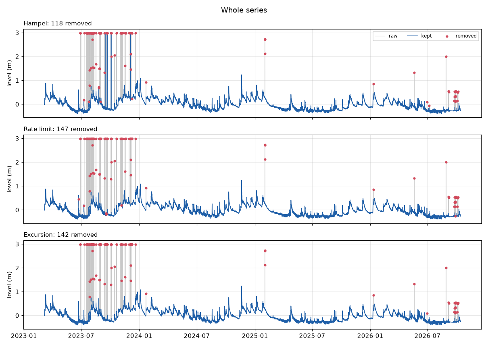
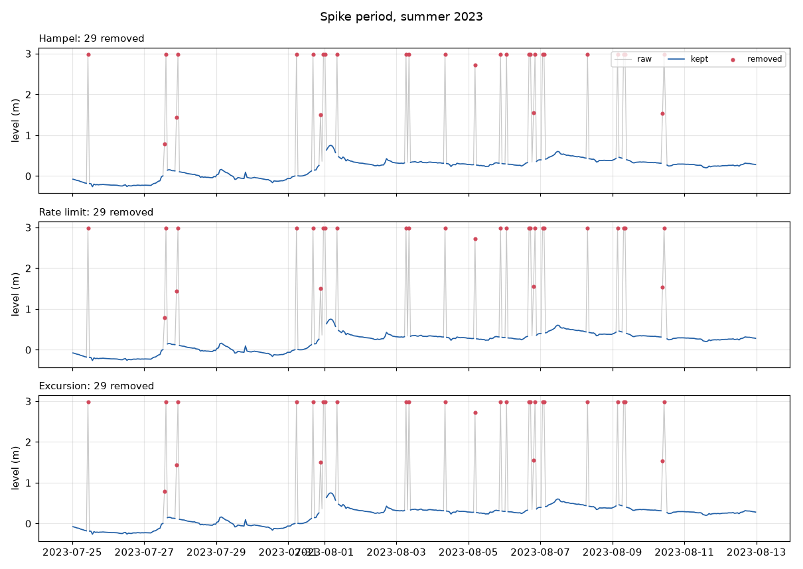
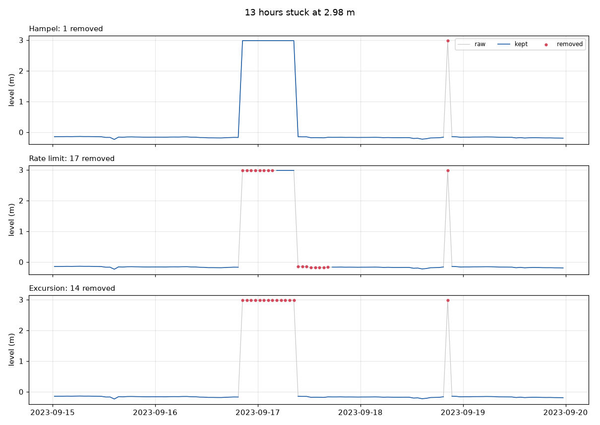
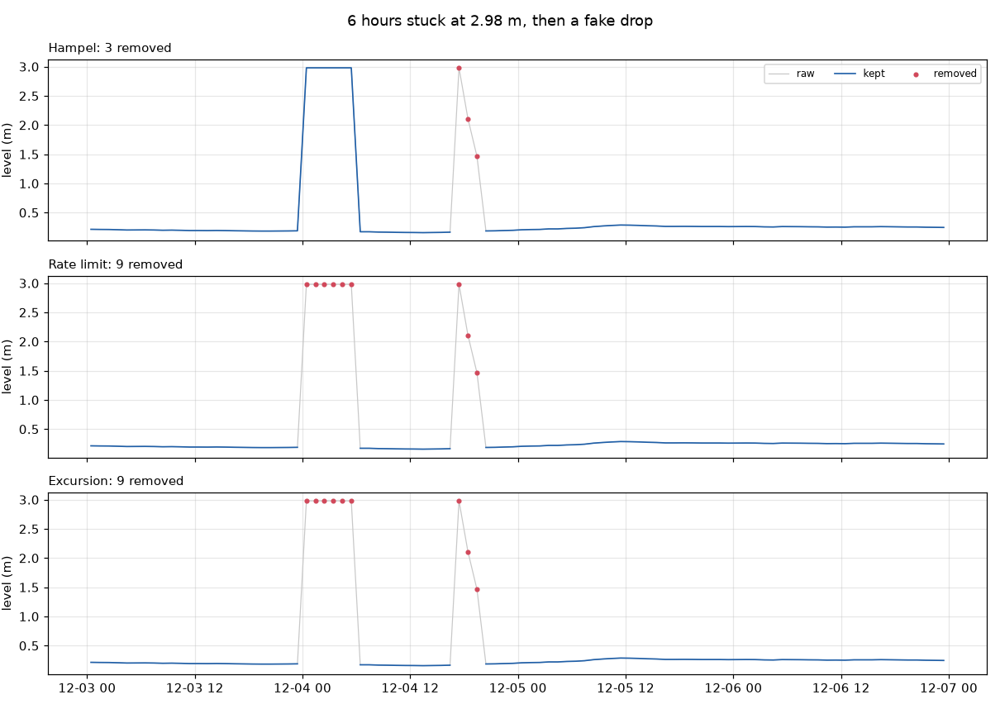
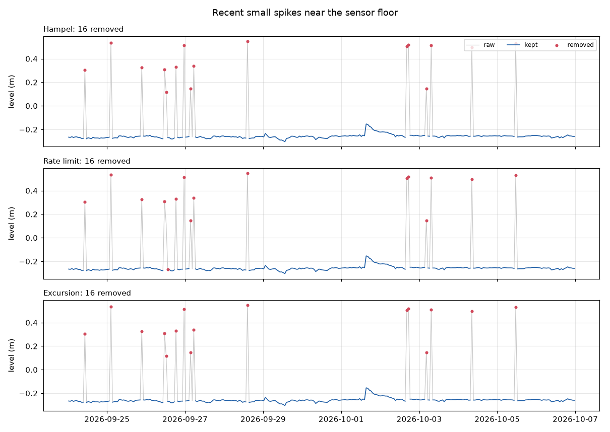
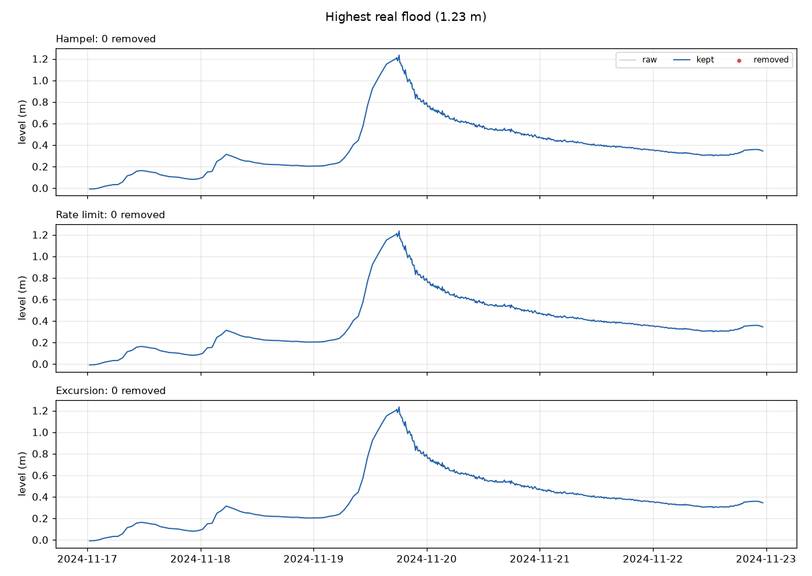
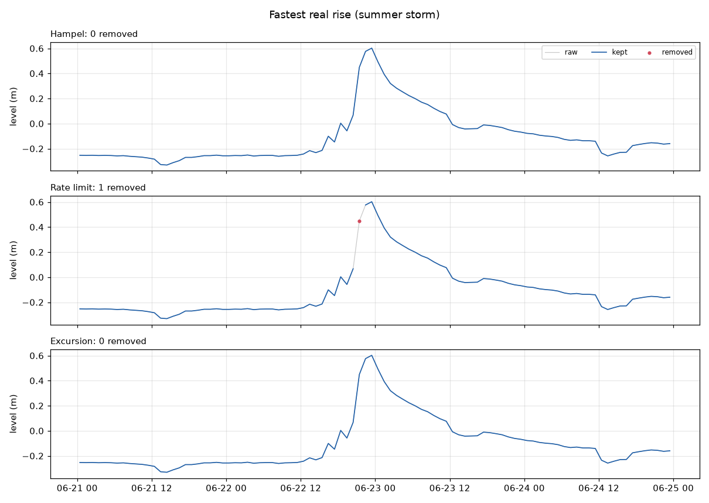

# Outlier removal for the Kupferdreh level

Exploration, not production code. It compares three ways to remove outliers from
the raw Kupferdreh level, using only the level series itself (no rain, no
upstream gauges).

Data: all 30,746 hourly readings in `raw_observations` (prod), 2023-03-06 to
2026-10-13.

## What the outliers look like

- **2.98 m is an error value.** It shows up 97 times, all in 2023, mostly for
  1–2 hours, but also in runs of 4, 6 and 13 hours. The highest real level in the
  data is 1.23 m (19 Nov 2024).
- **Fake values in between**, often next to a 2.98: 1.50, 1.55, 2.11, 2.72 m,
  sometimes for several hours (e.g. 2023-08-28 01:25–02:25 at 1.50 m, then back
  to 0.24 m).
- **Small one-hour spikes** since September 2026. The level sits near its floor
  at −0.26 m and jumps to +0.15…+0.55 m for one reading, then comes back.
- **Real behaviour:** the level rises by up to ~0.35 m/h (one summer storm went
  from 0.07 to 0.45 m in an hour). It falls slowly, never faster than 0.18 m/h
  once spikes are removed. Fast drops only happen at the end of fake values.

## The three methods

All three only flag points. Flagged points are dropped, not interpolated.

1. **Hampel filter.** The median of a centred 9-hour window, plus a limit of
   3 × MAD (at least 0.15 m). A point is flagged if it is further away than that.
   This is the standard statistical filter.
2. **Rate limit.** Causal: a point is flagged if it is more than 0.35 m per hour
   away from the last accepted value. After 8 rejections in a row the new level
   is accepted, so a real fast rise isn't locked out forever.
3. **Excursion.** A jump of more than 0.25 m counts as an outlier if, within
   14 hours, a step of more than 0.25 m in the other direction brings the level
   back to where it was (within a quarter of the jump's height). This uses the
   physics above: the river can rise fast, but it never drops fast. So a jump
   that is undone by a sharp step back is fake, however long it lasted.

## Results

| | Hampel | Rate limit | Excursion |
|:--|--:|--:|--:|
| points removed | 118 (0.38 %) | 147 (0.48 %) | 142 (0.46 %) |
| 2.98 m values caught | 68 / 97 | 92 / 97 | **97 / 97** |
| removed during real events¹ | **0** | 1 | **0** |
| jumps > 0.3 m left in kept data | 17 | 11 | **4** |
| … if 2.98 m is also removed by a fixed rule | 6 | 9 | 4 |
| highest kept value | 2.98 m | 2.98 m | **1.23 m** |

¹ Up to a day before or two days after 8 events checked by eye: the largest
floods (Dec 2023, Jan 2024, Nov 2024) and the fastest real rises (Jun 2023,
Aug 2024, Sep 2025, May/Jun 2026).

How many points two methods both flag (the diagonal is the total):

| | Hampel | Rate limit | Excursion |
|:--|--:|--:|--:|
| Hampel | 118 | 110 | 111 |
| Rate limit | 110 | 147 | 134 |
| Excursion | 111 | 134 | 142 |

The 4 jumps Excursion leaves in are all real-looking rises in summer storms
(2023-06-22, 2023-07-09, 2023-07-24, 2024-08-18).

## Plots

Grey is raw, blue is kept, red dots are removed.

**Whole series.** All three remove the 2023 error period. Hampel keeps the long
2.98 m runs.


**Spike period, summer 2023.** All three handle 1–2 hour spikes the same way.


**13 hours stuck at 2.98 m.** This is where the methods differ. Hampel keeps all
of it, because the run is longer than half its window. Rate limit accepts the
stuck value after 8 hours, then throws away 8 good hours after it. Only
Excursion gets it right.


**6 hours stuck, then a fake drop.** Same pattern: Hampel keeps the 6-hour run.


**Recent small spikes (Sept/Oct 2026).** All three catch them. Rate limit also
drops one good value.


**Highest real flood, Nov 2024.** Nothing removed by any method.


**Fastest real rise, June 2023.** Rate limit removes the real 0.45 m reading:
the rise was faster than 0.35 m/h.


More plots: [long wet period, winter 2023/24](plots/flood-2023-12.png),
[3-hour spike at 2.7 m, Feb 2025](plots/spike-2025-02.png),
[distribution of hourly changes](plots/diffs.png).

## Parameter choices

- Hampel with a wider window catches more of the long runs, but it starts
  cutting real flood peaks. 9 h: 68/97 caught, 0 real points lost. 25 h: 84/97
  and 43 lost. 31 h: 97/97 and 46 lost.
- Rate limit, number of rejections before re-anchoring: 4 → 86/97, 8 → 92/97,
  14 → 93/97. A higher value means more real data is lost when a real rise is
  faster than the limit.

## Recommendation

**Excursion.** It is the only method that removes every 2.98 m value, the long
stuck runs included, without touching real floods. It leaves the fewest bad
jumps, and its rule has a physical reason behind it.

Things to know before using it in the hourly job:
- **It needs to look ahead.** A spike is only recognised once the level comes
  back, so the newest reading can't be judged yet. In the live job that means
  either waiting up to 14 hours before calling a jump fake, or showing it as
  "unconfirmed". Rate limit is the only causal method, but it makes the two
  mistakes shown above.
- A cheap extra: treat 2.98 m as an error value directly (a fixed rule, no
  statistics). That alone removes the 97 worst values, whichever method runs after it.
- A jump that doesn't come back within 14 hours is kept, so a stuck value
  lasting longer than that would get through.

## How to rerun

Export the data (read only, prod connection string only in the environment for
that one command), then run the comparison. pandas and matplotlib are only
pulled in for this run; they are not project dependencies.

```
cd analysis/outliers
DATABASE_URL="$(neon cs prod --project-id mute-mountain-04871366 --role-name pegel_owner --database-name pegel </dev/null)" \
  uv run -q --no-project --with 'psycopg[binary]==3.3.6' python export.py data/kupferdreh.csv
uv run -q --no-project --with pandas --with matplotlib --with tabulate python outliers.py data/kupferdreh.csv
```

`data/` is gitignored, because the raw client data stays out of the repo.
