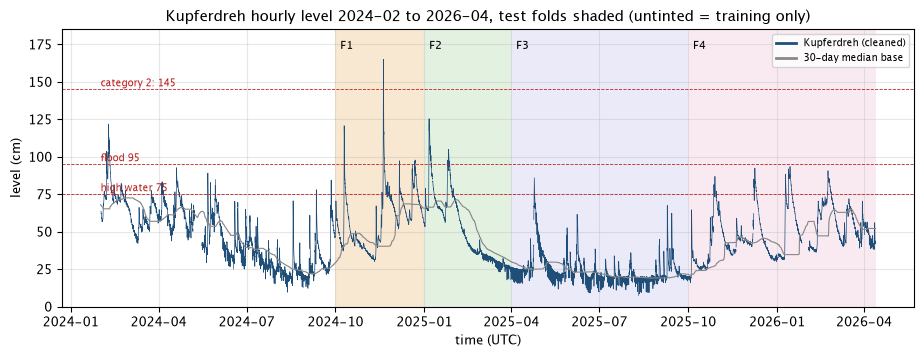
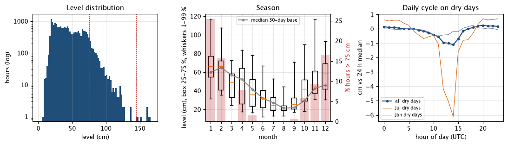
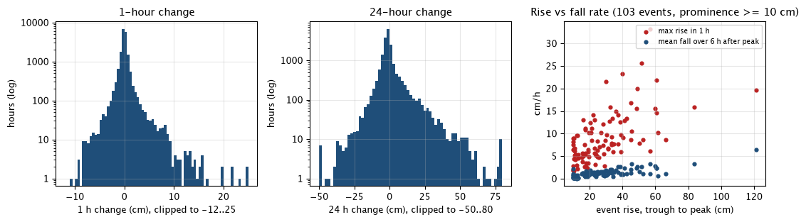
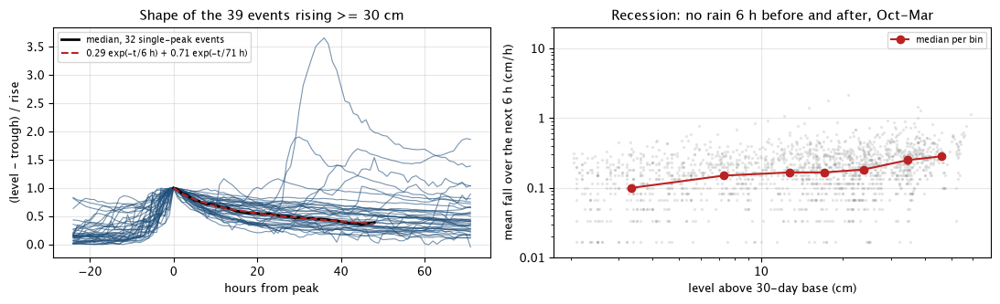
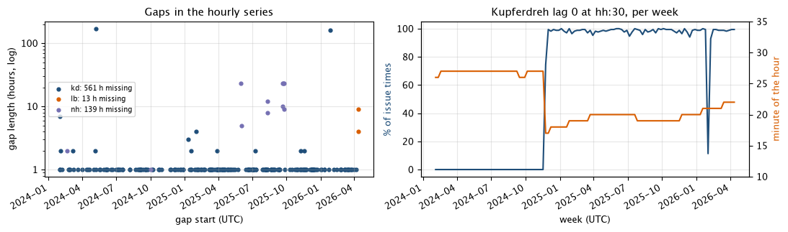
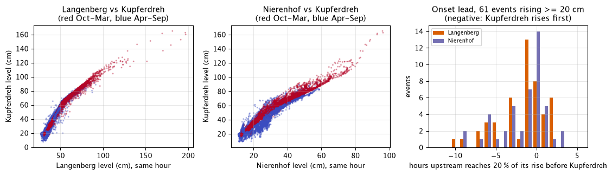
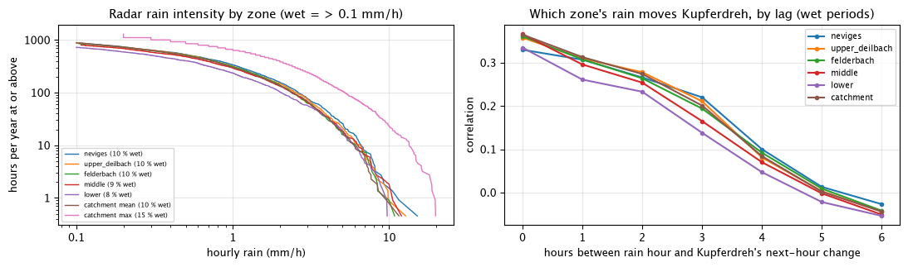
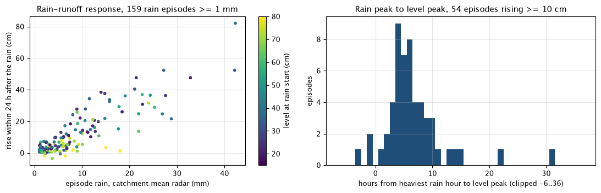
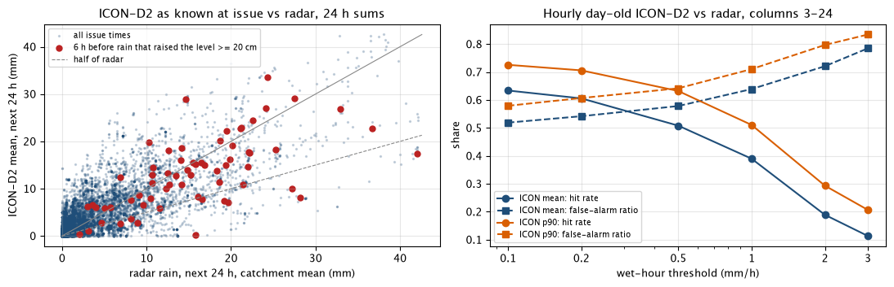

# Preliminary data analysis

What we learned about the data before modelling: the Kupferdreh level, the upstream gauges, radar rain and the ICON-D2 forecast. It is a snapshot of the data as it was before the first models, with a few first-fit numbers where they explain the data. Model results are in [the model learnings](model-evaluation/learnings.md). Append-only: add a new dated section at the end, don't rewrite old ones. If a later finding changes an earlier one, say so in the new section.

Numbers come from the frozen evaluation dataset of 2026-10-14 (`eval.parquet`, 19,248 issue times, 2024-02-01 to 2026-04-12) and the folds in [decision 0008](../docs/decisions/0008-model-evaluation-and-selection.md). Kupferdreh is always the cleaned series.

## 2026-10-14 · First look at the data

### Data and timing

- **Kupferdreh reports once an hour, between :17 and :27.** It arrives about 5 minutes later. At an hh:30 issue time the current hour's reading is missing in 38 % of cases, so the newest known level is then about an hour old. Live behaves the same. Rules that need "the last 3 hours" must count from the newest known reading, not from lag 0.
- **Inputs are nearly complete in the window.** Langenberg ≥ 99.9 %, Nierenhof 99.3 %, radar and ICON-D2 100 %, Kupferdreh 97.1 % (2.9 % gaps).
- **No late revisions.** No cleaned Kupferdreh value became known more than 2 hours after its time, so the strict as-of filter loses nothing.
- **LANUV is sometimes later than the 25 minutes we assume.** On 2026-10-14 12:30 the Langenberg batch was more than 90 minutes late. The backtest assumes 25 minutes, so live has one hour less upstream data now and then.
- **Neviges has data only from 2024-12 to 2025-06** and is left out.

### ICON-D2 archive

- **Before 2026-04-02 Open-Meteo keeps no whole ICON-D2 runs.** For each hour it keeps one value from a run 1–3 hours earlier and one from a run 25–27 hours earlier. The Single Runs API has whole runs from 2026-04-02 (ECMWF IFS from 2024-03-14).
- **At an issue time only the day-old value is known for most hours.** The first two columns (current and next hour) are sometimes fresh. Every other hour ahead gets a 25–27 hour forecast; live, the lead grows from about 4 hours at +1 to 27 hours at +24.
- **Coverage is complete anyway:** a known value always reaches 22.5 to 24.5 hours ahead.

### The catchment

- **The catchment reacts within hours.** Cross-correlation of 1-hour changes on wet periods: Langenberg leads Kupferdreh by 1 hour (r 0.53), Nierenhof by 0 hours (r 0.48), catchment radar rain by 1 hour (r 0.48). All fade after about 4 hours.
- **So upstream gauges give at most 1–2 hours of warning.** Routing them with a travel time isn't worth it.
- **Old rain means falling water.** Radar rain of the last 3 hours raises the forecast for +1 to +6 h; radar rain 3–12 hours back lowers it at long leads, because the wave has already passed.
- **High levels fall back towards the 30-day base.** The fitted recession factor is about 0.98 at +1 h and 0.8 at +24 h.

## 2026-10-14 · The target and the inputs

A descriptive look at the target and the inputs in the frozen dataset. **It covers the whole window, test folds included**, so nothing here is a clean hold-out result. Where a number is a design choice (a threshold, a window, a coefficient), the pre-F1 value (before 2024-10-01) is given next to it, or the text says it wasn't checked there. Hourly series are built from the dataset: Kupferdreh as the cleaned series at hh:22 (`target_1`), never the raw one, Langenberg and Nierenhof as lag 0 at hh:30 (valid about hh:00), radar as lag 0. "Catchment mean" here is the cell-weighted mean of the five zones; the dataset's `radar_catchment` column is the cell maximum, not a mean. All times UTC. Scripts stayed in a scratch folder.

### The level

- **Low most of the time.** Median 41 cm, 5–95 % range 19–78 cm, maximum 165 cm (2024-11-19 17:00). Above 75 cm: 6.9 % of hours (1,337). Above 95 cm: 1.0 % (198). Above 145 cm (category 2): 7 hours, all in one flood.
- **Strong seasonal base.** The 30-day median base runs from 21 cm in August to 65 cm in February. High water is a winter thing: 25 % of January hours are above 75 cm, 16–17 % in February and December, none from June to August. Rises of 20 cm or more happen in every month (3–9 per month), but in summer they start from about 20 cm and rarely reach 75.
- **A daily cycle in summer.** On dry days from April to August the level dips by 6–8 cm, lowest at 13–14 UTC (2024: 5.9 cm, 2025: 7.9 cm). From October to March the cycle is under 1 cm. The cause (evaporation or a temperature effect on the sensor) is unknown. It's big enough to matter: on dry summer days persistence is worse at +12 h (2.48 cm) than at +24 h (1.81 cm).

- **Most hours barely move.** The 1-hour change is within ±0.5 cm in 67 % of hours. 1st and 99th percentiles: −3.7 and +5.6 cm. Extremes: +33.2 cm (2024-08-18) and −10.6 cm. The 24-hour change runs from −17 to +34 cm (1st and 99th percentiles). Skew of the hourly change: 4.1.
- **Fast up, slow down.** Over 103 events (peaks at least 10 cm prominent): the steepest hour of a rise is 7.7 cm/h in the median (90th percentile 15.6, maximum 33.2). In the first 6 hours after the peak the level falls 1.1 cm/h in the median, about 7 times slower. From trough to peak takes 33 hours in the median, because most events come in several rain pulses. Event count depends on the prominence chosen: 259 at 5 cm, 103 at 10 cm, 42 at 20 cm (whole window).
- **Very persistent.** Level autocorrelation: 0.976 at 6 h, 0.916 at 24 h. For the level minus the 30-day base: 0.83 at 24 h and 0.26 at 7 days. Hourly changes are nearly unpredictable from their own past: autocorrelation 0.17 at 1 h, about 0 at 6 h, and back to 0.17 at 24 h (the daily cycle).

### Recession

- **Two speeds.** Normalised to the event's rise, 32 single-peak events of at least 30 cm keep 77 % of the rise after 6 h, 65 % after 12 h, 52 % after 24 h and 39 % after 48 h. Two exponentials fit the median: 0.29 · exp(−t/6 h) + 0.71 · exp(−t/71 h). Pre-F1 alone (13 events): 0.40 · exp(−t/8.5 h) + 0.60 · exp(−t/83 h), 48 % left after 24 h.
- **The 30-day base is not where the recession ends.** On dry hours from October to March the fall rate hardly depends on the distance to the base: 0.10 cm/h at 2–5 cm above it and 0.28 cm/h at 40–60 cm above. A linear reservoir towards the base fits badly. Its half-life is 83 h on the whole window and 46 h pre-F1. Qualifies the earlier "high levels fall back towards the 30-day base": they do, but slowly and not in proportion to the distance, which fits the fitted factor of 0.8 at +24 h.

### Folds

| Period | Hours | Mean cm | 95 % cm | Max cm | % > 75 | % > 95 | Base cm | Rain mm/30 d |
|---|---|---|---|---|---|---|---|---|
| pre-F1 (Feb–Sep 2024) | 5,832 | 48.3 | 76.7 | 121.8 | 6.6 | 0.9 | 54.1 | 99 |
| F1 (Oct–Dec 2024) | 2,208 | 58.1 | 88.2 | 165.0 | 17.0 | 2.4 | 46.2 | 90 |
| F2 (Jan–Mar 2025) | 2,160 | 51.1 | 93.5 | 125.4 | 12.6 | 4.1 | 64.7 | 61 |
| F3 (Apr–Sep 2025) | 4,392 | 24.5 | 42.5 | 85.9 | 0.3 | 0.0 | 22.0 | 65 |
| F4 (Oct 2025–Apr 2026) | 4,656 | 48.9 | 77.9 | 93.5 | 6.2 | 0.0 | 44.6 | 72 |

- **Every fold differs from its training data.** F1 trains on February to September 2024 only: a wet period (99 mm per 30 days) with no October to January in it. F3 is a dry, low summer: 0.3 % high water, one flood event. F4 has five flood events, none above 95 cm. All high-water scores lean on F1 and F2.

### Data quality

- **Gaps are short, apart from two.** Kupferdreh misses 561 hours (2.9 %) in 214 gaps; 90 % of them are single hours. Two long ones: 170 h from 2024-05-08 and 160 h from 2026-01-26. Only one gap falls in high water (3 h on 2025-01-09 at 85 cm). Langenberg misses 13 hours; Nierenhof misses 139, mostly 2025-09-21 to 09-25.
- **Lag 0 comes in two regimes.** This corrects the earlier "the current hour's reading is missing in 38 % of cases": 38 % is the average of two regimes. It also corrects "Live behaves the same": live, lag 0 is now known in 98–99 % of issue times. Until 2024-11-19 Kupferdreh read at :26–:27, so lag 0 was never known at hh:30 (100 % missing until 2024-11-18, 75 % on 11-19). From 2024-11-20 it reads at :17–:18 (until January 2025), then at :19–:22, and lag 0 is missing in 0–4 % of issue times per day. The one dip, from 2026-01-26 to 02-02, is the 160-hour gap, not a timing change. Training for F1 never saw lag 0, and the test data mostly have it. The newest known reading is 10 minutes old in the median (90th percentile 63 minutes).

### Upstream gauges

- **Langenberg almost fixes Kupferdreh's level.** A binned-median curve from Langenberg to Kupferdreh (same hour) leaves 3.5 cm residual (R² 0.971), 7.5 cm above 75 cm. The curve is nonlinear: 1.7 cm at Kupferdreh per cm at Langenberg at low levels, 1.3 at high. Nierenhof leaves 5.3 cm and has a seasonal offset (−2.3 cm April–September, +1.3 cm October–March).
- **The relationship drifts.** A linear fit on both gauges has coefficients 0.98 and 0.67 pre-F1 but 0.73 and 0.91 on the whole window. Its mean residual per fold ranges from −2.0 cm (F3) to +2.4 cm (F4).
- **Upstream changes explain about a quarter of wet-weather changes, and only in the first hours.** In wet or high periods (more than 2 mm of radar rain in 12 h, or above 75 cm), the 3-hour changes at Langenberg and Nierenhof explain R² 0.27 of the next-hour change at Kupferdreh, 0.26 at +3 h and 0.11 at +6 h. Kupferdreh's own 3-hour change explains 0.12, 0.12 and 0.05. In dry periods both explain at most 0.03. (Regime thresholds not checked pre-F1.)
- **Upstream does not rise first.** In 61 events rising at least 20 cm, Kupferdreh reaches 20 % of its rise in the same hour as the upstream gauge or earlier in 84 % of events (Langenberg) and 87 % (Nierenhof). Upstream only *peaks* earlier: 1 hour in the median. With Langenberg valid at about hh:00 and Kupferdreh at hh:22, that is 40–80 minutes. The first rise comes from rain on the area near the gauge, and the upstream wave arrives later to make the peak.
- **Event size follows the upstream rises.** Kupferdreh's rise ≈ 0.46 × Langenberg's rise + 0.44 × Nierenhof's rise + 18 cm (R² 0.81, 61 events). The constant suggests a large share comes from the area below both gauges.

### Radar rain

- **About 10 % of hours are wet** (> 0.1 mm/h, catchment mean). The catchment mean comes to 965 mm per year over the window. A wet hour has a median of 0.64 mm and a 99th percentile of 6.0 mm, with a maximum of 11.5 mm/h. The lower zone gets about 20 % less than the upper Deilbach (779 vs 1,008 mm per year). The catchment max over cells is 2.5 times the mean.
- **The zones are nearly redundant.** Hourly correlation between zones is 0.79–0.97; for 6-hour sums it is 0.90–0.99. Each zone's rain correlates about equally with Kupferdreh's next-hour change (0.33–0.37 at lag 0, about 0.2 at lag 3, 0 by lag 5). The lower zone is not faster; it's the weakest.

- **Roughly linear, about 1.5 cm of rise per mm of rain; below 5 mm rises stay under 10 cm.** The sample is 159 isolated rain episodes: at least 1 mm, ended by 6 dry hours, and no rain in the 24 h after. Below 5 mm the level rises 1–3 cm in the median, and never by 10 cm. At 5–10 mm the median rise is 6.4 cm, and 31 % rise by 10 cm or more; above 10 mm almost all do. Fit: rise ≈ 1.47 cm/mm × rain − 1.2 cm (R² 0.75), which breaks even near 1 mm, so the data show no clear threshold; pre-F1 1.72 cm/mm − 1.8 (R² 0.76). Peak intensity adds a little on the whole window (R² 0.81), but its pre-F1 coefficient has the opposite sign, so it isn't robust. (The episode definition was not checked pre-F1.)
- **A wet start does not mean a bigger rise in cm, rather the opposite.** For 1–10 mm, starting above the 30-day base gives median rises of 1.2–4.9 cm against 2.3–10.1 cm from below it. Rise correlates with the start level at −0.25 (pre-F1 −0.33), and with the 7-day radar sum at −0.13. A likely reason is the flatter rating at high levels (see the upstream curve): the same extra water gives fewer cm.
- **Rain peak to level peak: 6 hours in the median** (quartiles 4 and 8, 90th percentile 11; 54 isolated episodes rising at least 10 cm; pre-F1 5.5).

### ICON-D2 against the radar

- **Time alignment:** ICON-D2 valid at hour V matches the radar window ending at V:30 best (hourly correlation 0.386, against 0.379 one hour earlier).
- **Only the first two columns are ever fresh.** Column 1 has a lead of 6 hours or less in 67 % of rows, column 2 in 33 %, and no column after that ever does. From column 3 the median lead is 26 h.
- **Hour by hour, day-old ICON is weak.** Correlation 0.39 (fresh column 1: 0.62). Over a wet hour (> 0.1 mm) it hits 63 % and gives 52 % false alarms. Above 1 mm/h it hits 39 % with 64 % false alarms. **Summed, it is good:** correlation 0.71 for 6-hour sums and 0.81 for 24-hour sums (pre-F1 0.70 and 0.78). It has almost no bias: total 1.04 times radar (pre-F1 0.93).
- **p90 is a scaled mean.** Its 24-hour sums are 1.77 times radar with correlation 0.79, against 0.81 for the mean. It hits more wet hours only by raising more false alarms.
- **ICON rarely misses rain that raises the level.** There were 49 rain episodes with at least 10 mm of radar in 24 h that raised Kupferdreh by 20 cm or more. Issued 6 h before the rain started, the day-old ICON 24-hour sum was below half of the radar sum in 7 of them (14 %); the p90 was in 1. The worst was a summer storm on 2024-06-21: 0.3 mm forecast, 15.8 mm fell. **The biggest flood was underforecast:** for 2024-11-19 ICON gave 17.4 mm against 42.1 mm of radar (41 %). For the other flood peaks above 95 cm in the window, the ICON sum was within 15 % of the radar.

### What this suggests for models

1. **Build future rain as ICON sums.** Use 6-hour and 24-hour sums of the ICON mean, not hourly values; the response is roughly linear at about 1.5 cm/mm. A hinge such as max(sum − 5 mm, 0) is one candidate to test, not something the data demand. Leave out p90.
2. **Model the recession from the recent trough or peak, not the 30-day base.** Two time scales: about 6–8 h for the fast part (about a third of the rise) and 70–80 h for the rest. Hours since the last peak and the height above the 72-hour minimum should beat "distance to the 30-day base".
3. **Use the newest known reading and its age, never lag 0 directly.** Lag 0 was always missing before late November 2024 and is almost always there since. A feature built on lag 0 trains on one regime and tests on another.
4. **Upstream gauges are for +1 to +3 h only.** They explain about a quarter of wet-weather changes in the first hours and nothing after 6 h, and they don't warn of onsets. Use the 3-hour changes; skip routing and travel times. If a level mapping is used, make it nonlinear and expect it to drift a few cm between folds.
5. **One radar series is enough.** Zones correlate at 0.90–0.99 over 6 hours, and none reacts faster. Use the catchment mean over the last 3–6 hours, plus 6–12 hours back for the falling limb. The catchment max correlates with the mean at 0.92 hourly and 0.95 over 6 hours; it may help for convective storms, but it wasn't tested.
6. **Let the response depend on the level, but don't assume wet antecedents amplify it.** In cm, the same rain gives smaller rises from a high start. An interaction of rain with the start level should have a negative sign (pre-F1 −0.28 cm per mm per 10 cm).
7. **Add hour of day for April to September.** The summer daily cycle (6–8 cm) is larger than persistence's calm-hour error at +6 to +12 h.
8. **Expect the floods to decide the ranking.** By the [flood event rule](../docs/evaluation.md#flood-events) there are 22 events with a peak above 75 cm: 9 before F1 and 13 in the test folds (F1 4, F2 3, F3 1, F4 5). Six of the test events pass 95 cm, all in F1 and F2. The biggest flood had ICON at 41 % of the real rain, so no ICON-based model can get it right a day ahead. Judge high-water skill per event and report F1 separately: it trains on 8 months without autumn and without lag 0.
