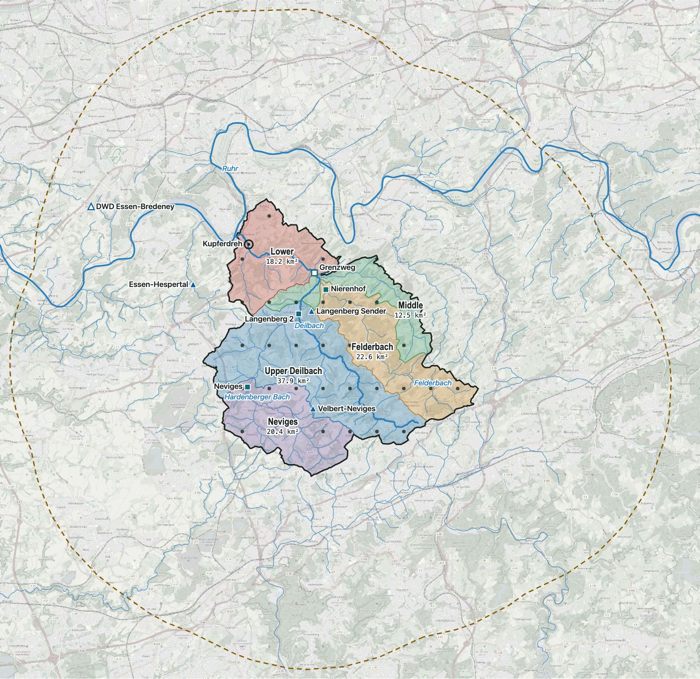

# Catchment and rain inputs

Where the water at the Kupferdreh gauge comes from, how we split that area, and which rain data the forecast will use. The outlines live in [`config/catchment.geojson`](../config/catchment.geojson).



Base map © OpenStreetMap contributors. Catchment and rivers from the NRW river map GSK3E.

## Catchment

The catchment above Kupferdreh covers 111.5 km². All rain that falls inside it flows past the gauge. It's built from the sub-catchments of the NRW river map GSK3E. Each sub-catchment names the one it drains into, so the area above a gauge is the sub-catchment holding the gauge plus everything upstream of it.

The result matches the areas the gauge operators publish:

| Gauge | Built | Published |
|---|---|---|
| Langenberg 2 | 58.2 km² | 57.74 km² |
| Grenzweg | 93.3 km² | 93.55 km² |
| Nierenhof | 22.5 km² | 22.00 km² |
| Neviges | 20.3 km² | 20.20 km² |

The last sub-catchment runs to the Deilbach mouth at the Ruhr, a little past the Kupferdreh gauge. So the true area above Kupferdreh is slightly under 111.5 km².

## Zones

The catchment is split at the gauges into five zones. Rain on a zone passes the gauge at its outlet before it reaches Kupferdreh. Zones without a usable gauge give no such early signal, so for them rain data is the only warning.

| Zone id | Area | Outlet gauge | Radar cells | Model points |
|---|---|---|---|---|
| `neviges` | 20.3 km² | Neviges | 21 | 8 |
| `upper_deilbach` | 37.9 km² | Langenberg 2 | 41 | 12 |
| `felderbach` | 22.5 km² | Nierenhof | 25 | 7 |
| `middle` | 12.5 km² | Grenzweg (BRW, not used yet) | 14 | 3 |
| `lower` | 18.2 km² | Kupferdreh | 18 | 6 |

`middle` only drains through Grenzweg. Until BRW allows us to use that gauge, `middle` behaves like `lower`: no gauge sees its water before Kupferdreh.

Radar cells are the 1 km RADOLAN cells whose centre lies in the zone. Model points are the ICON-D2 grid points (every 0.02°, about 2.2 km) inside the zone.

## Forecast ring

`ring_10km` is the catchment widened by 10 km (872 km², 280 ICON-D2 points). Weather models often place a shower 10 to 30 km from where it falls. The ring catches storms the model puts just outside the catchment.

## Rain data we collect

Two kinds: observed rain (what has fallen) and rain forecasts (what will fall). Both are stored as rain in mm per hour, with the end of the hour as the time.

### Observed rain: DWD RADOLAN RW

The hourly radar rain map, corrected with rain gauges, 1 km cells. The hourly product covers the hour ending at :50 UTC and is out about 25 minutes later. History goes back to 2005.

Six values per hour:

| Series | Value |
|---|---|
| `zone:neviges` … `zone:lower` | Mean of the radar cells in each zone (5 values) |
| `catchment:max` | Wettest single cell in the catchment |

The mean over the whole catchment is the area-weighted mean of the zones, so it isn't stored separately.

### Rain forecast: ICON-D2 via Open-Meteo

DWD's 2.2 km weather model. A new run starts every 3 hours and reaches 48 hours ahead. Open-Meteo serves it as JSON (`models=icon_d2`, `hourly=precipitation`) and keeps past forecasts. The free tier is for non-commercial use only, which fits this project as long as it stays non-commercial.

We fetch the 280 ring points once per new run, so about 8 times a day, and store the run's start time with each forecast. Training then only sees forecasts as they were issued.

Per run, for each lead time from +1 h to +48 h:

| Series | Value | Points |
|---|---|---|
| `catchment:mean` | Mean over the catchment | 36 |
| `ring:p90` | 90th percentile over the ring | 280 |
| `zone:neviges` … `zone:lower` | Mean per zone | 3 to 12 each |

That's 7 × 48 = 336 values per run. The zone means are kept to test whether they help. We expect the catchment mean and the ring value to carry most of the signal, because the model's position errors are larger than the zones.

For training before we started collecting, Open-Meteo's Previous Runs API has ICON-D2 from February 2024. It gives, for each hour, the forecast from the newest run and from the run about a day earlier, not every lead time.

### Later

| Data | Why it waits |
|---|---|
| LANUV rain gauges Velbert-Neviges and Velbert-Langenberg Sender (hourly) | Only the last 7 days exist. Useful to check the radar, not for training. |
| DWD rain gauge Essen-Bredeney 01303 (10 min, since 1994) | 8 km outside the catchment. Useful to check the radar history. |
| DWD AMBAV soil moisture at 01303 (daily) | Rain sums over the last days carry much of the same signal. |
| ICON-D2-EPS rain probabilities | Not checked yet whether Open-Meteo serves and archives it. |

## Rebuilding the outlines

`scripts/build_catchment.py` writes `config/catchment.geojson`. It needs the GSK3E shapefile (430 MB), which isn't in the repo:

```
curl -O https://www.opengeodata.nrw.de/produkte/umwelt_klima/wasser/oberflaechengewaesser/gsk3e/gsk3e_EPSG25832_Shape.zip
unzip -j gsk3e_EPSG25832_Shape.zip 'Eingangsdaten/shapefile/gsk3e_basis_ezg.*' -d gsk3e
uv run scripts/build_catchment.py gsk3e/gsk3e_basis_ezg
```

The script declares its own dependencies, so `uv run` installs them in a temporary environment without touching the project's.

## Sources and licences

| Data | Source | Licence |
|---|---|---|
| Catchments and rivers | GSK3E, LANUV NRW (edition 2019) | dl-de/zero-2-0 |
| Radar rain, soil moisture | DWD Open Data | CC BY 4.0, credit "Datenbasis: Deutscher Wetterdienst" |
| ICON-D2 forecasts | DWD via Open-Meteo | CC BY 4.0, non-commercial free tier |
| Base map in the image | OpenStreetMap | ODbL |
