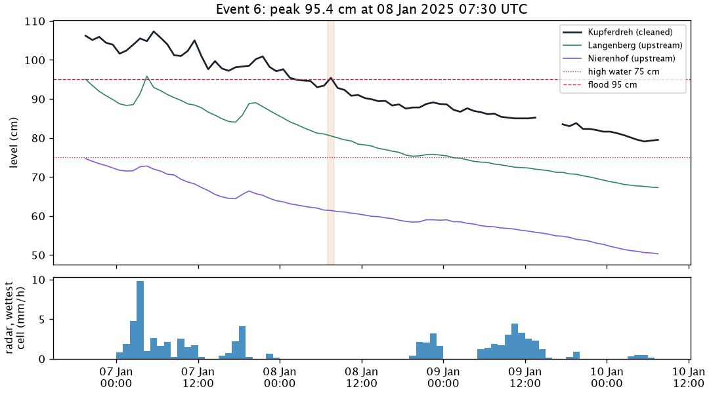
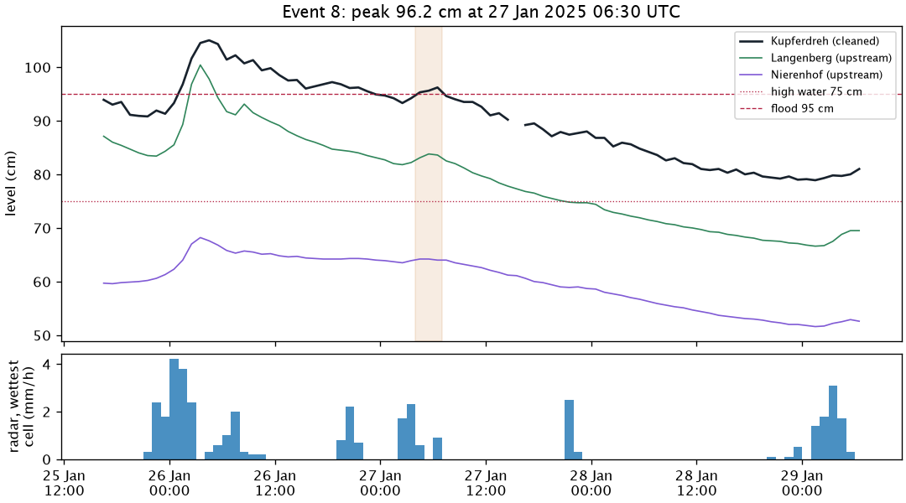

# Evaluation methodology

How we score forecast models for Kupferdreh: the data, the split into training and test periods, the flood events, and the metrics. The reasons behind each choice are in [decision 0008](decisions/0008-model-evaluation-and-selection.md). How one dataset row is built, and the ICON-D2 archive gap, are shown in [Model evaluation, explained](model-evaluation.md).

The figures and tables come from the frozen dataset `eval/2026-10-14/eval.parquet`. To redraw them:

```
uv run --group analysis python analysis/model-evaluation/methodology_plots.py \
    ~/data/deilbach-pegel/eval/2026-10-14/eval.parquet docs/images/evaluation-methodology
```

## Data

- **Window:** issue times from 2024-02-01 to 2026-04-12, hourly at hh:30 UTC, 19,248 rows. The window starts with the ICON-D2 archive and ends where the LANUV open data for Langenberg ends.
- **One row per issue time.** Each row holds only what was known at that time: Kupferdreh, Langenberg and Nierenhof levels for the last 24 hours, radar rain for the last 7 days, and the ICON-D2 rain forecast for the next 24 hours.
- **Targets:** the Kupferdreh level 1 to 24 hours after the issue time.
- **Only the cleaned Kupferdreh series** (`kupferdreh:cleaned_kalman`) is used, for inputs, targets, high water, events and warnings. The raw series is only used to tune the cleaning.

## Data split

Four expanding-window folds. Each model is trained on everything from 2024-02-01 up to its test period, then predicts the test period without seeing its levels. The last 24 hours before each test period are dropped from training, because their targets reach into the test period. Every model is trained fresh for each fold. The fold dates are fixed in code (`src/pegel/evaluation/contract.py`), never random.


| fold | test period | training issue times | test issue times | test issue times above 75 cm | flood events |
|---|---|---|---|---|---|
| F1 | 2024-10-01 – 2024-12-31 | 5,808 | 2,208 | 377 | 4 |
| F2 | 2025-01-01 – 2025-03-31 | 8,016 | 2,160 | 276 | 4 |
| F3 | 2025-04-01 – 2025-09-30 | 10,176 | 4,392 | 15 | 0 |
| F4 | 2025-10-01 – 2026-04-12 | 14,568 | 4,656 | 297 | 0 |

Things to keep in mind:

- **All eight flood events are in F1 and F2**, winter 2024/25. F3 is summer, with almost no high water. F4 has high water but its peaks stop just below 95 cm.
- **Training before F1 has only two floods**, both in February 2024 (104 cm and 122 cm). F1 is scored by models that have seen very little flood behaviour.
- **There is no hold-out period.** With so few floods, every flood is needed in a test fold. The live shadow run is the check on overfitting.

## Subsets

Every score is computed twice:

- **All issue times.** Mostly low, slowly falling water.
- **High water:** forecasts where the level is above 75 cm at the issue time or at the target time. This is where the forecast matters.

## Flood events

A flood event is a time above 95 cm. Spells above 95 cm whose peaks are less than 24 hours apart are merged into one event. Only events in the test periods are scored (`src/pegel/evaluation/events.py`).

| event | fold | above 95 cm from (UTC) | to (UTC) | peak (cm) | peak at (UTC) | radar, wettest cell, 48 h to peak (mm) |
|---|---|---|---|---|---|---|
| 1 | F1 | 2024-10-10 00:30 | 2024-10-10 08:30 | 120.7 | 2024-10-10 02:30 | 62.2 |
| 2 | F1 | 2024-11-19 10:30 | 2024-11-20 20:30 | 165.0 | 2024-11-19 17:30 | 118.4 |
| 3 | F1 | 2024-12-06 04:30 | 2024-12-06 05:30 | 97.3 | 2024-12-06 05:30 | 36.4 |
| 4 | F1 | 2024-12-22 01:30 | 2024-12-22 15:30 | 97.8 | 2024-12-22 13:30 | 46.2 |
| 5 | F2 | 2025-01-05 17:30 | 2025-01-08 01:30 | 125.4 | 2025-01-05 23:30 | 44.6 |
| 6 | F2 | 2025-01-08 07:30 | 2025-01-08 07:30 | 95.4 | 2025-01-08 07:30 | 46.3 |
| 7 | F2 | 2025-01-25 06:30 | 2025-01-26 22:30 | 105.0 | 2025-01-26 04:30 | 46.5 |
| 8 | F2 | 2025-01-27 04:30 | 2025-01-27 06:30 | 96.2 | 2025-01-27 06:30 | 33.9 |

Events 6 and 8 follow another event within hours. They count as events for peak errors, but not as first crossings for warnings (no hour above 95 cm in the 24 hours before). That is why the warning tables have 6 crossings at 95 cm, not 8. At 95 cm there are 10 crossings in the test periods in all; 6 are first crossings. Only event 2 crosses the first category bound, 145 cm.

Each plot shows the event from 36 hours before it starts to 48 hours after it ends. Top: the cleaned Kupferdreh level and the two upstream gauges, with the time above 95 cm shaded. Bottom: hourly radar rain in the wettest radar cell of the catchment (the dataset's `catchment` series is the cell maximum, not a mean). In the 48 hours before event 2 the zone means got 47 to 70 mm, the wettest cell 118 mm.

### Event 1 · 10 Oct 2024, 120.7 cm


### Event 2 · 19 Nov 2024, 165.0 cm

The largest flood in the window and the only one above 145 cm. ICON-D2 badly underforecast its rain.


### Event 3 · 6 Dec 2024, 97.3 cm


### Event 4 · 22 Dec 2024, 97.8 cm


### Event 5 · 5 Jan 2025, 125.4 cm

Above 95 cm for more than two days.


### Event 6 · 8 Jan 2025, 95.4 cm

A one-hour return above 95 cm, six hours after the last hour above 95 cm in event 5.



### Event 7 · 26 Jan 2025, 105.0 cm


### Event 8 · 27 Jan 2025, 96.2 cm

A second peak, six hours after the last hour above 95 cm in event 7.



## Metrics

- **MAE per lead time**, 1 to 24 hours, per model and fold, for both subsets. This is the main metric.
- **Skill against persistence:** 1 − MAE / MAE of persistence (the last level held flat). Above 0 means better than doing nothing. A bootstrap over whole days gives a 90 % range for the difference to persistence.
- **Peaks:** for each event and lead k, the forecast issued k hours before the peak: its highest value minus the observed peak (height) and the time of its highest value minus the peak time (timing).
- **Warnings:** at 95 cm and each category bound (145, 165, 185, 225 cm), the first crossings warned at least 3 and 6 hours ahead, and false alarms per month. These are reported but don't select models yet.
- **Lag check:** on high water, the time shift that best fits the forecast to the observed level. If it equals the lead, the model is only a delayed persistence.

## Selection

A model wins over a simpler one when its mean MAE over leads 1 to 24 is lower in at least 3 of 4 folds, and its pooled high-water MAE is not worse. Every scored run is logged in [`analysis/model-evaluation/experiments.md`](../analysis/model-evaluation/experiments.md).

## Limits

- Eight flood events (6 first crossings of 95 cm, the count in decision 0008), all in winter, and no summer thunderstorm flood. Differences of one or two warnings mean nothing.
- Training and test both use the day-old ICON-D2 archive. Live forecasts get fresher rain forecasts, so the live shadow run has the final say.
- Picking the best of many models on the same folds overfits them a little. The live shadow run checks this too.
