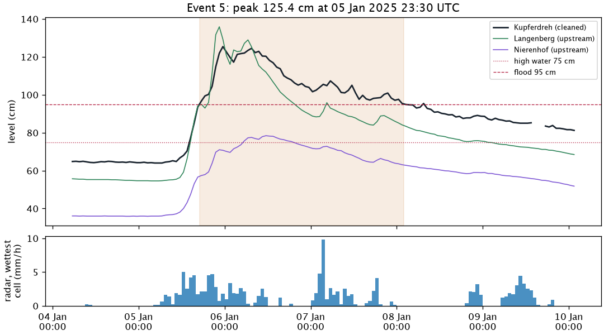

# Model evaluation

How we score forecast models for Kupferdreh: the data, the split into training and test periods, the flood events, the metrics and how to run it. The reasons behind each choice are in [decision 0008](decisions/0008-model-evaluation-and-selection.md). The models themselves are in [models.md](models.md). Results go in the [experiment log](../analysis/model-evaluation/experiments.md), insights in the [learnings](../analysis/model-evaluation/learnings.md), what we know about the data in the [preliminary data analysis](../analysis/preliminary-data-analysis.md).

## Running it

1. **Build the dataset once.** `pegel build-eval-set`, read-only from prod (command in `AGENTS.md`). Every input as of its issue time. Frozen as `eval.parquet` with a checksum in `eval.manifest.json`, outside the repo.
2. **Fit and predict.** `python -m pegel.evaluation.predict <dataset> --out <dir>` trains every registered model on each fold's training rows and predicts its test rows. Writes `predictions.parquet`.
3. **Score.** `python -m pegel.evaluation.score <predictions> <dataset> --out <dir>` writes `scores.csv`, `bootstrap.csv`, `events.csv`, `peaks.csv`, `crossings.csv`, `false_alarms.csv`, `lag.csv` and `alarms.csv` (per-lead hits, a diagnostic only).
4. **Log it.** `python -m pegel.evaluation.report <run dir>` appends a section with tables and plots to `analysis/model-evaluation/experiments.md`. Add what we learned to `learnings.md`.

## Data

- **Window:** issue times from 2024-02-01 to 2026-04-12, hourly at hh:30 UTC, 19,248 rows. It starts with the ICON-D2 archive and ends where the LANUV open data for Langenberg ends.
- **One row per issue time**, holding only what was known then: Kupferdreh, Langenberg and Nierenhof levels for the last 24 hours, radar rain for the last 7 days, and the ICON-D2 rain forecast for the next 24 hours.
- **Targets:** the Kupferdreh level 1 to 24 hours after the issue time. Training sees them; prediction never does.
- **Only the cleaned Kupferdreh series** (`kupferdreh:cleaned_kalman`), for inputs, targets, high water, events and warnings.


Left of the red line is what was known at 12:30 on 19 Nov 2024, a flood day. Blue: observed, or a fresh ICON value. Orange: a day-old ICON value. Red circles: the targets.

## The ICON-D2 archive

Before April 2026 the archive only has day-old ICON-D2 forecasts for most hours, so every model trains and tests on 25–27 hour old rain forecasts. Live, the short hours get much fresher ones. The backtest is fair between models, but it likely undervalues rain-driven leads; the live shadow run from 12 Oct 2026 has the final say. Details and figures: [catchment.md](catchment.md#what-a-model-sees-at-an-issue-time).

## Data split

Four expanding-window folds, fixed in code (`src/pegel/evaluation/contract.py`). Each model is trained fresh on everything from 2024-02-01 up to its test period. The last 24 hours before each test period are dropped from training, because their targets reach into it.


| fold | test period | training issue times | test issue times | test issue times above 75 cm | flood events | of them above 95 cm |
|---|---|---|---|---|---|---|
| F1 | 2024-10-01 – 2024-12-31 | 5,808 | 2,208 | 377 | 4 | 4 |
| F2 | 2025-01-01 – 2025-03-31 | 8,016 | 2,160 | 276 | 3 | 2 |
| F3 | 2025-04-01 – 2025-09-30 | 10,176 | 4,392 | 15 | 1 | 0 |
| F4 | 2025-10-01 – 2026-04-12 | 14,568 | 4,656 | 297 | 5 | 0 |

- **Every fold has flood events, but all six above 95 cm are in F1 and F2**, winter 2024/25. F3 is summer, with one event in April 2025 (86 cm). F4 has five events, all peaking between 86 and 94 cm.
- **Training before F1 has nine events**, only one above 95 cm: February 2024, 122 cm, with an earlier peak of 104 cm in the same event.
- **There is no hold-out period.** Every flood is needed in a test fold. The live shadow run is the check on overfitting.

## Flood events

**Proposed, not in the code yet.** The scorer (`src/pegel/evaluation/events.py`) still uses the old rule: a time above 95 cm, with spells whose peaks are less than 24 hours apart merged. That gave 8 events. The new rule below replaces it once confirmed.

A flood event is one rise of the river and its fall back, with a peak above 75 cm (`evaluation.high_water_cm`). It is found on the hourly cleaned level:

- **Start.** An hour above 75 cm that is at least **15 cm** above the lowest level of the **24 hours** before it starts an event. The event starts at that lowest hour, and the level there is the **pre-event level**. The 24 hours never reach back before the end of the previous event.
- **End.** The first hour after that where the level is back within **5 cm** of the pre-event level, or is below 75 cm and fell less than **2 cm** in the last 24 hours.
- **One event.** A new rise before the end belongs to the same event. The event's peak is its highest level.

Hours without a level are skipped. The second end rule is needed in winter. The base level rises from storm to storm, so most winter events never get back to where they started; without it, one event would run from late September to November. Comparing with the level 24 hours earlier cancels the daily dip of 6 to 8 cm in summer, and 15 cm is about twice that dip.

The events are not sensitive to the numbers. Changing one at a time:

| setting | events in the test folds (F1, F2, F3, F4) | events in the whole window |
|---|---|---|
| rise 15 cm in 24 h, back within 5 cm, flat below 2 cm a day | 13 (4, 3, 1, 5) | 22 |
| rise 10 cm instead of 15 | 14 (5, 3, 1, 5) | 26 |
| rise 20 cm instead of 15 | 13 (4, 3, 1, 5) | 21 |
| rise within 12 h instead of 24 | 13 (4, 3, 1, 5) | 22 |
| back within 3 or 10 cm instead of 5 | 13 (4, 3, 1, 5) | 22 or 23 |
| flat below 1 cm a day instead of 2 | 13 (4, 3, 1, 5) | 21 |
| flat below 3 cm a day instead of 2 | 14 (5, 3, 1, 5) | 24 |

| event | fold | start (UTC) | end (UTC) | pre-event level (cm) | peak (cm) | peak at (UTC) | radar, wettest cell, 48 h to peak (mm) |
|---|---|---|---|---|---|---|---|
| 1 | F1 | 2024-10-09 01:30 | 2024-10-18 00:30 | 37.1 | 120.7 | 2024-10-10 02:30 | 62.2 |
| 2 | F1 | 2024-11-17 05:30 | 2024-11-23 10:30 | 48.1 | 165.0 | 2024-11-19 17:30 | 118.4 |
| 3 | F1 | 2024-12-05 10:30 | 2024-12-08 07:30 | 51.8 | 97.3 | 2024-12-06 05:30 | 36.4 |
| 4 | F1 | 2024-12-18 09:30 | 2024-12-27 11:30 | 57.6 | 97.8 | 2024-12-22 13:30 | 46.2 |
| 5 | F2 | 2025-01-01 16:30 | 2025-01-03 22:30 | 53.3 | 78.9 | 2025-01-02 06:30 | 37.7 |
| 6 | F2 | 2025-01-05 04:30 | 2025-01-12 07:30 | 64.0 | 125.4 | 2025-01-05 23:30 | 44.6 |
| 7 | F2 | 2025-01-23 20:30 | 2025-01-31 14:30 | 66.0 | 105.0 | 2025-01-26 04:30 | 46.5 |
| 8 | F3 | 2025-04-23 15:30 | 2025-04-30 09:30 | 27.5 | 85.9 | 2025-04-24 20:30 | 105.5 |
| 9 | F4 | 2025-10-27 00:30 | 2025-11-01 14:30 | 49.6 | 86.9 | 2025-10-28 18:30 | 59.3 |
| 10 | F4 | 2025-12-06 23:30 | 2025-12-15 07:30 | 47.7 | 92.4 | 2025-12-09 02:30 | 50.2 |
| 11 | F4 | 2026-01-08 15:30 | 2026-01-12 11:30 | 32.3 | 88.4 | 2026-01-09 19:30 | 52.0 |
| 12 | F4 | 2026-01-12 12:30 | 2026-01-17 10:30 | 65.4 | 93.5 | 2026-01-14 11:30 | 25.1 |
| 13 | F4 | 2026-02-21 17:30 | 2026-02-26 03:30 | 69.9 | 90.7 | 2026-02-22 18:30 | 35.2 |

**What changed from the old 8 events.**

- Old events 5 and 6 are now event 6. The 95.4 cm on 8 Jan 2025 was a small bump in the fall after the 125 cm peak.
- Old events 7 and 8 are now event 7. The level stayed above 90 cm between the two peaks.
- Events 6 and 7 stay apart, so old events 5 to 8 become two events, not one. From 14 to 23 January the level was back at 56 to 67 cm, at or below the 64 cm event 6 started from. No rule that ends an event at its pre-event level can join them.
- New are the seven events that peak between 75 and 95 cm: 5 (2 Jan 2025), 8 (April 2025) and all five in F4.
- Events 11 and 12 (January 2026) are two events: between them the level sat at 65 to 67 cm for a day and a half. Events 5 and 6 in January 2025 are split the same way.

**13 events, 6 first crossings.** Six events pass 95 cm (1, 2, 3, 4, 6, 7), and each holds one first crossing of 95 cm. Only event 2 crosses the first category bound, 145 cm. The other seven count for peak errors only.

**Warnings don't change.** First crossings of 95 cm and of each category bound are found on the level itself, not from events, so the warning tables keep their 6 crossings at 95 cm and 1 at 145 cm. The per-lead hits diagnostic (`alarms.csv`) also keeps its own spells above each threshold.

Each plot shows the event from 36 hours before it starts to 48 hours after it ends. Top: the cleaned Kupferdreh level and the two upstream gauges, with the event shaded. Bottom: hourly radar rain in the wettest radar cell of the catchment (the dataset's `catchment` series is the cell maximum, not a mean). The figures are redrawn with:

```
uv run --group analysis python analysis/model-evaluation/methodology_plots.py \
    ~/data/deilbach-pegel/eval/2026-10-14/eval.parquet docs/images/evaluation-methodology
```

**The images below are still from the old rule** (time above 95 cm shaded, old numbers in the titles and in the split figure). They will be redrawn once the new rule is in the code. Events 5 and 8 to 13 get their figures then.

### Event 1 · 10 Oct 2024, 120.7 cm


### Event 2 · 19 Nov 2024, 165.0 cm

The largest flood in the window and the only one above 145 cm. ICON-D2 badly underforecast its rain. In the 48 hours before it the zone means got 47 to 70 mm, the wettest cell 118 mm.


### Event 3 · 6 Dec 2024, 97.3 cm


### Event 4 · 22 Dec 2024, 97.8 cm


### Event 5 · 2 Jan 2025, 78.9 cm

A small rise three days before event 6. The level then stayed at 64 to 66 cm for two days.

### Event 6 · 5 Jan 2025, 125.4 cm

Above 95 cm for more than two days. The bump to 95.4 cm on 8 January is part of the fall.



### Event 7 · 26 Jan 2025, 105.0 cm

Two peaks: 98 cm on 25 January and 105 cm on 26 January, with a last bump to 96 cm on 27 January.


### Event 8 · 24 Apr 2025, 85.9 cm

The only event in the summer half, after 106 mm of radar rain in the wettest cell.

### Event 9 · 28 Oct 2025, 86.9 cm

### Event 10 · 9 Dec 2025, 92.4 cm

### Event 11 · 9 Jan 2026, 88.4 cm

### Event 12 · 14 Jan 2026, 93.5 cm

### Event 13 · 22 Feb 2026, 90.7 cm

## Metrics

Every score is computed for **all issue times** (mostly low, slowly falling water) and for **high water**: the level is above 75 cm at the issue time or at the target time.

- **MAE per lead time**, 1 to 24 hours, per model and fold. The main metric.
- **Skill against persistence:** 1 − MAE / MAE of persistence (the last level held flat). Above 0 is better than doing nothing. A bootstrap over whole days gives a 90 % range for the difference to persistence.
- **Peaks:** for each event and lead k, the forecast issued k hours before the peak: its highest value minus the observed peak (height), and the time of its highest value minus the peak time (timing).
- **Warnings** at 95 cm and each category bound (145, 165, 185, 225 cm):
  - A first crossing is an hour above the threshold with no hour above it in the 24 hours before.
  - A forecast crosses when the last known level (at most 3 hours old) is not above the threshold and one of its 24 values is.
  - A first crossing is warned by every forecast issued before it whose crossing time is at most 6 hours off. It counts as a hit at 3 or 6 hours if the first such forecast came that early.
  - A forecast crossing with no observed crossing within 6 hours is a false alarm. A warning that stays up over several issue times counts once.
  - Warnings are reported, not used to select models yet.
- **Lag check:** on high water, the time shift that best fits the forecast to the observed level. If it equals the lead, the model is only a delayed persistence.

## Selection

A model wins over a simpler one when its mean MAE over leads 1 to 24 is lower in at least 3 of 4 folds, and its pooled high-water MAE is not worse. Ties go to the simpler model.

## Limits

- 13 flood events, but only 6 above 95 cm and 6 first crossings of 95 cm, all in winter. One event is in April, no summer thunderstorm. Differences of one or two warnings mean nothing.
- Seven events peak between 75 and 95 cm. They add peak errors, but only for moderate high water.
- Training and test both use the day-old ICON-D2 archive. Live gets fresher rain forecasts.
- Picking the best of many models on the same folds overfits them a little. The live shadow run checks both.
