# Model evaluation

How we score forecast models for Kupferdreh: the data, the split into training and test periods, the flood events, the metrics and how to run it. The reasons behind each choice are in [decision 0008](decisions/0008-model-evaluation-and-selection.md). The models themselves are in [models.md](models.md). Results go in the [experiment log](../analysis/model-evaluation/experiments.md), insights in the [learnings](../analysis/model-evaluation/learnings.md), what we know about the data in the [preliminary data analysis](../analysis/preliminary-data-analysis.md).

## Running it

1. **Build the dataset once.** `pegel build-eval-set`, read-only from prod (command in `AGENTS.md`). Every input as of its issue time. Frozen as `eval.parquet` with a checksum in `eval.manifest.json`, outside the repo.
2. **Fit and predict.** `python -m pegel.evaluation.predict <dataset> --out <dir>` trains every registered model on each fold's training rows and predicts its test rows. Writes `predictions.parquet`.
3. **Score.** `python -m pegel.evaluation.score <predictions> <dataset> --out <dir>` writes `scores.csv`, `bootstrap.csv`, `lag.csv`, `events.csv` (the test events), `peaks.csv` (size, timing and predicted per model, event and lead, in `src/pegel/evaluation/flood_scores.py`) and `false_alarms.csv` (count and rate per model). The forecast replay page will come from a separate command.
4. **Log it.** `python -m pegel.evaluation.report <run dir>` appends a section with tables and plots to `analysis/model-evaluation/experiments.md`. Add what we learned to `learnings.md`.

## Data

- **Window:** issue times from 2024-02-01 to 2026-04-12, hourly at hh:30 UTC, 19,248 rows. It starts with the ICON-D2 archive and ends where the LANUV open data for Langenberg ends.
- **One row per issue time**, holding only what was known then: Kupferdreh, Langenberg and Nierenhof levels for the last 24 hours, radar rain for the last 7 days, and the ICON-D2 rain forecast for the next 24 hours.
- **Targets:** the Kupferdreh level 1 to 24 hours after the issue time. Training sees them; prediction never does.
- **Only the cleaned Kupferdreh series** (`kupferdreh:cleaned_kalman`), for inputs, targets, high water, events and flood forecasts.


Left of the red line is what was known at 12:30 on 19 Nov 2024, a flood day. Blue: observed, or a fresh ICON value. Orange: a day-old ICON value. Red circles: the targets.

## The ICON-D2 archive

Before April 2026 the archive only has day-old ICON-D2 forecasts for most hours, so every model trains and tests on 25–27 hour old rain forecasts. Live, the short hours get much fresher ones. The backtest is fair between models, but it likely undervalues rain-driven leads; the live shadow run from 12 Oct 2026 has the final say. Details and figures: [catchment.md](catchment.md#what-a-model-sees-at-an-issue-time).

## Data split

Four expanding-window folds, fixed in code (`src/pegel/evaluation/contract.py`). Each model is trained fresh on everything from 2024-02-01 up to its test period. The last 24 hours before each test period are dropped from training, because their targets reach into it.

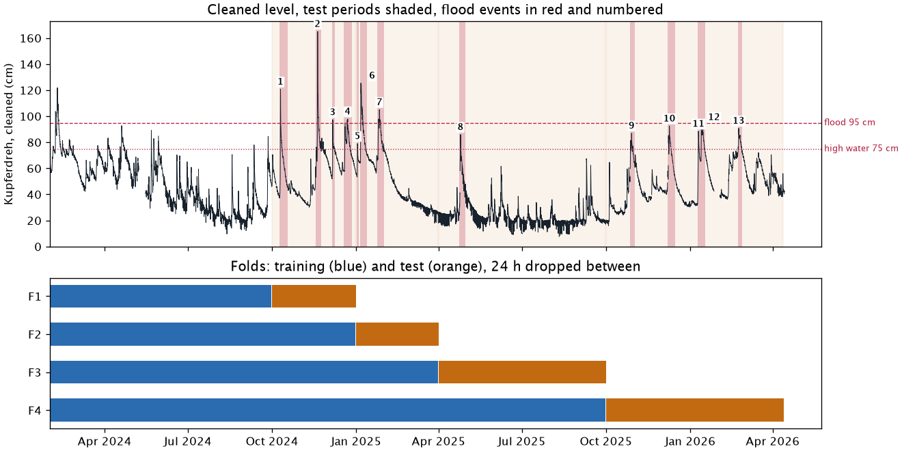

| fold | test period | training issue times | test issue times | test issue times above 75 cm | flood events | of them above 95 cm |
|---|---|---|---|---|---|---|
| F1 | 2024-10-01 – 2024-12-31 | 5,808 | 2,208 | 377 | 4 | 4 |
| F2 | 2025-01-01 – 2025-03-31 | 8,016 | 2,160 | 276 | 3 | 2 |
| F3 | 2025-04-01 – 2025-09-30 | 10,176 | 4,392 | 15 | 1 | 0 |
| F4 | 2025-10-01 – 2026-04-12 | 14,568 | 4,656 | 297 | 5 | 0 |

- **Every fold has flood events, but all six above 95 cm are in F1 and F2**, winter 2024/25. F3 is summer, with one event in April 2025 (86 cm). F4 has five events, all peaking between 86 and 94 cm.
- **Training before F1 has nine events**, only one above 95 cm: February 2024, 122 cm, with an earlier peak of 104 cm in the same event.
- **There is no hold-out period.** Every flood is needed in a test fold. The live shadow run is the check on overfitting.

## Flood events

Found by `flood_events` in `src/pegel/evaluation/events.py`.

A flood event is one rise of the river and its fall back, with a peak above 75 cm (`evaluation.high_water_cm`). It is found on the hourly cleaned level:

- **Start.** An hour above 75 cm that is at least **15 cm** above the lowest level of the **24 hours** before it starts an event. The event starts at that lowest hour, and the level there is the **pre-event level**. The 24 hours never reach back before the end of the previous event.
- **End.** The first hour after that where the level is back within **5 cm** of the pre-event level, or is below 75 cm and fell less than **2 cm** in the last 24 hours.
- **One event.** A new rise before the end belongs to the same event. The event's peak is its highest level.

Hours without a level are skipped. The second end rule is needed in winter. The base level rises from storm to storm, so most winter events never get back to where they started; without it, one event would run from late September to November. Comparing with the level 24 hours earlier cancels the daily dip of 6 to 8 cm in summer, and 15 cm is about twice that dip.

The events are not sensitive to the numbers. Changing one at a time:

| setting | events in the test folds (F1, F2, F3, F4) | events in the whole window |
|---|---|---|
| rise 15 cm in 24 h, back within 5 cm, flat below 2 cm a day | 13 (4, 3, 1, 5) | 22 |
| rise 10 cm instead of 15 | 14 (5, 3, 1, 5) | 26 |
| rise 20 cm instead of 15 | 13 (4, 3, 1, 5) | 21 |
| rise within 12 h instead of 24 | 13 (4, 3, 1, 5) | 22 |
| back within 3 or 10 cm instead of 5 | 13 (4, 3, 1, 5) | 22 or 23 |
| flat below 1 cm a day instead of 2 | 13 (4, 3, 1, 5) | 21 |
| flat below 3 cm a day instead of 2 | 14 (5, 3, 1, 5) | 24 |

| event | fold | start (UTC) | end (UTC) | pre-event level (cm) | peak (cm) | peak at (UTC) | radar, wettest cell, 48 h to peak (mm) |
|---|---|---|---|---|---|---|---|
| 1 | F1 | 2024-10-09 01:30 | 2024-10-18 00:30 | 37.1 | 120.7 | 2024-10-10 02:30 | 62.2 |
| 2 | F1 | 2024-11-17 05:30 | 2024-11-23 10:30 | 48.1 | 165.0 | 2024-11-19 17:30 | 118.4 |
| 3 | F1 | 2024-12-05 10:30 | 2024-12-08 07:30 | 51.8 | 97.3 | 2024-12-06 05:30 | 36.4 |
| 4 | F1 | 2024-12-18 09:30 | 2024-12-27 11:30 | 57.6 | 97.8 | 2024-12-22 13:30 | 46.2 |
| 5 | F2 | 2025-01-01 16:30 | 2025-01-03 22:30 | 53.3 | 78.9 | 2025-01-02 06:30 | 37.7 |
| 6 | F2 | 2025-01-05 04:30 | 2025-01-12 07:30 | 64.0 | 125.4 | 2025-01-05 23:30 | 44.6 |
| 7 | F2 | 2025-01-23 20:30 | 2025-01-31 14:30 | 66.0 | 105.0 | 2025-01-26 04:30 | 46.5 |
| 8 | F3 | 2025-04-23 15:30 | 2025-04-30 09:30 | 27.5 | 85.9 | 2025-04-24 20:30 | 105.5 |
| 9 | F4 | 2025-10-27 00:30 | 2025-11-01 14:30 | 49.6 | 86.9 | 2025-10-28 18:30 | 59.3 |
| 10 | F4 | 2025-12-06 23:30 | 2025-12-15 07:30 | 47.7 | 92.4 | 2025-12-09 02:30 | 50.2 |
| 11 | F4 | 2026-01-08 15:30 | 2026-01-12 11:30 | 32.3 | 88.4 | 2026-01-09 19:30 | 52.0 |
| 12 | F4 | 2026-01-12 12:30 | 2026-01-17 10:30 | 65.4 | 93.5 | 2026-01-14 11:30 | 25.1 |
| 13 | F4 | 2026-02-21 17:30 | 2026-02-26 03:30 | 69.9 | 90.7 | 2026-02-22 18:30 | 35.2 |

**13 events, 6 above 95 cm.** Only event 2 passes the first category bound, 145 cm. All 13 are scored the same way, in [Flood forecasts](#flood-forecasts).

Each plot shows the event from 36 hours before it starts to 48 hours after it ends. Top: the cleaned Kupferdreh level and the two upstream gauges, with the event shaded and its pre-event level as a dash-dot line. Bottom: hourly radar rain in the wettest radar cell of the catchment (the dataset's `catchment` series is the cell maximum, not a mean). The figures are redrawn with:

```
uv run --group analysis python analysis/model-evaluation/methodology_plots.py \
    ~/data/deilbach-pegel/eval/2026-10-14/eval.parquet docs/images/evaluation-methodology
```

### Event 1 · 10 Oct 2024, 120.7 cm

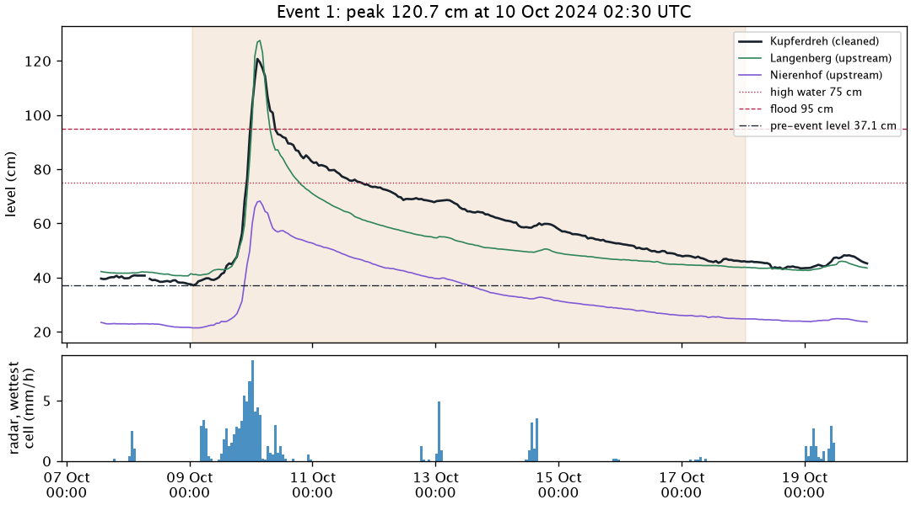

### Event 2 · 19 Nov 2024, 165.0 cm

The largest flood in the window and the only one above 145 cm. ICON-D2 badly underforecast its rain. In the 48 hours before it the zone means got 47 to 70 mm, the wettest cell 118 mm.

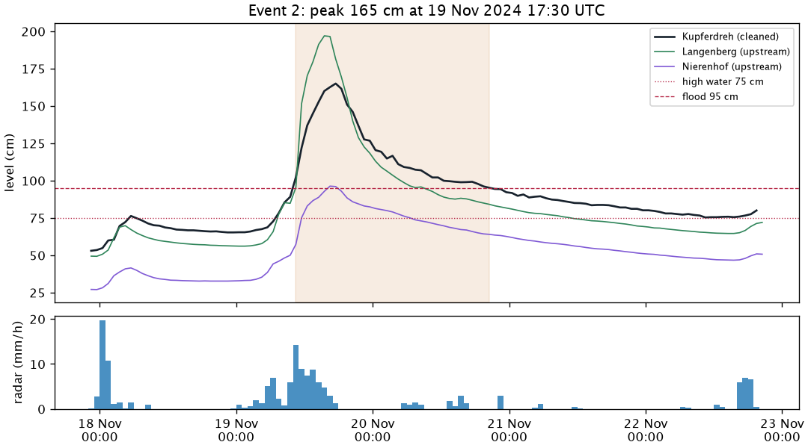

### Event 3 · 6 Dec 2024, 97.3 cm

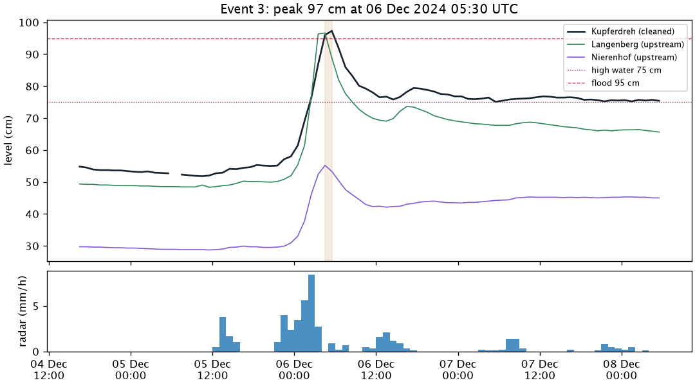

### Event 4 · 22 Dec 2024, 97.8 cm

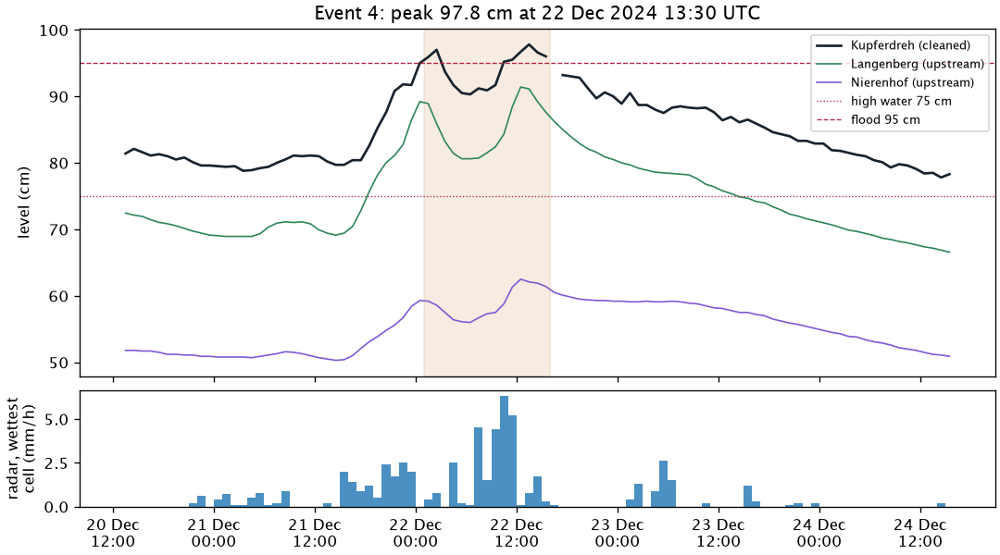

### Event 5 · 2 Jan 2025, 78.9 cm

A small rise three days before event 6. The level then stayed at 64 to 66 cm for two days.

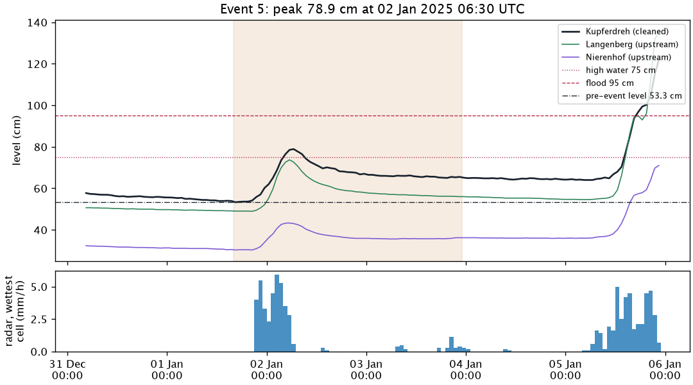

### Event 6 · 5 Jan 2025, 125.4 cm

Above 95 cm for more than two days. The bump to 95.4 cm on 8 January is part of the fall.

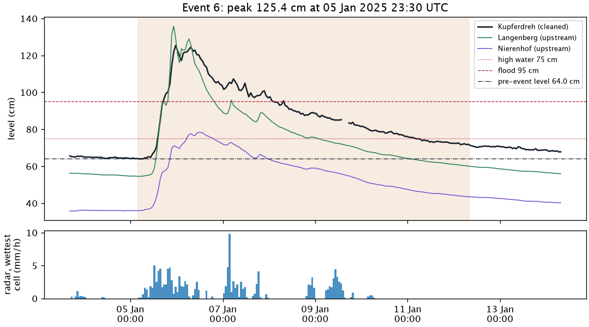

### Event 7 · 26 Jan 2025, 105.0 cm

Two peaks: 98 cm on 25 January and 105 cm on 26 January, with a last bump to 96 cm on 27 January.

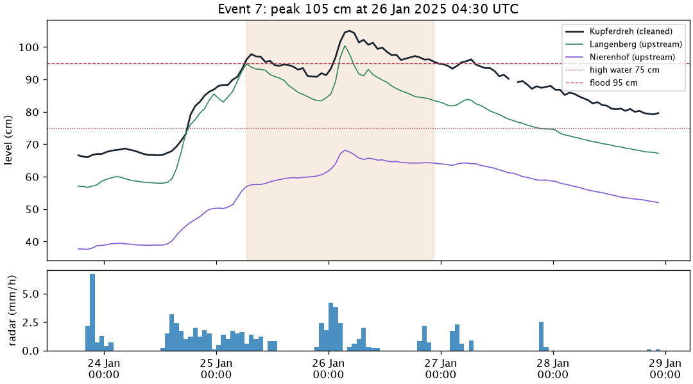

### Event 8 · 24 Apr 2025, 85.9 cm

The only event in the summer half, after 106 mm of radar rain in the wettest cell.

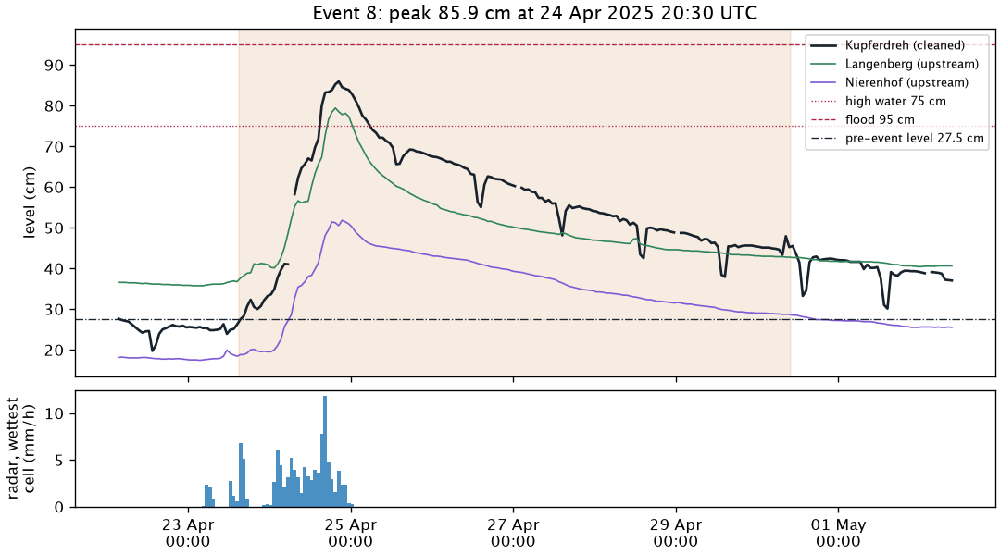

### Event 9 · 28 Oct 2025, 86.9 cm

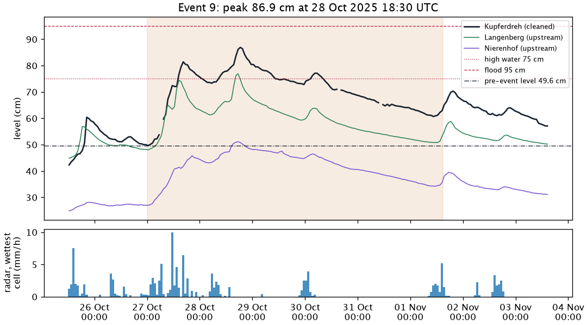

### Event 10 · 9 Dec 2025, 92.4 cm

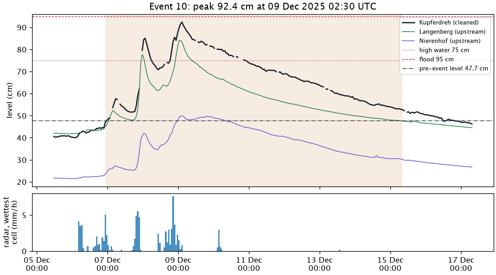

### Event 11 · 9 Jan 2026, 88.4 cm

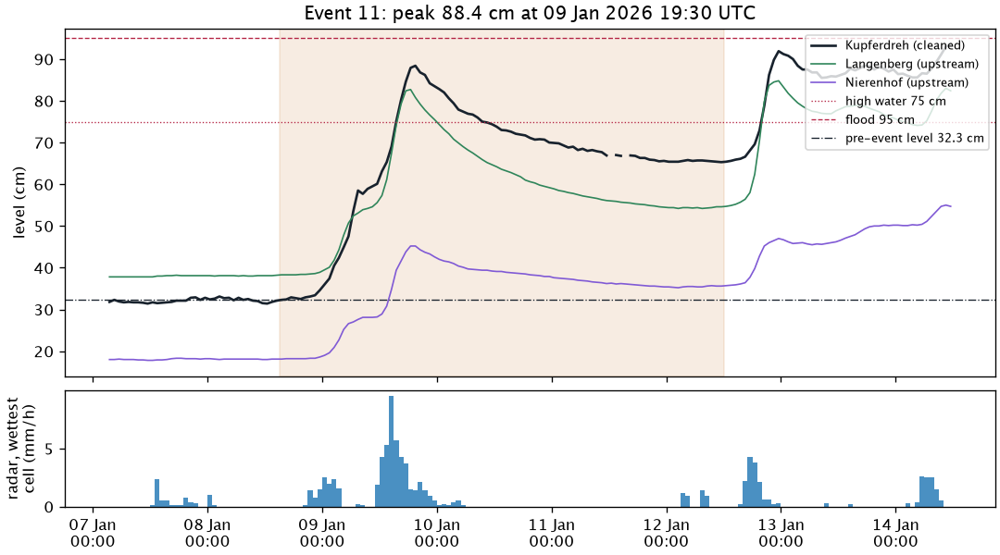

### Event 12 · 14 Jan 2026, 93.5 cm

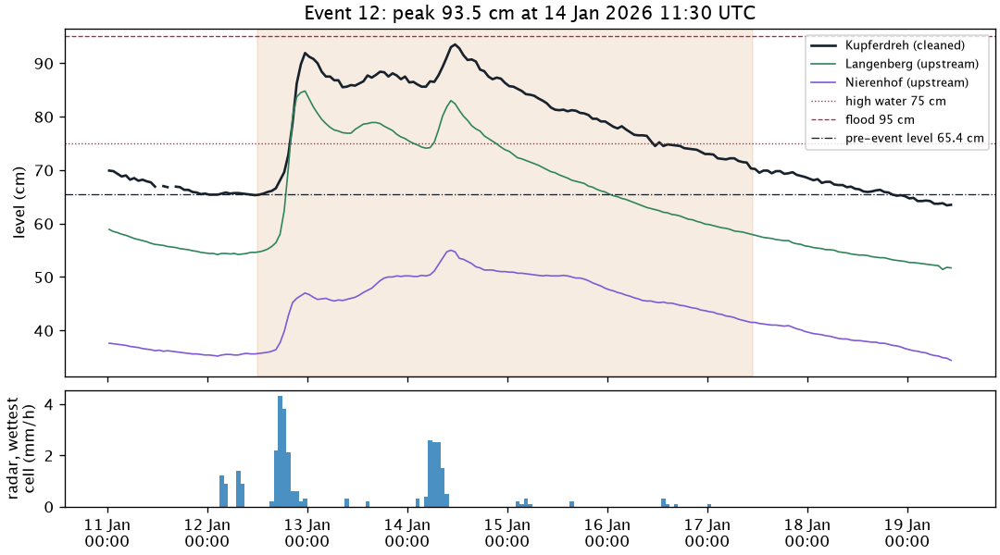

### Event 13 · 22 Feb 2026, 90.7 cm

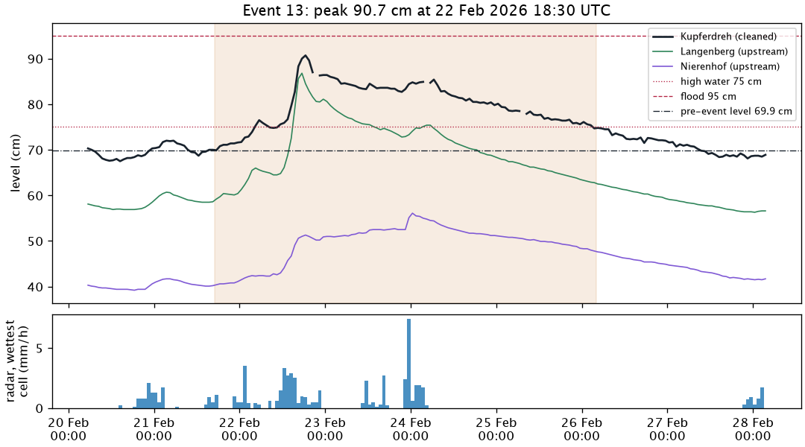

## Metrics

Every score is computed for **all issue times** (mostly low, slowly falling water) and for **high water**: the level is above 75 cm at the issue time or at the target time.

- **MAE per lead time**, 1 to 24 hours, per model and fold. The main metric.
- **Skill against persistence:** 1 − MAE / MAE of persistence (the last level held flat). Above 0 is better than doing nothing. A bootstrap over whole days gives a 90 % range for the difference to persistence.
- **Lag check:** on high water, the time shift that best fits the forecast to the observed level. If it equals the lead, the model is only a delayed persistence.

## Flood forecasts

For each flood event we ask three questions of every model: did it see the peak coming, how big did it see it, and when. Each is answered at five leads: **24, 12, 6, 3 and 1 hour before the peak**. The peak is the event's highest level; an event with two peaks is scored on the higher one. A lead whose issue time falls before the end of the previous event is shown as missing, and the replay starts no earlier than that end.

### One forecast per event and lead

For lead L, take the forecast issued L hours before the observed peak. It covers the 24 hours after its issue time, so the peak falls inside it. Its own peak is its highest value over all 24 hours, and the time of that value. If several hours tie, take the first.

- **Size** is how much of the rise the forecast saw, measured from the event's pre-event level:

  ```
  size = (forecast peak − pre-event level) / (observed peak − pre-event level)
  ```

  100 % is the right height, 50 % half the rise, 120 % too high. Measuring from the pre-event level matters: for a rise from 50 to 100 cm, a forecast of 80 cm saw 60 % of the rise, not 80 %.
- **Timing** is the time of the forecast peak minus the time of the observed peak, in hours. Negative is early, positive is late. If the forecast's highest value is at its last hour (24) and L is less than 24, it may peak later still, so the timing is shown as "at least 24 − L h late".
- **Predicted** is yes when the size is more than 50 %: the forecast saw more than half the rise coming. Otherwise no. The bar is the same at every lead. At 1 hour the level is already close to the peak, so persistence is mostly a yes there; the leads that tell models apart are 6 to 24 hours.

A missing forecast (no issue time, or any of its 24 hours missing) is shown as missing, not as no, and left out of the count: `9 of 12`, with 1 missing.

### False alarms

Without a counterweight, a model that forecasts a flood all the time would always be right. So we count false alarms: a forecast that shows a new event, its peak above 75 cm and at least 15 cm above the last known level, while no event is running at its issue time and none starts in the 24 hours after. Event start is as in [Flood events](#flood-events): the foot of the rise. The last known level must be at most 3 hours old; otherwise the issue time is skipped. A run of hourly issue times with such forecasts counts once; a skipped issue time inside the run doesn't split it. A forecast with missing hours still counts if its known hours show the event. The rate is the count divided by the number of test months.

### Tables

1. **Summary, one row per model**: per lead, the events predicted (e.g. `9 of 13`), the median size and the median timing of the predicted events, and the false alarms per month (the rate above). Persistence is the first row.
2. **Per model, one row per event**: per lead, ✓ or ✗ with size and timing, e.g. `✓ 82 % −2 h`, `✗ 31 % +5 h`, `—` when missing, `≥ +4 h` when the forecast may peak later.

### Plots

- **Forecast replay**, one interactive HTML page per run. Pick an event and a set of models. The page steps through the issue times from 24 hours before the peak to the end of the event, with play, pause, a step of one hour back or forward, and a slider. It shows the observed level, solid up to the issue time and light after it, a vertical line at the issue time, each model's 24-hour forecast with the last few forecasts fading behind it, and the 75 cm line, the pre-event level and the peak.
- **Three static plots per run** in the experiment log. Each answers one question and says the answer in its title, computed from the run. They show persistence in grey and the two best models by the [selection rule](#selection) that beat it; the tables show all models.
  1. **How fast does the forecast get worse?** Average error (MAE) per hour ahead, all issue times and high water side by side on one scale.
  2. **Does it see the floods coming?** Events predicted per lead before the peak, the earliest lead on the left.
  3. **How much of each flood did it see?** One row per event: the size of each model's forecast issued 12 hours before the peak, with the 50 % bar (predicted) and 100 % (right height).

  How each event unfolds hour by hour is the replay's job, so there is no static plot per event.

Flood forecasts are reported, not used to select models yet.

## Selection

A model wins over a simpler one when its mean MAE over leads 1 to 24 is lower in at least 3 of 4 folds, and its pooled high-water MAE is not worse. Ties go to the simpler model.

## Limits

- 13 flood events, only 6 above 95 cm and one above 145 cm. All but one in winter, no summer thunderstorm. Differences of one or two predicted events mean nothing.
- Seven events peak between 75 and 95 cm, so most of the flood scores are about moderate high water.
- Training and test both use the day-old ICON-D2 archive. Live gets fresher rain forecasts.
- Picking the best of many models on the same folds overfits them a little. The live shadow run checks both.
