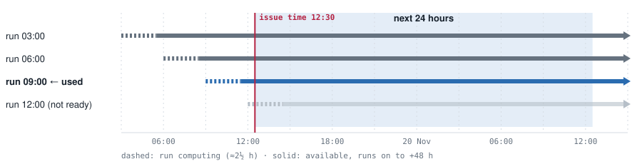
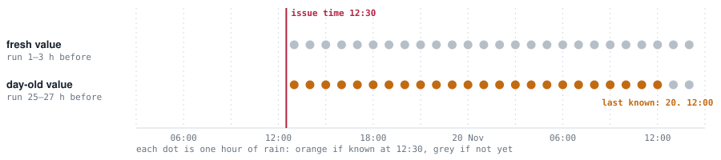
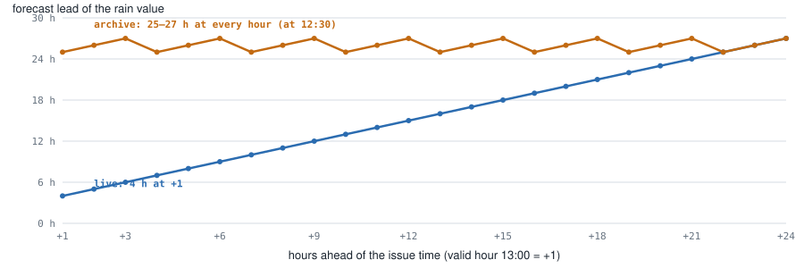
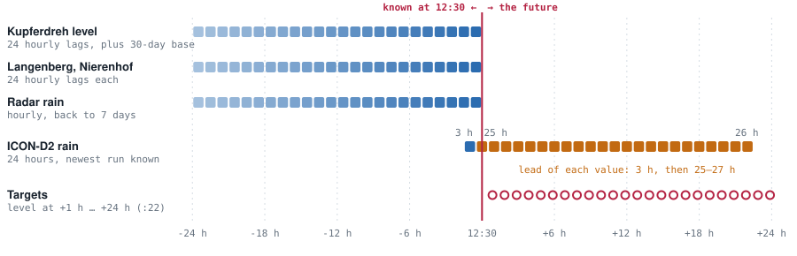
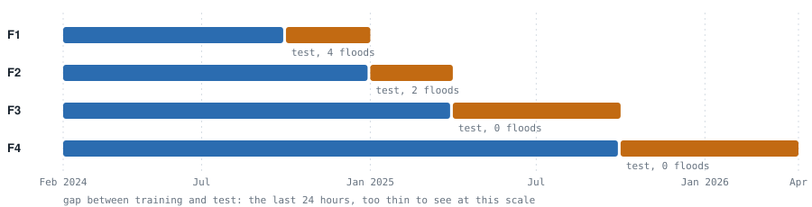

# Model evaluation, explained

How the backtest works, with pictures. The decisions and their reasons are in [decision 0008](decisions/0008-model-evaluation-and-selection.md). All figures use one real issue time, 19 Nov 2024 at 12:30 UTC, a flood day.

## Part 1 · The ICON-D2 archive

ICON-D2 starts a new run every 3 hours. Each run forecasts 48 hours ahead and is ready about 2½ hours after it starts.

### Live: we keep whole runs

At 12:30 the 12:00 run isn't ready yet, so we use the 09:00 run. It covers the next 24 hours completely, and much more. The forecast for 1 hour ahead is a 4-hour forecast; the one for 24 hours ahead is a 27-hour forecast.

Dashed: the run is still computing. Solid: available, running on to +48 h. The shaded band is the next 24 hours.

### Archive: only two values per hour

Before April 2026, Open-Meteo doesn't keep whole runs. For each hour it keeps two values: one from the run 1–3 hours before that hour, and one from the run a day earlier, 25–27 hours before. At 12:30 the fresh values for the coming hours come from runs that aren't ready yet. Only the day-old values are known.

Orange: known at 12:30. Grey: not known yet.

### What that means per hour ahead

How far ahead each rain value was forecast, by hours ahead of the issue time. Live, short hours get short, sharp forecasts. In the archive, at 12:30, every hour gets a 25–27 hour forecast. The two only meet around 22–24 hours ahead.

Blue: live. Orange: archive.

**Coverage is fine.** The archive always has a known value up to 22½ to 24½ hours ahead, so the 24 hourly rain sums are complete for every issue time.

**Quality is the issue.** A model trained on the archive only sees day-old rain forecasts. Starting in 2024 doesn't change that; it is how the archive is stored. Before April 2026 Open-Meteo has whole runs only for ECMWF IFS ([Single Runs API](https://open-meteo.com/en/docs/single-runs-api)).

## Part 2 · From one issue time to a score

### One row of the dataset

The dataset has one row per issue time. Left of the red line is everything the model may use: what was known at 12:30. Right of it, the ICON-D2 forecast for the next 24 hours. The first two columns sometimes get a fresh value (here only the first, with a 3-hour lead); all others are day-old values. The targets are the measured levels 1 to 24 hours later. Training sees them as the answers; prediction never does.

Blue: observed, or a fresh ICON value. Orange: a day-old ICON value. Red circles: the targets.

### Training and test periods

Four test periods. Each model is trained on everything before its test period and never sees the test period's levels. The last 24 hours before each test period are left out, because their targets would reach into it. Every model is trained fresh for each period.

Blue: training. Orange: test.

### The run, step by step

1. **Build the dataset once.** `pegel build-eval-set`, read-only from prod. Every input as of its issue time, ICON-D2 stitched as above. Frozen as `eval.parquet` with a checksum in `eval.manifest.json`.
2. **Fit on the training rows.** Inputs and targets of every issue time before the test period. The model learns how levels follow from the inputs, with day-old rain forecasts only.
3. **Predict the test rows.** Targets removed. The model gives 24 levels per issue time, one per hour ahead (`python -m pegel.evaluation.predict`).
4. **Score against the targets.** MAE per hour ahead, skill against persistence, high water, floods and warnings (`python -m pegel.evaluation.score`).
5. **Log it.** A new section in `analysis/model-evaluation/experiments.md` with the scores, the plots and what we learned.

### Where the stitch bites

Training and test both use the archive, so the backtest is fair between models: every model gets the same day-old rain forecasts.

Live is different. The same feature code runs on fresh runs, where rain in the next few hours is forecast much better. A model trained on day-old forecasts learned to trust them little, so live it may underuse good short-range rain. That is why every model also runs without ICON-D2, and why the live shadow run from 12 Oct 2026 has the final say.

## Models

- [Rain change](models/rain-change.md): the last level plus a change from upstream gauges, radar and ICON-D2, fitted per lead.
