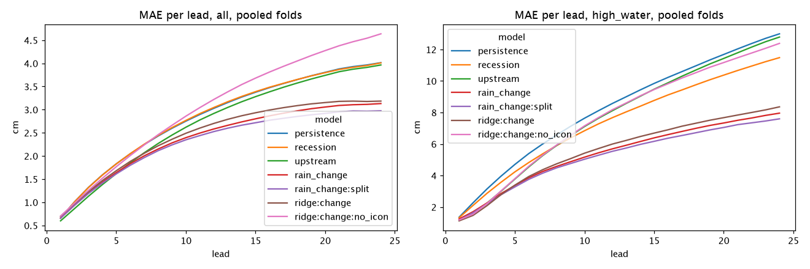

# Rain change model

`rain_change` forecasts the Kupferdreh level 1 to 24 hours ahead as the last level plus a change. The change is a straight line in six inputs, fitted separately for each lead. `rain_change:split` is the same model with one set of coefficients for rising water and one for the rest. Code: `src/pegel/evaluation/models/rain_change.py`.

It is a backtest model for now. It runs in the evaluation ([decision 0008](../decisions/0008-model-evaluation-and-selection.md), [walkthrough](../model-evaluation.md)), not on the website.

## Inputs, and why each one

The Deilbach catchment is small and reacts within hours. Cross-correlating hourly changes on wet periods, Langenberg leads Kupferdreh by about 1 hour, Nierenhof by about 0 hours and radar rain over the catchment by about 1 hour. All of it fades after about 4 hours. So the model needs only a few inputs, all close to the issue time:

1. **Distance to the 30-day base** (last level minus the median of the last 30 days). High water falls back towards normal. The fitted coefficient is about −0.02 at +1 h and −0.16 at +24 h.
2. **Langenberg change over 3 hours.** The upstream wave, about an hour ahead.
3. **Nierenhof change over 3 hours.** The wave from the side valley, arriving at about the same time.
4. **Radar rain, last 3 hours** (lags 0 to 2). Rain that has fallen but not yet arrived. It pushes the forecast up for the next hours.
5. **Radar rain, 3 to 12 hours back** (lags 3 to 11). Old rain means the wave has passed and the water will fall. Its coefficient is negative.
6. **ICON-D2 rain still to fall**: the catchment mean summed over hours 1 to k for lead k. Even as the day-old forecast the archive gives us, this is the strongest input. Alone it explains about half the variance of the change at high water.

Plus a **constant**. The rain terms push the forecast up on average, and the constant pulls it back. Without it the model lost to persistence in a dry period.

Radar is the catchment mean: the five zone means weighted by each zone's number of radar cells in `config/radolan_cells.json`. The `catchment` series in the dataset is the maximum, not the mean, so it isn't used.

## Formula

For lead k:

```
level_k  = last + change_k
change_k = c0 + c1·(last − base_30d)
              + c2·Langenberg 3 h change + c3·Nierenhof 3 h change
              + c4·radar, lags 0–2 + c5·radar, lags 3–11
              + c6·ICON-D2 mean, sum over hours 1..k
```

Each lead has its own seven coefficients.

## Fitting

Ordinary least squares per lead on the change (`target_k − last`), using every training row that has a target and all inputs for that lead. No regularisation, no scaling: with seven inputs and several thousand rows per fold it isn't needed.

## Missing inputs

- **Missing upstream change counts as 0**: no wave. Langenberg and Nierenhof have short gaps, and a gap shouldn't cost the whole forecast.
- **Anything else missing gives persistence**: the last level for every lead. That covers the last level, the 30-day base, radar and ICON-D2. In the archive radar and ICON-D2 are complete, so in practice it's a missing base.

## The split variant

`rain_change:split` fits two coefficient sets. A row is **rising** when Kupferdreh or Langenberg rose more than 0.5 cm over the last 3 hours (a missing change counts as no rise). All other rows use the second set. The two sets differ mostly in the constant and the upstream terms. For rising rows the constant is near zero or positive up to +6 h: the rise goes on. For the other rows it is negative: the level drifts down. And in the other rows a falling Langenberg or Nierenhof carries through to +24 h, with coefficients of about 1.0 to 1.8 instead of 0.3 or less.

## Typical coefficients

Fitted on the training rows of fold F4 (2024-02-01 to 2025-09-29), plain `rain_change`, in cm per cm or cm per mm:

| Lead | Constant | To base | Langenberg | Nierenhof | Radar 0–2 | Radar 3–11 | ICON-D2 sum |
|---|---|---|---|---|---|---|---|
| +1 h | −0.09 | −0.015 | 0.23 | 0.31 | 0.17 | −0.02 | 0.63 |
| +6 h | −0.56 | −0.07 | 0.30 | 0.19 | 0.57 | −0.31 | 1.04 |
| +24 h | −2.19 | −0.16 | 0.24 | 0.17 | −0.63 | −0.63 | 1.12 |

They are stable across the four folds: at +24 h the ICON-D2 coefficient stays between 1.06 and 1.19, the base coefficient at about −0.16.

## Results

From the run on the frozen dataset of 2026-10-14 (19,248 issue times), the four folds of decision 0008. MAE in cm, pooled over the folds. High water: the level is above 75 cm at the issue time or at the target. Ridge is `ridge:change` from PR #70, before merge; upstream is from PR #68.

| Model | All +6 h | All +24 h | High water +6 h | High water +24 h |
|---|---|---|---|---|
| persistence | 2.05 | 4.01 | 5.39 | 12.99 |
| upstream | 1.85 | 3.97 | 4.55 | 12.79 |
| ridge, change | 1.88 | 3.18 | 3.94 | 8.36 |
| rain_change | 1.83 | 3.13 | 3.85 | 7.96 |
| rain_change:split | 1.80 | 2.98 | 3.76 | 7.60 |



At +24 h `rain_change:split` is 1.04 cm better than persistence (90 % bootstrap interval −1.31 to −0.78 cm).

**Per fold** (mean MAE over leads 1 to 24, all issue times), `rain_change:split` beats persistence and upstream in all four folds. Against ridge it wins F1 clearly and loses the other three narrowly:

| Fold | persistence | ridge, change | rain_change:split |
|---|---|---|---|
| F1 | 3.75 | 3.73 | 2.51 |
| F2 | 2.15 | 1.72 | 1.80 |
| F3 | 3.00 | 2.73 | 2.73 |
| F4 | 2.57 | 1.93 | 2.03 |

**Warnings at 95 cm.** It warns 7 of the 8 crossings, 13 hours ahead in the median. That median hides two different folds: the four F1 crossings get 1 to 2 hours of warning (one, 2024-11-19, is missed), the four F2 crossings 13 to 24 hours. Upstream warns all 8, but only 2 hours ahead in the median. Persistence "warns" 2 of the 8 crossings (2025-01-08 and 2025-01-27), 24 hours ahead, only because the level was already above 95 cm a day earlier: both are re-crossings of a flood still running. It warns none of the first crossings. The 24-hour warnings of `rain_change:split` for those two are the same re-crossings. The one crossing of 145 cm (2024-11-19) gets 2 hours of warning.

These warning numbers will be redone with the new crossing-based metric (PR coming, minimum lead 3 hours).

## Known weaknesses

- **No gain at +1 h.** 0.66 cm, the same as persistence. Upstream is better there (0.60 cm).
- **More missed lead-hours at 95 cm than persistence at long leads.** Summed over leads 13 to 24 it misses 45 lead-hours against persistence's 34, over all leads 72 against 58. Persistence scores "hits" by staying high through a long flood; the selection rule in decision 0008 counts this.
- **It forecasts the fall a bit early.** Mean bias −0.49 cm at +24 h (plain `rain_change`: −0.61 cm).
- **At high water it under-forecasts more than persistence.** Mean bias −1.82 cm against −0.80 cm at +6 h, and −3.92 cm against −3.03 cm at +24 h.
- **Trained on day-old ICON-D2.** The archive only has 25 to 27 hour old rain forecasts. Live, the short leads get much fresher ones. How the fitted ICON-D2 coefficients behave on those is unknown until the live shadow run.
- **Few floods.** All 8 episodes above 95 cm are in F1 and F2, only one passes 145 cm.
- **Chosen from about 20 candidates.** That is selection, even on inner splits (below).

## How it was designed

The candidates were compared on an inner time split inside each fold's training rows: fit on the older 80 %, validate on the newest 20 %, with a 24-hour gap. The test periods were not used for that. About 20 variants were tried: ICON-D2 p90 instead of the mean, radar sums over 12 to 72 hours, 1-hour upstream changes, interactions of rain with the level, and splits by rising or by wet conditions. Those didn't help, apart from the constant and the rising split. The two finalists then went through the four folds once, and the numbers above are that run.

The inner splits of later folds overlap earlier test periods, so this is not a clean hold-out either. The live shadow run is.
